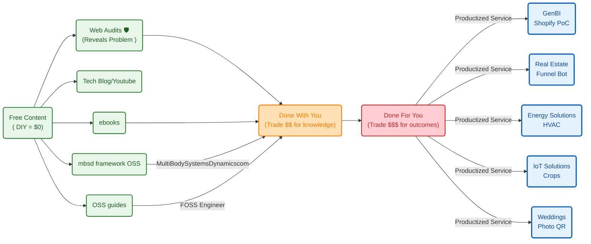
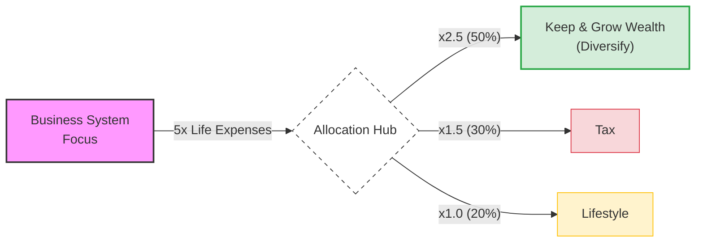

**Tl;DR**

Hows my brand *and outbound email* going?

**Intro**

* Why Im writting this post: *bc if you are good, you should not be [giving for free your upside](#risk-and-opportunities)*
* What [Ive learnt](#conclusions) with it: *Ive ended up being [pragmatic](https://www.jalcocertech.com/support/articles/cloudflare-pragmatism-oss-exit-plan/) and exploring how to help [UK businesses](https://developer.company-information.service.gov.uk/manage-applications/6acb6fbe9edf417a7cadee77/view/live#). I unified my inbounds with a custom multisite fwk and set the outbound 101 to test offers.* As i want to move towards a portfolio at this points, was lazy and put together this [workflow wrap](#workflow-wrap).

Ive started [telling the agents why i need](https://www.seangoedecke.com/tell-agents-the-why/) things and there has been some interesting surprises: *like having my posts with draft=false into a future date to be effectively scheduled without me having to re-run Ci/CD manually*.

If something can be achieved via an integration/API, why not letting agents doing so.

For example: *[GSC](#google-search-api), [PSI](#psi-api) or API for web analytics, the gov UK [company house](https://www.jalcocertech.com/support/articles/uk-lead-list-apify-websites-companies-house/) one*

You can get interesting outcomes, like [DRIP sequences](https://github.com/JAlcocerT/jalcocertech-core/tree/main/leads-hub/hub/sequences/jt-welcome), around [infra that you can re-use](https://github.com/JAlcocerT/jalcocertech-core/tree/main/leads-hub/hub/sequences) for few sites, all with [GDPR double opt-in](https://github.com/JAlcocerT/jalcocertech-core/blob/main/architecture/adr/0003-diy-email-double-opt-in-drips.md)


## Mail

Last year I said that [email is hard](https://jalcocert.github.io/JAlcocerT/emails-101/).

Since then, I discovered some local testing mail for devs to get familiar with smtp: [mailpit](https://fossengineer.com/selfhosting-mailpit/), [inbucket](https://fossengineer.com/selfhosting-inbucket/), [maildev](https://fossengineer.com/selfhosting-maildev/)...

There will never be [better weddings](https://jalcocert.github.io/JAlcocerT/poc-101/#better-weddings) without proper mail outbound.

To lower the CaC, you can [use email DRIP](https://jalcocert.github.io/JAlcocerT/quick-weddings-poc/#drip-to-convert) to increase the conversion rate to the people that was attracted, but didnt convert/buy.


Tools like [notifuse](https://fossengineer.com/selfhosting-notifuse-email-platform/), [listmonk](https://fossengineer.com/selfhosting-listmonk-newsletter/), [mautic](https://fossengineer.com/selfhosting-mautic-marketing-automation/) help with email marketing/newsletter/transactional. [Growchief](https://fossengineer.com/selfhosting-growchief/) with the outreach automation


But...I ended up building my DIY/custom one for [slub](https://github.com/JAlcocerT/slubnechwile-chwile-y26-claude) - [chwi](https://github.com/JAlcocerT/slubne-chwile-y26) and not only :)

## Videos

Ive...kinda been doing videos for a while: had this [initial flow with OpenAI x OBS x Canva](https://jalcocert.github.io/JAlcocerT/my-youtube-ai-workflow/#my-initial-workflow), which i [upgraded in late 2024](https://jalcocert.github.io/JAlcocerT/my-youtube-ai-workflow/#updating-my-yt-video-wf-ai-powered).


  


I [had some thoughts](https://jalcocert.github.io/JAlcocerT/my-youtube-ai-workflow/#data-driven-videos-with-streamlit) around making data driven videos with streamlit, remotion...

But those had to wait, as I had to get an action cam and [get in love with ffmpeg cli first](https://jalcocert.github.io/JAlcocerT/my-action-cam-video-workflow/#quick-videos---ffmpeg-cli), get [gyroflow](https://jalcocert.github.io/JAlcocerT/my-action-cam-video-workflow/#gyroflow) to brick my linux GUI and brick [my pixel8](https://jalcocert.github.io/JAlcocerT/pixel-8-pro-tricks/)

For automatic chapers see [this script](https://jalcocert.github.io/JAlcocerT/my-action-cam-video-workflow/#youtube-video-descriptions)

To extract thumbnails from your video [see this](https://jalcocert.github.io/JAlcocerT/photo-video-tinkering/#thumbnails)

I also went crazy and made some [simple video edits with kdenlive](https://jalcocert.github.io/JAlcocerT/photo-video-tinkering/#kdenlive)


> here you have some [video editing notes](https://jalcocert.github.io/JAlcocerT/photo-video-tinkering/#video-editing) and [photo management tools](https://jalcocert.github.io/JAlcocerT/photo-management-tools/)

But things accelerated and I had a chat with a youtuber friend [about text to video and brainrot shorts](https://jalcocert.github.io/JAlcocerT/photo-video-tinkering/#text2video)

But at the time i tried some [animations as a code](https://jalcocert.github.io/JAlcocerT/animations-as-a-code/) with [python x matplotlib x financial data](https://jalcocert.github.io/JAlcocerT/animations-as-a-code/#matplotlib-animations), then, made [some map animations](https://jalcocert.github.io/JAlcocerT/geo-maps-and-data/#animated-videos)



  
  


Later, i bite [remotion x yfinance](https://jalcocert.github.io/JAlcocerT/video-creation-with-remotion/#yfinance-x-remotionjs) and also [made data animations](https://jalcocert.github.io/JAlcocerT/ai-scripts-and-animated-data/) around [f1](https://jalcocert.github.io/JAlcocerT/ai-scripts-and-animated-data/#f1) and [its race data](https://jalcocert.github.io/JAlcocerT/f1-data-animated/)

Then, i tinkered around [repo to ~~post~~ video](https://jalcocert.github.io/JAlcocerT/oss-automatic-docs-and-tech-video/#about-foss---repo-to-video)

How could I not...use [remotion for mechanisms videos](https://jalcocert.github.io/JAlcocerT/video-creation-with-remotion/#mechanisms-x-remotionjs)



  
  


Not as a full time thing, not as a...minor thing.

But there has been output: 

And in theory, there is nothing stopping you [to go viral](https://jalcocert.github.io/JAlcocerT/youtube-video-as-a-code/)


Videos is going to be an important [part of JAlcocerTech-Core](#conclusions)


Bc non of those were about branding, attraction and conversion

Those mentions were about features, describing stuff

But what if you need a [video sales letter](#Vsl)?

### VSL

I had to sit and ask myself: [what do I do](https://jalcocert.github.io/JAlcocerT/what-do-i-do/)?

Concluded that: *I do independent consulting work, driving business outcomes by building enterprise analytics systems*

When you dont have [a story line for chatting](https://jalcocert.github.io/JAlcocerT/what-do-i-do/#conclusions) you are far from any sales pitch.

How to put together some [inbound branded videos](https://jalcocert.github.io/JAlcocerT/jalcocertech-services-update/#inbound-marketing-x-branded-videos)?

### Promo Video

https://jalcocert.github.io/JAlcocerT/poc-101/#from-html-to-promo-video

### PAS

Problem - Amplification - Solution

If you watch TV, you should be aware of that already.


### Why not just RemotionJS

As of today you can get away and create a video with AI in few ways: remotionJS, hyperframe or any of the Veo and whatever video native model is out there.

Get inspired: https://www.remotion.dev/prompts/cinematic-tech-intro

As of now, I like the hyperframe workflow the most:

```sh

```


## Gold Info for SoloPreneurs

You need to **ship**/fix/kill (quick).

After distilling a lot of ideas: `http://192.168.1.2:8001`

These are the main poins to never forget: *time is THE most scarce resource, allocate it properly into your project portfolio*

{}

For this I dedicated a full post few weeks ago.

The general idea checklist is as follows:

{}


{}


{}

{}


{}


### Google Search API

Google has APIs for almost all of it.

The one step that needs you is creating the Google credentials.

What the APIs cover:

  ┌─────────────────────────────┬─────────────────────────────┬───────────────────────────────────┐
  │            Need             │             API             │               Notes               │
  ├─────────────────────────────┼─────────────────────────────┼───────────────────────────────────┤
  │ Stats: clicks, impressions, │                             │ About 16 months of history, with  │
  │  CTR, average position per  │ **Search Console API** →        │ data 2–3 days behind. Once you    │
  │ search, page, country,      │ searchanalytics.query       │ verify a site you also see data   │
  │ device and day              │                             │ from before verification.         │
  ├─────────────────────────────┼─────────────────────────────┼───────────────────────────────────┤
  │ Submit sitemaps             │ Search Console API →        │                                   │
  │                             │ sitemaps.submit / list      │                                   │
  ├─────────────────────────────┼─────────────────────────────┼───────────────────────────────────┤
  │ "Is this page indexed?"     │ URL Inspection API          │ Quota of around 2,000 checks per  │
  │                             │                             │ day                               │
  ├─────────────────────────────┼─────────────────────────────┼───────────────────────────────────┤
  │ Add a site                  │ Search Console API →        │                                   │
  │                             │ sites.add                   │                                   │
  ├─────────────────────────────┼─────────────────────────────┼───────────────────────────────────┤
  │                             │ Site Verification API → get │ The TXT record can go into        │
  │ Verify ownership            │  a DNS TXT token, then      │ Cloudflare by API too             │
  │                             │ verify                      │                                   │
  └─────────────────────────────┴─────────────────────────────┴───────────────────────────────────┘

> One property can cover all four subdomains. 

A domain property (sc-domain:jalcocertech.com) includes www, consulting, ebooks and webaudit. 


{}


You (about 10 minutes, once):

1. Verify the domain. In Search Console, add `jalcocertech.com` as a Domain property. Because your DNS is on Cloudflare, Google offers one-click verification ("Verify with Cloudflare") and adds the TXT record for you. I could do this by API instead, but my wrangler login probably can't edit DNS,
  and the one-click route is quicker anyway.
2. Create a service account. In a Google Cloud project, enable the Search Console API and create a service account with a JSON key. I'll give you the exact gcloud commands if you prefer the terminal.
3. Give it access. In Search Console, under `Settings → Users and permissions`, add the service account's email.

The agent:

- **Sitemaps**: submit all the sitemaps by API and check they're accepted.
- A seo command in the homelab hub: top searches, top pages, clicks and impressions, compared with the previous period. It also saves weekly snapshots to SQLite, so you can see trends over the nine months.
- One line in your weekly `ntfy digest`, for example: Search: 1,240 impressions (+18%), 37 clicks, top: "github actions docker versioning".
- Indexing checks: whether new articles get indexed, so you can tell if Google is picking them up.

One technical note: the hub uses only Python's standard library by design.

Signing in as a service account needs an RSA-signed token, which the standard library can't produce.

I'd either add Google's small google-auth package or sign with openssl from the script. 

I'd go with google-auth; one well-maintained dependency is fine for this.

What it won't tell you: search data shows what people searched before finding you, not who they are or whether they'd buy. 

For that you still need the subscriber and lead numbers.

Together they show whether the plan is working.

{}

The cloudflare deploy login's general account read access includes Web Analytics, so no extra Cloudflare token is needed yet.

{}

1. Google sends you almost nothing: 1 visit in 7 days, against 108 from Bing and 6 from DuckDuckGo.

> Either Google isn't indexing your sites well, or it ranks them low. Search Console will show
 which, so it's the right next step.

2. fossengineer's numbers are probably mostly bots. 2,605 views have no referrer, and the top
 countries are the US (1,170), Singapore (987) and China (497), with only 26 from Poland. 
 
Singapore and China at that volume usually means crawlers that run JavaScript, not readers. 
    
The human audience is likely a few hundred a week.

3. The fossengineer Pages address isn't redirected to the real domain, so Google sees two copies of
 every page. It's a quick fix with a redirect rule; I can do it, the same way we did the www/apex    redirects.

{}



PageSpeed APIs are different than Google Search ones

  
It can't be used for Search Console: *Search Console data is private, so it needs a sign-in such as a service account, not a key.*

In `Google Cloud → APIs & Services → Credentials`, either restrict it to the PageSpeed Insights API only or regenerate it.

It could be useful later: the audit tool could pull Google's real-user speed data for a site with it.

**Search Console setup**....

{}

1. Add your sites (search.google.com/search-console):

- Add `property → Domain → jalcocertech.com`. This one property covers www, consulting, ebooks and webaudit.
- Google detects Cloudflare and offers to verify with Cloudflare; accept, and it adds the DNS record itself.
- Repeat for fossengineer.com and multibodysystemsdynamics.com.

2. Create a service account in the same Google Cloud project as your PageSpeed key: `https://console.cloud.google.com/`
- APIs & Services → Library → enable "Google Search Console API".
- IAM & Admin → Service Accounts → Create, named e.g. leads-hub-gsc. It doesn't need any project
  roles; skip that step.
- Open it → Keys → Add key → JSON. A file downloads.
- Move it to ~/.config/leads-hub/gsc-service-account.json on this laptop (and later the homelab),
  then run chmod 600 on it. Don't paste its contents here.

3. Give it access to each property: in `Search Console → Settings → Users and permissions → Add user → the service account's email` (leads-hub-gsc@<project>.iam.gserviceaccount.com) → Full. Full is needed so it can submit sitemaps; it can't delete the property or change owners.

4. Tell me "done". I'll then:
- check the service account can see all three properties;
- submit all the sitemaps;
- pull the first report: what Google has indexed, which searches you appear for, and why Google sends you so little;
- add a weekly search line to the digest, next to the Cloudflare visits.

5. Optional but worth it: at `bing.com/webmasters`, use Import from Google Search Console. 

It's one click once step 1 is done, and Bing already sends you 100 times more visitors than Google.

What you need is a key for the service account you already created, a JSON file. 

It's in a different place:

1. On that Credentials page, under Service Accounts, click
    jalcocertech@jalcocertech-analytics.iam.gserviceaccount.com.
2. Open the Keys tab at the top.
3. Add key → Create new key.
4. Choose JSON → Create.

A file like jalcocertech-analytics-1a2b3c….json downloads. That's the credential. Then:

```sh
mkdir -p ~/.config/leads-hub
mv ~/Downloads/jalcocertech-analytics-*.json ~/.config/leads-hub/gsc-service-account.json
chmod 600 ~/.config/leads-hub/gsc-service-account.json
```

Keep it like a password: don't paste its contents here or commit it. 

{}

┌──────────────────────────┬───────────────────────────────────────────────────────┬─────────────┐
│        Credential        │                     What it's for                     │   Needed    │
│                          │                                                       │    here?    │
├──────────────────────────┼───────────────────────────────────────────────────────┼─────────────┤
│ API key                  │ Public Google data (e.g. PageSpeed)                   │ No          │
├──────────────────────────┼───────────────────────────────────────────────────────┼─────────────┤
│ OAuth client ID          │ Apps where a person clicks "Sign in with Google"      │ No          │
├──────────────────────────┼───────────────────────────────────────────────────────┼─────────────┤
│ Service account key      │ A script reading your private data, such as Search    │ Yes         │
│ (JSON)                   │ Console                                               │             │
└──────────────────────────┴───────────────────────────────────────────────────────┴─────────────┘

> https://console.cloud.google.com/welcome?project=jalcocertech-analytics and https://console.cloud.google.com/marketplace/product/google/searchconsole.googleapis.com?q=search&referrer=search&project=jalcocertech-analytics

> > https://console.cloud.google.com/iam-admin/serviceaccounts/details/110474226869769663578;edit=true/keys?project=jalcocertech-analytics


#### PSI API

{}

Your audit runs Lighthouse on your homelab: a lab test, one simulated mobile visit from your network.

The PageSpeed Insights API adds two things that can't be done from there:

1. Real-user data from Google: the big one.

- What it is: the PSI response includes the Chrome User Experience Report (CrUX), the speed real
  Chrome users actually experienced on a site over the last 28 days. That covers LCP, INP
  (responsiveness, which only exists as real-user data), CLS, FCP and TTFB, with Google's own "Core
  Web Vitals: passed/failed" verdict.
- Why it matters: this is the data Google uses for ranking, and a lab test can't produce it.
- For a report: "Google's data shows 38% of your real mobile visitors wait more than 4 seconds"
  convinces a site owner far more than a lab score. It's also what they see themselves at
  pagespeed.web.dev.
- The limit: CrUX only has data for sites with enough Chrome traffic. Many small-business sites have
  none. The report would then say "not enough real-user data yet" and fall back to your lab numbers.

2. Lighthouse run on Google's machines.

- More consistent scores: results don't depend on your homelab's CPU, its other containers, or its
  network.
- Lighter homelab: each audit wouldn't need Chromium and Lighthouse to run locally, which is the
  heaviest part of the container.
- Desktop as well as mobile, at little extra cost.

The trade-off is that each call takes 10–30 s, and you depend on Google's quota (about 25,000
requests a day, plenty for you). 

Your own checks stay as they are: SEO, security headers, HTTPS, broken links, share image.

The **PSI API** doesn't do those :)

What I'd build (about half a day): keep the local Lighthouse run, and add a "Real users (Google
data)" block to the audit and the PDF:

- the Core Web Vitals pass/fail verdict;
- each metric's real-world value, with the share of visitors in good, needs-improvement and poor;
- a sentence in plain language;
- when Google has no data, a clear "not enough real-user data", never a fake score.

That key would live as a secret on the homelab, never in the repo. 

Restrict or regenerate it first, since it's been pasted in this chat.

Then put the new key in `~/.config/leads-hub/psi_api_key` on the homelab, and I'll wire it in.

{}


### CF API

it needs a new Cloudflare API token, but there's a bigger finding first:

Only fossengineer.com sends real-visitor data. www, consulting, ebooks, webaudit and
 multibodysystemsdynamics.com have no Cloudflare Web Analytics beacon, so for them there are no
  human-visitor numbers to read, through the API or otherwise.
  
Their privacy pages also say you use **Cloudflare's cookieless analytics**. 

That's harmless for visitors (less tracking, not more), but the pages and reality don't match.

  What it takes

1. Turn on Web Analytics for each site (you, about 5 minutes in the dashboard):

- Cloudflare Pages sites (www, consulting, ebooks, multibodysystemsdynamics): project → Metrics →
  enable Web Analytics. Pages then inserts the beacon automatically; no code change.
- webaudit (served from your homelab through the tunnel): Analytics & Logs → Web Analytics → Add a
  site → webaudit.jalcocertech.com, with automatic setup, which injects the beacon through
  Cloudflare's proxy.
- Security headers: www and consulting already allow the beacon (I included the two Cloudflare
  analytics hosts when we wrote them), and ebooks allows any HTTPS script. After you enable it, I'll
  check every site for blocked requests.

2. Create a read-only analytics token for the homelab (you): `My Profile → API Tokens → Create Token`,
with these permissions:

- Account → Account Analytics → Read. This covers Web Analytics: page views and visits from real
  browsers.
- Zone → Analytics → Read, for your zones. This covers all requests, including bots; it's useful as a
  second number, but don't read it as "visitors".

Save it to `~/.config/leads-hub/cf_analytics_token` on the homelab, the same pattern as your other
secrets. 
  
> Keep it separate from the KV token, so each one can do only one thing.

3. Then I'll have the **hub query the GraphQL API weekly**: visits and page views per site, top pages and referrers. That goes into SQLite for trends and becomes one line in the ntfy digest, next to the
Search Console numbers.

Together that gives the full picture each week:

* Search (Google): impressions → clicks
* Visits (Cloudflare): per site, top pages, where they came from
* List: confirmed subscribers
Leads: forms, audits, bookings

Web Analytics only counts from the day you enable it, so the sooner it's on, the more of the nine months you'll have data for.

Even a real browser loads no Cloudflare analytics script on any jalcocertech.com subdomain. 

Only fossengineer.com has one, and it's the one site set up with "JS Snippet installation" instead of
  "Automatic setup".

So "Automatic setup" isn't injecting the script on your sites. Two likely causes:
  
1. The "exclude EU visitors" option. If it's on, Cloudflare skips injection for visitors in the EU.
    You're in Poland, so you'd never see the script yourself, and only non-EU visits would be counted.
    That fits the 3 visits a day. Check under jalcocertech.com → Manage site.
2. Pages-hosted sites. As far as I know, automatic injection doesn't reliably reach sites served by
    Cloudflare Pages, which is all of yours except webaudit.

The reliable fix is the same method fossengineer uses: the snippet in the page itself.

1. In the dashboard: jalcocertech.com → Manage site, switch to (or copy) the JS snippet. It looks
    like <script defer src='https://static.cloudflareinsights.com/beacon.min.js'
    data-cf-beacon='{"token": "…"}'></script>.
2. Paste the snippet here. The token isn't secret: it's public in the HTML of every page that uses
    it, like fossengineer's.
3. I'll add it to the shared layout of www, consulting, ebooks and webaudit, deploy them, and check
    in a browser that the script loads with no security-policy blocks (www, consulting and ebooks
    already allow it; I'll check webaudit's headers).

Do the same for multibodysystemsdynamics.com if you want it measured too. 

It also shows "Automatic setup" with 0 visits.

Once the snippet is in, the numbers start that same day, and the analytics token for the homelab
digest from my previous message becomes worth creating.


So all your properties now report: *fossengineer (already did), the four jalcocertech.com sites and
the two multibody ones. 

webaudit follows once you run the git pull and recreate on the homelab*.

In a few days, create the read-only analytics token (Account → Account Analytics → Read) and save it
on the homelab as `~/.config/leads-hub/cf_analytics_token`.

I'll then add weekly visits per site to your ntfy digest. 

> One thing to know: the PWA counts page loads of the app, not solver runs. 
 
If you later want "solves started", that's a small count the app can send to your own forms Worker, with no third party involved.


---

## Conclusions

Some are doing a lot to generate [organic content on social media](https://www.linkedin.com/feed/update/urn:li:activity:7432721791468367872/).

Any [solar panel](https://youtube.com/shorts/e_GwgidIPFg) with no load has potential (V)

Yet, makes no actual work / provides power / throughput

```sh
#git clone /jalcocertech-core
cd ./jalcocertech-core/leads-hub/hub #for inbound checks
make lead-messages LIMIT=5
```

Dont be an open solar panel, embrace the [risk and opportunities](#risk-and-opportunities):


From my side: Have made some upgrades to the site: `https://consulting.jalcocertech.com/talks/` superseeding such `https://consulting.jalcocertech.com/presentations/opco/slides`


  
  


Most likely: You aren't doing anything wrong technically. 

Everything built works. 

The problem is that almost all your effort goes into building and almost none into talking to buyers. 


*Prep for / Delivering* sth that nobody wants is pointless *unless your one one of the violent ones*


{}

1. You build for people who don't buy.

- Who you write for: about 60 articles in a few weeks, nearly all "how I built X with Cloudflare,
Workers, KV". The readers are developers. Developers don't hire consultants; they read the ebook
and do it themselves.
- Who pays: business owners and team leads, who search for outcomes ("site is slow", "app keeps
breaking in production"), not tools.

2. Five audiences, so nobody feels it's for them.

- Who you speak to today: small-business site owners (audit), real estate agencies (white-label),
data engineers and analysts (talks), PMs (coaching), and teams shipping AI ("Ship AI features").
- What happens: a visitor can't tell in five seconds that this is for them. Each extra audience makes
the message weaker for the rest.

3. Your only clients came from people, not funnels. The hospital and real estate clients didn't come
through a form; they came from relationships. 

Meanwhile your biggest asset, 70+ LinkedIn recommendations, sits unused. 

> Funnels convert attention you already have; they don't create it.

4. The first step asks strangers for too much. 

Paying $235 is a fine filter for warm leads, but a cold visitor won't pay someone they met two minutes ago. The audit is a good free first step, but it targets small-business websites while the paid call sells AI features: two different buyers.

5. Time is the real constraint. Building feels productive, but it's the comfortable option; outreach and conversations are the uncomfortable ones. 


What I'd do next: *30 days, almost no new building*


1. Freeze the engine. 

It's done (moving from ship stage towards fix, aka test/validate distribution and percieved value). 

No new features until it has handled 10 real leads.

2. Pick one buyer and one offer for 90 days. You have the most evidence for one of these two:

- Small teams with a working app that's painful to ship or run. Your case: the hospital CI/CD
story. Offer: a fixed-price "make it shippable" engagement (containers, CI, HTTPS, monitoring),
which can be done mostly async in your evenings.
- Real estate agencies. You have a live product, a price and a case study. But the agencies have
to be found and contacted, which is the hardest part for someone with two jobs.

I'd pick the first. It's closer to what you do every day, and it suits async delivery.

3. Have 10 conversations a week; write fewer articles. No cold email, because of the Polish rules we
    discussed. Instead:

  - Your network: message the people who recommended you on LinkedIn, roughly: "I now help small
    teams make their apps shippable (versioned releases, CI, HTTPS). Do you know a team that's
    struggling with this?" Referrals convert far better than any page.
  - LinkedIn posts aimed at buyers: one post a week about an outcome ("A hospital team went from
    manual deployments to versioned releases"), not the tooling. Link the case study PDF.
  - The audit as a conversation opener: when someone engages, offer to run their site and send them
    the PDF.

4. Measure conversations, not content. Track one number per week: real conversations with potential buyers. Ten conversations a week will produce a client long before 60 more articles will.

5. Check your Cloudflare analytics once. If the consulting site gets around 20 human visitors a week,the problem is attention, not conversion.
    

Don't tweak the site until traffic is there.


2. Measure the right things, starting now  Right now you can't tell whether any of this works.
  
I'd set up:

- Google Search Console for the three sites, with the sitemaps submitted. It's free and shows which
  searches you appear for, months before clicks arrive. As far as I know it isn't set up yet.
- Monthly visitors per site in your weekly ntfy digest, from Cloudflare's analytics API. That's about
  an hour of work in the homelab hub.
- The one number that matters for you: confirmed email subscribers. Your list is the asset you can
  use on launch day.

What I'd stop: building more infrastructure, and articles about how the plumbing was built.

The engine is done; nine months of plumbing articles brings readers who build things, not buyers.

I can do any of these next:
1. [Search Console](#google-search-api) for the three sites (needs a `DNS TXT` record per domain; you click "verify").
2. Visitors per site in the weekly digest.
3. A 12-week content plan for the chosen buyer, with titles based on real searches.
4. The launch checklist in core.

{}


### About JAlcocerTech Core

As started [here](https://jalcocert.github.io/JAlcocerT/blog/entrep-saas-waiting-x-ebook/#checking-leads), you can get leads via a serverless architecture around cf kv and workers:

```sh
git clone https://github.com/JAlcocerT/jalcocertech-core
#git clone https://github.com/JAlcocerT/jalcocertech-services
cd ~/jalcocertech-core/leads-hub/hub
#docker compose logs --tail 5 hub
sqlite3 data/leads.db "SELECT received_at, site, kind, email FROM leads ORDER BY received_at DESC LIMIT 10;"
# docker compose exec hub python -c 'import sqlite3, json; c = sqlite3.connect("/data/leads.db"); row = c.execute("SELECT raw FROM leads WHERE key LIKE \"fossengineer.com:enquiry:2026-10-06%\"").fetchone(); print(json.dumps(json.loads(row[0]), indent=2)) if row else print("No match found")'
```

Just see them:

```sh
sqlite3 -readonly -json data/leads.db "SELECT received_at, site, kind, email, json(raw) AS raw FROM leads ORDER BY received_at DESC LIMIT 10;"
```


### Lead Hub Architecture with Archify

To make things clear, i got to know and applied a new skill: https://github.com/tt-a1i/archify

> Which reminded me [about Graphify](https://fossengineer.com/graphify-code-knowledge-graph/)

```sh
npx skills add tt-a1i/archify -g
#codex --yolo
claude update
#npm update -g @anthropic-ai/claude-code
## claude --dangerously-skip-permissions

#Get-ChildItem -Path . -Recurse -Force -File -Filter "combine_pbip_model.py" -ErrorAction SilentlyContinue
#uv run .\iac-fwk-test.py sql --fast
# later, off-peak, the heavy ones on their own:
#uv run .\iac-fwk-test.py sql --only SQL-TAG-04 SQL-TAG-07 SQL-TAG-08 SQL-CRT-01       
#SQL-REC-01 SQL-TRI-01 --timeout 1800
```

If you like mermaid diagrams and [ever thought to be an architect](https://jalcocert.github.io/JAlcocerT/selfhosting-information-flow/#architect-or-principal), this is for you



  
  


### Outbound mail

> https://mxtoolbox.com/SuperTool.aspx?action=mx%3agerleadarchitect.com&run=toolpage#

```sh
git clone http://192.168.1.2:3034/jalcocert/leads-slubnechwile/src/commit/c2605d3ded7244d008b17c6ecc310ff36f50ca86/zzz-hormozi-actionplan-leadarchitect.md
#http://192.168.1.2:3034/hermesagent/email-outbound-check
```


### About Leverage

To achieve all what i want to achieve, im always looking for *better workflows* as my time allocation is maxed out already.

Few months ago, using coding agents with [long plans.md](https://developers.openai.com/cookbook/articles/codex_exec_plans), skills, [plugins](https://agent-plugins.org/)...

Agentic cli tools like `herdr` that wrap codex cli / claude code / hermes agents have helped me ship like never before.

Using the T3 code and `https://github.com/ilysenko/codex-desktop-linux` for this

But whats next?

How to bring memory for agents?

Will it be [hermes](https://fossengineer.com/hermes-agent-self-improving-ai-agent/), [agentmemory](https://github.com/rohitg00/agentmemory) or [Graphify](https://fossengineer.com/graphify-code-knowledge-graph/)?

---

## FAQ

### Risk and Opportunities

#### The Wheel Strategy

The exact dynamic of the two sides of The Wheel strategy.

```sh
cd ./poc/stocks-option-wheel
npx wrangler pages deploy . --project-name=option-wheel
```

> `https://option-wheel.pages.dev/`


{}

The **Black-Scholes model** (developed in 1973 by economists Fischer Black, Myron Scholes, and Robert Merton) is the definitive, Nobel Prize-winning mathematical formula used by Wall Street to calculate the **"fair market price"** of an option contract.

Before this formula existed, nobody really knew exactly how much an option check *should* cost. People just guessed based on intuition. Black-Scholes solved this by boiling option pricing down to a definitive equation using five unarguable baseline inputs:

1. **Current Stock Price ($S$)**
2. **Strike Price ($K$)**
3. **Time to Expiration ($T$)**
4. **Risk-Free Interest Rate ($r$)**
5. **Volatility ($\sigma$)**

Every single number on that options table—the Bid, the Ask, and the Last price—is directly generated by the market solving the Black-Scholes equation in real-time.

It maps directly to your master workflow in three critical ways:

1. It Dictates the "Fear Tax" You Collect

In the Black-Scholes formula, the most powerful variable is **Volatility ($\sigma$)**. All other variables (like time and stock price) are fixed numbers.

* When the market gets anxious about PepsiCo or SCHD, volatility spikes.
* The Black-Scholes math responds to this spike by drastically pumping up the theoretical value of the options.
* **The Connection:** This is why you can extract a heavy 9% to 14% pure risk premium. You are using the Black-Scholes formula to charge terrified buyers a higher "insurance premium" to take over their risk.

2. It Mathematically Proves Time is Your Best Friend

The model heavily weights **Time to Expiration ($T$)**.

It dictates an effect called **Theta** (Time Decay). Because options have a hard expiration date, the Black-Scholes value of an option contract evaporates more rapidly every single day that the stock fails to crash.

* **The Connection:** When you are running Step 1 or Step 2, you are an option *seller*. Black-Scholes math ensures that time acts like a slow leak in the buyer’s boat. Even if the stock does absolutely nothing, you make money purely because the calendar moves forward and the option value decays toward zero.

3. It bakes the "Risk-Free Rate" right into your pocket

Remember when we calculated how much of your 17.5% PepsiCo yield was the risk-free baseline? The Black-Scholes model uses the **Risk-Free Interest Rate ($r$)** as a core component of option pricing.

* **The Connection:** Because central bank interest rates are sitting around 3.6%, the Black-Scholes math automatically inflates the baseline price of Put options to reflect that time-value of money. You don't have to manually fight for a higher rate; the formula automatically adds the macro interest rate directly into the premium check you collect on Day 1!


Think of Black-Scholes as the **digital scale** the market uses to weigh risk. You aren't tricking anyone when you trade options; you are simply using a Nobel Prize-winning formula to charge a mathematically fair, highly predictable price to lease your capital out to the rest of the world!


The Black-Scholes model calculates the price of European options. For a **Call option ($C$)** and a **Put option ($P$)**, the equations are:

$$C = S_0 N(d_1) - K e^{-rT} N(d_2)$$

$$P = K e^{-rT} N(-d_2) - S_0 N(-d_1)$$

Where the terms $d_1$ and $d_2$ are calculated as:

$$d_1 = \frac{\ln(S_0 / K) + \left(r + \frac{\sigma^2}{2}\right)T}{\sigma \sqrt{T}}$$

$$d_2 = d_1 - \sigma \sqrt{T}$$

🧩 Breaking Down the Variables (As They Apply to Your Wheel)

* **$S_0$ (Current Stock Price):** The live price of the asset (e.g., SCHD at $31.92).
* **$K$ (Strike Price):** The price you agree to buy or sell at (e.g., your $31.00 Put or $33.00 Call boundaries).
* **$r$ (Risk-Free Interest Rate):** The benchmark rate (~3.6%). The formula multiplies this by time ($e^{-rT}$) to discount the strike price to its present value.
* **$T$ (Time to Expiration):** Expressed as a fraction of a year (e.g., 117 days / 365 days = $0.32$).
* **$\sigma$ (Implied Volatility):** The market's expectation of future turbulence. This is the ultimate multiplier.
* **$N(d)$ (Cumulative Standard Normal Distribution):** This is the statistical math that translates the inputs into a **probability**.

🧠 The Practical Translation for You

In the Put equation, the $N(-d_2)$ term effectively represents the **probability that the stock will drop below your strike price** (meaning you get assigned).

When you sell an option, you don't need to do this math yourself.

The market's algorithms crunch this equation thousands of times per second to hand you your exact cash premium check on day one!

{}

How It Relates to the Wheel Strategy: https://github.com/JAlcocerT/poc/tree/main/stocks-option-wheel


Uncovered/Naked puts vs Cash-Secured Put!


Step 1: Selling **Cash-Secured Puts** (CSP - Getting Paid for Downside Risk)

* **The Role:** You act like an **insurance seller** against a stock drop.
* **What You Give Up:** Downside protection. If the stock crashes, you are contractually obligated to buy 100 shares at the agreed strike price, regardless of how far it falls.
* **What You Get Paid For:** You collect an upfront cash premium for taking on that downside assignment risk. If the stock stays above your strike, you keep the cash free and clear.

Step 2: Selling **Covered Calls** (CC - Getting Paid to Cap Upside Potential)

* **The Role:** You act like a **seller who sets a firm exit price**.
* **What You Give Up:** Unlimited upside. If the stock rallies significantly past your strike price, you do not participate in any gains beyond that strike because your shares are called away at the agreed price.
* **What You Get Paid For:** You collect an upfront cash premium in exchange for surrendering that potential runaway profit.

| Strategy Step | What You Are Selling | What You Give Away | Optimal Market Condition |
| --- | --- | --- | --- |
| **Step 1 (Cash-Secured Put)** | Downside obligation | Protection against a severe decline below the strike | Neutral to moderately bullish |
| **Step 2 (Covered Call)** | Upside obligation | Capital appreciation above the strike price | Neutral to moderately bullish |

In both phases, you monetize market uncertainty and time decay (theta) in exchange for setting fixed boundaries on your price outcomes.

#### Employment vs The Wheel

That is a sharp philosophical analogy—an employment contract structurally mirrors a permanent **covered straddle / collar**, exchanging volatility and unlimited upside for capped, predictable cash flow.

The Parallels: *Employment vs. The Wheel*

| Dimension | In "The Wheel" (Covered Call + Cash-Secured Put) | In a Standard Employment Contract |
| --- | --- | --- |
| **The "Premium"** | Regular cash credit (option premium) deposited into your account. | Your bi-weekly or monthly fixed salary/paycheck. |
| **The Upside Cap** | **Step 2 (Covered Call):** If the company/stock does a 10x, your shares are called away at the strike. You capture zero percent of the runaway upside. | If your department invents a billion-dollar product, you still receive your agreed baseline wage (perhaps plus a modest capped bonus). The equity shareholders capture the exponential upside. |
| **Downside Buffer** | **Step 1 (Cash-Secured Put):** You absorb gradual dips, buffered by the upfront premiums you collect. | If company revenue dips 15% in a quarter, your paycheck doesn't automatically drop by 15%. The business absorbs normal fluctuations. |
| **Catastrophic Tail Risk** | If the underlying company goes bankrupt to $0, you hold the bag on the assigned shares. | If the business faces systemic failure or insolvency, you face layoffs or restructuring (your human capital is "unassigned" from the income stream). |

Why the Analogy Fits

* **Monetizing Human Capital Theta:** In options, you sell options to capture **Theta (time decay)**. In employment, you literally sell blocks of your finite time (hours/weeks) for an agreed cash yield.

* **The Implied Volatility Trade-off:** Entrepreneurs and equity owners take on unlimited downside and retain unlimited upside (long volatility). Salaried employees effectively write a derivative contract against their labor: high win rate, steady small payouts, strictly bounded boundaries.

Where the analogy breaks down is assignment: when an option trader gets assigned, they own an equity asset; when an employee gets laid off, they hold uncompensated spare time rather than retained company shares.

### My Fav Diagrams







### Web audits x checks

There are no excuses to have a **website A+ for the planet**: https://www.websitecarbon.com/website/fossengineer-com/

```sh
cd ~/poc_webs_magnet && git pull && docker compose -f docker-compose.prod.yml up -d --force-recreate
```

You can confirm the first scheduled run published the Cloudflare post with:

```sh
npx wrangler pages deployment list --project-name jalcocert
```

And with links+notifications in place: https://github.com/linkchecker/linkchecker `https://ntfy.jalcocertech.com/`


  
  


* https://github.com/lissy93/web-check

> 🕵️‍♂️ All-in-one OSINT tool for analysing any website

localhost:6160 or via curl to your local endpoint (you wont be able to do curl to the hosted we-check.xyz)

> > Lissy93 have a lot other interesting OSS tools! 

https://github.com/lissy93/awesome-privacy
https://awesome-privacy.xyz/all/#media-photo-management
https://privacytools.io/trending/today
https://www.bitdoze.com/self-hosted/#level-up
https://www.bitdoze.com/self-hosted-apps-cloudflare-workers/
https://selfh.st/apps/

Mailpit and mailjet **SMTP APIs** were really helpful to get this going:


  
  


On the homelab: *run git pull in jalcocertech-core to pick up the hub's new fallback.*

```sh
cd ./jalcocertech-core && git pull
cd leads-hub/hub && docker compose up -d --build
docker compose exec hub python -c "import leadshub; print(leadshub.__version__)"   # should print 0.4.3
```

It isn't urgent, since your `.env` sets the sender. 

To see the new email, request an emailed full report from the audit tool; the "ready" email will include the PDF link.


1. jalcocertech-core: pull, then rebuild the hub. The hub's code is copied into its Docker image when
the image is built (only sequences/ is mounted), so git pull alone doesn't change what's running:

2. poc_webs_magnet: pull once more. The Node 18 fix for make report came after your last pull:

```sh
cd ~/poc_webs_magnet && git pull
docker exec auditmagnet-prod node scripts/audit-cli.mjs https://jalcocertech.com --links --html=data/example.html
#docker exec auditmagnet-prod make -s reports  # valid reports only
```

No rebuild or recreate is needed: the repo is mounted into the container, and nothing the server runs has changed since your last deploy.


That report didn't show up in make reports because the CLI doesn't store reports on the server. 

Itonly writes the files you ask for, with no link or token, so the list never includes it. Two ways to
get PDFs:

1. For a CLI audit, ask for the PDF too:

```sh
docker exec auditmagnet-prod node scripts/audit-cli.mjs https://jalcocertech.com --links --html=data/example.html --pdf=data/example.pdf
```  

data/ inside the container is `~/poc_webs_magnet/data/` on the host, so the file lands at `~/poc_webs_magnet/data/example.pdf`. 
  
Copy it to your laptop with:

```sh
scp homelab:~/poc_webs_magnet/data/example.pdf .
#Plain --pdf without a filename writes to reports/<host>-<date>.pdf instead.
```

2. For reports created on the site (the ones make reports lists), open the .pdf link in a browser, for example: `https://webaudit.jalcocertech.com/r/fcdc291f-1d55-4c62-bdf7-5bd63e5000c3.pdf`

The first open prints the PDF, which takes a second. 

After that, make reports shows "PDF printed" for it.

The two box2overtake "full" reports were created before your update, so their pages have no button, but the `.pdf` link works for them too.

Why the apex scored 60 on security: you audited jalcocertech.com, the apex, which only redirects to www.

The CLI checked the headers on that redirect response, and Cloudflare's redirect doesn't carry the _headers from the site. www.jalcocertech.com scores 100. 

The web app doesn't have this problem because it follows redirects before auditing; the CLI doesn't yet.

There's also a real point in it: *HSTS is worth having on the apex itself, so browsers never try `http://jalcocertech.com`*

That's a Cloudflare setting (SSL/TLS → Edge Certificates → HSTS), not a `_headers` change. 


Only switch it ON if every subdomain serves HTTPS!



#### Web Best practices

{}


Posts containing the guidance itself

| Date | Post | Relevant material |
|---|---|---|
| Jan 2 | [A boilerplate to create Landings for lead generation](https://jalcocert.github.io/JAlcocerT/diy-landing-boilerplate/#what-should-a-landing-have) | Landing-page anatomy, ATF, social proof, components, conversion, Astro and the DIY boilerplate. |
| Jan 31 | [How to analyze Business Opportunities](https://jalcocert.github.io/JAlcocerT/ideas-and-opportunities-health-check/) | Reusable "cool and modern UI" prompt, development plan, content files and technical stack. |
| Feb 8 | [How to (Dis)qualify Business Opportunities](https://jalcocert.github.io/JAlcocerT/ideas-to-execution/#creating-with-ai) | AI-assisted website creation prompt plus architecture, UX/UI and review templates. |
| Feb 23 | [Are agents and DAOs the inevitable future?](https://jalcocert.github.io/JAlcocerT/ideas-to-execution-with-dao/#for-vibe-coders) | Full **Cinematic Landing Page Builder** prompt and fixed design system. |
| Mar 17 | [If I would have known - Web Apps edition](https://jalcocert.github.io/JAlcocerT/learnt-while-building-web-apps/#collecting-cool-prompts-for-blueprints) | "Collecting cool prompts for BluePrints"; points toward the PBi/PoC collections. |
| Mar 30 | [From Idea to Resolution](https://jalcocert.github.io/JAlcocerT/take-ideas-to-their-digital-resolution/#my-favourite-prompts) | "My favourite prompts," base landing prompt, full cinematic prompt and landing-page essentials. |
| May 1 | [How to PoC around Brands](https://jalcocert.github.io/JAlcocerT/poc-103/) | Embedded landing-page/agentic-engineering starter prompt. |
| May 3 | [How to PoC - Arbitrage with AI](https://jalcocert.github.io/JAlcocerT/poc-104/) | Another copy of the same reusable website-building prompt. |

Posts linking directly to stored GitHub guidance

| Date | Post | GitHub material |
|---|---|---|
| Jan 21 | [Improving a micro-SaaS Conversion](https://jalcocert.github.io/JAlcocerT/iterating-and-improving-a-micro-saas/) | [`poc_shopify/landing/z-atf-changes.md`](https://github.com/JAlcocerT/poc_shopify/blob/master/landing/z-atf-changes.md) for effective above-the-fold design. |
| Feb 2 | [The insights for a profitable Shopify](https://jalcocert.github.io/JAlcocerT/custom-analytics-for-shopify/) | Landing [tech stack](https://github.com/JAlcocerT/poc_shopify/blob/master/landing/tech-stack.md), [UI forms](https://github.com/JAlcocerT/poc_shopify/blob/master/landing/z-form-tech.md), [form psychology](https://github.com/JAlcocerT/poc_shopify/blob/master/landing/z-form-psychology.md), [ATF changes](https://github.com/JAlcocerT/poc_shopify/blob/master/landing/z-atf-changes.md) and [business strategy](https://github.com/JAlcocerT/poc_shopify/blob/master/landing/business-strategy.md). |
| Mar 7 | [Learning with/from agents](https://jalcocert.github.io/JAlcocerT/ideas-to-execution-after-learning/) | Links to the [`PBi/z-prompt-collection-md`](https://github.com/JAlcocerT/PBi/tree/main/z-prompt-collection-md); broader UI/prompt collection. |
| Mar 27 | [OSS-AI Generated Videos with Remotion](https://jalcocert.github.io/JAlcocerT/video-creation-with-remotion/) | Links directly to [`btc-powerlaw/tech-stack.md`](https://github.com/JAlcocerT/btc-powerlaw/blob/master/tech-stack.md) and [`GEMINI.md`](https://github.com/JAlcocerT/btc-powerlaw/blob/master/GEMINI.md). |
| Apr 2 | [OOP 101 for Engineers](https://jalcocert.github.io/JAlcocerT/object-oriented-programming-101/) | References the [`btc-powerlaw`](https://github.com/JAlcocerT/btc-powerlaw) UI prompt and using `GEMINI.md` for a cinematic educational site. |
| May 2 | [Launching a MBSD framework?](https://jalcocert.github.io/JAlcocerT/design-centric-mbsd/) | Links directly to [`Slider-Crank/prompt-blueprint.md`](https://github.com/JAlcocerT/Slider-Crank/blob/main/prompt-blueprint.md). |

Additional backlinks to the central guidance

These do not contain or directly link to the GitHub prompt files, but they point readers back to the central prompt or landing-practices sections:

- [Closing the code to impact gap](https://jalcocert.github.io/JAlcocerT/how-is-for-agents-what-and-why-for-you/)
- [Improving a HomeLab Privacy with OSS DNS](https://jalcocert.github.io/JAlcocerT/private-dns-with-docker/)
- [F1 Data Animations](https://jalcocert.github.io/JAlcocerT/f1-data-animated/)
- [Just Data Animations x Kilo Code](https://jalcocert.github.io/JAlcocerT/ai-scripts-and-animated-data/)
- [From PoC to OutReach](https://jalcocert.github.io/JAlcocerT/poc-107/)

The most natural canonical source is currently **Are agents and DAOs the inevitable future?** for visual design and **DIY Landing Boilerplate** for conversion/architecture. 

Several later posts duplicate the full prompt, so centralizing it in one repository file would reduce drift.

**The GitHub source material**

These are the practical files referenced across the posts, gathered in one place:

- [PBi prompt collection](https://github.com/JAlcocerT/PBi/tree/main/z-prompt-collection-md)
  - [Cinematic Landing Page Builder](https://github.com/JAlcocerT/PBi/blob/main/z-prompt-collection-md/ui-cinematic-landing-page.md)
  - [Frontend design skill](https://github.com/JAlcocerT/PBi/blob/main/z-prompt-collection-md/ui-claude-skill.md)
- [Slider-Crank cinematic UI blueprint](https://github.com/JAlcocerT/Slider-Crank/blob/main/prompt-blueprint.md)
- [BTC Power Law `GEMINI.md`](https://github.com/JAlcocerT/btc-powerlaw/blob/master/GEMINI.md)
- [BTC Power Law tech stack and design system](https://github.com/JAlcocerT/btc-powerlaw/blob/master/tech-stack.md)
- [Shopify landing tech stack](https://github.com/JAlcocerT/poc_shopify/blob/master/landing/tech-stack.md)
- [Qualification form implementation](https://github.com/JAlcocerT/poc_shopify/blob/master/landing/z-form-tech.md)
- [Qualification form psychology](https://github.com/JAlcocerT/poc_shopify/blob/master/landing/z-form-psychology.md)
- [Above-the-fold changes](https://github.com/JAlcocerT/poc_shopify/blob/master/landing/z-atf-changes.md)
- [Landing-page business strategy](https://github.com/JAlcocerT/poc_shopify/blob/master/landing/business-strategy.md)
- [DIY Landing Boilerplate](https://github.com/JAlcocerT/diy-landing-boilerplate)

**The combined web best practices**

This is the consolidated version of what I wrote and tested across those posts and repositories.

1. **Start with the job of the website**

Before choosing colors or a framework, define four things: *the brand and its one-line purpose, the audience, three concrete value propositions, and the primary action visitors should take.*

A landing page without one dominant action is just a brochure.

The website should also have a place in the value ladder. 

Free content attracts attention; an audit, calculator or useful interaction proves value; the CTA moves the right visitor toward DIY, DWY or DFY help.

2. **Commit to one aesthetic direction**

Pick a deliberate identity such as editorial luxury, organic technology, raw brutalism or industrial precision. Turn it into design tokens: palette, typography, spacing, radii, borders, imagery and motion rules. Keep these consistent instead of improvising each component.

Avoid the usual AI-generated look: generic typography, purple gradients, interchangeable cards and decoration without context. The page should have one memorable visual idea, not ten unrelated effects.

3. **Make the above-the-fold area earn the click**

The first viewport (ATF) should explain what this is, who it helps, what outcome it creates and what to do next. Use a clear headline, supporting sentence and one high-contrast CTA.

Proof should appear early: a product preview, useful statistic, customer evidence, risk reversal or three short trust points. When appropriate, replace a passive CTA with a low-friction interaction such as entering a URL, running a check or previewing the product. Reduce time to value before asking the visitor to scroll.

4. **Use a dependable page hierarchy**

A practical sequence is:

- Navigation with one visible CTA.
- Hero with the promise, action and immediate proof.
- Social proof or trust strip.
- Three outcome-oriented benefits, preferably demonstrated through functional micro-interfaces rather than static cards.
- A short explanation of how the process works.
- A contrast section explaining the old way versus your approach.
- Offer, pricing or one strong get-started section.
- FAQ, legal links and a final CTA.

Every section should either explain, prove, qualify or convert. If it does none of those, it is probably noise.

5. **Treat forms as progressive commitment**

Start with easy click-based questions and delay high-friction fields until the visitor understands the value. A useful qualification flow is: opportunity size, compatibility, website or problem context, name and business email, then the result.

Capture enough information before showing the scheduler so an abandoned booking can still be followed up. Branch the result: qualified visitors can book immediately; others can join a waitlist or receive a more suitable offer. For high-ticket work, fewer well-qualified leads are more useful than many anonymous submissions.

6. **Show functionality, not decorative motion**

Interactions should make the product easier to understand. A chart should reveal an insight, a scheduler should demonstrate the flow, and a card animation should communicate state—not merely move because GSAP is installed.

Use one coherent motion language: consistent easing, restrained stagger values and a small number of high-impact sequences. Clean up animation contexts, respect reduced-motion preferences and confirm that every interaction remains usable without waiting for animation.

7. **Keep the fast parts static and isolate interactivity**

Astro works well when the hero, proof, copy, FAQs and most layout ship as static HTML. Hydrate only interactive islands such as a qualification modal, chatbot, calculator or scheduler. Load below-the-fold widgets when visible or idle rather than making them part of the initial payload.

Start with the simplest architecture that preserves the product truth:

- Use browser-side logic for light, stable calculations.
- Precompute data into JSON when Python is useful but a runtime backend is not.
- Add FastAPI or another backend only for heavy, dynamic or authoritative computation.

8. **Separate content, design and business logic**

Marketing copy, features, testimonials, pricing and FAQs should live in Markdown or structured content rather than being scattered through components. Qualification rules belong in their own function or configuration. Secrets belong in environment variables.

This makes copy changes safe, lets one design serve multiple brands, and prevents a redesign from silently changing the funnel logic.

9. **Make the development workflow reproducible**

Begin with a BRD and ask the agent whether the requirements are clear. Then create an explicit technical stack, independent development phases and a definition of done. Keep a `Makefile` with obvious setup, development, test and production commands.

Record significant iterations as change requests. Finish with a walkthrough explaining how to run, deploy and modify the project. A beautiful result that nobody can reproduce or maintain is still a weak deliverable.

10. **Design mobile-first and verify the boring parts**

Stack complex layouts cleanly, reduce oversized hero text, simplify navigation and make every tap target comfortable. Use semantic HTML, visible focus states, descriptive labels, sufficient contrast and useful alternative text.

Validate performance, accessibility, SEO and responsive behavior. Confirm that forms reach the real destination, analytics record the important funnel events, booking works, emails arrive, legal pages exist and users can unsubscribe where required.

11. **Measure the complete funnel**

Track meaningful steps: CTA click, form start, step completion, submission, qualification, booking and follow-up. Measure where people stop rather than celebrating page views.

The actual definition of done is not "the landing page looks nice." It is: the right visitor understands the offer, sees proof, completes the intended action, enters a working follow-up loop and can be measured without sacrificing privacy.

**Compact definition of done**

- The audience, promise and primary CTA are obvious within the first viewport.
- One coherent design system governs typography, color, spacing, imagery and motion.
- The page contains proof, not only claims.
- Static content stays fast; interactive code is loaded deliberately.
- The layout, forms and animations work on mobile, keyboard and reduced-motion setups.
- Copy and FAQs are editable without rewriting components.
- Forms, scheduling, analytics, email and follow-up work end to end.
- Privacy, terms, consent and unsubscribe behavior match what the system actually does.
- The repository contains requirements, development phases, repeatable commands and a deployment walkthrough.

{}

### BaJ

I converted all the pushed images to CF pages to `.webp`:

```sh
git clone https://github.com/JAlcocerT/BeyondAJourney #https://beyondajourney.pages.dev/
codex --yolo #have a look to BeyondAJourney and make websites UI/X improvements for SEO, while respecting my content, also have a look to ./poc_webs_magnets and the make CLIs you can run to get audits and get the score as close to 100% as possible with no broken links. The page is deployed at cloudflares pages at beyondajourney.pages.dev
#I had CI/CD configured to avoid manual builds
cd astro-news
#npm run build
#npx wrangler pages deploy dist
```

Also used my own ~~dog food~~ web audit:

```sh
cd /home/jalcocert/poc_webs_magnet

AUDIT_REPORT_ROOT="$(mktemp -d /tmp/baj-audit-XXXXXX)" \
LINK_CHECK_TIMEOUT_SECONDS=600 \
make audit-full-fast URL=https://beyondajourney.pages.dev
```

The temporary report directory avoids permission problems from previously root-owned report folders.

The shorter standard command is:

```sh
make audit-full-fast URL=https://beyondajourney.pages.dev
```

### EayP v4

Coming from [eayp v3 here](https://jalcocert.github.io/JAlcocerT/diy-webs-via-paas/#testing-the-web-audits-with-eayp-v3) and [here](https://jalcocert.github.io/JAlcocerT/take-ideas-to-their-digital-resolution/#eayp-v3)


```sh
git clone https://github.com/JAlcocerT/EntreAgujayPunto #decapCMS
```

How could I not offer something very special to entreagujaypunto: *to capture all those projects with an editable UI*

```sh
#git clone https://github.com/JAlcocerT/foldergram
#For Docker Compose, add to .env:  DEFAULT_LOCALE=es
docker compose up -d --force-recreate

#For Docker Compose, add to .env:  DEFAULT_LOCALE=es
docker compose up -d --force-recreate #this pulls upstream img #192.168.1.2:4141

docker compose \
  -f docker-compose.yml \
  -f docker-compose.local.yml \
  up -d --build --force-recreate

#This creates foldergram:local from your current files while preserving the existing gallery/database volumes.
docker network connect --alias foldergram \
    cloudflared_tunnel foldergram-foldergram-1

#For Spanish by default, put this in .env first:
#DEFAULT_LOCALE=es
```


  


I compared both projects. 

They serve different purposes rather than being direct alternatives.

   Area          Foldergram                                           EntreAgujayPunto
  ━━━━━━━━━━━━  ━━━━━━━━━━━━━━━━━━━━━━━━━━━━━━━━━━━━━━━━━━━━━━━━━━━  ━━━━━━━━━━━━━━━━━━━━━━━━━━━━━━━━━━━━━━━━━━━━━━━━━━━━━
   Purpose       Private/self-hosted Instagram-style media browser    Public portfolio/gallery website
  ────────────  ───────────────────────────────────────────────────  ─────────────────────────────────────────────────────
   Stack         Vue 3, Express, TypeScript, SQLite, Sharp            Hugo, Gallery theme, Decap CMS
  ────────────  ───────────────────────────────────────────────────  ─────────────────────────────────────────────────────
   Content       Automatically indexes folders                        Hugo page bundles with Markdown frontmatter
  ────────────  ───────────────────────────────────────────────────  ─────────────────────────────────────────────────────
   Publishing    Persistent Node server/Docker                        Static Cloudflare Pages site
  ────────────  ───────────────────────────────────────────────────  ─────────────────────────────────────────────────────
   Editing       Filesystem changes, scanning, deletion, trash        Git, Decap CMS, Flask uploader, Telegram bot
  ────────────  ───────────────────────────────────────────────────  ─────────────────────────────────────────────────────
   Features      Feed, Explore, Likes, Moments, search, video, PWA    SEO pages, descriptions, menus, public presentation
  ────────────  ───────────────────────────────────────────────────  ─────────────────────────────────────────────────────
   Tests         23 backend test files and CI workflows               No substantive automated test suite found

  Important findings:

  - Foldergram already has a complete local copy of EntreAgujayPunto’s media: 123 files, 113 unique hashes, with no missing or additional media.
  - Its SQLite database has indexed all 123 images across 12 folders.
  - The migrated media under foldergram/data/ is ignored by Git. EntreAgujayPunto keeps its content in Git. Backups therefore need separate handling.
  - Foldergram imports Hugo description and per-image resources[].title, but ignores broader Hugo data such as page title, date, keywords, featured image, menus, About and Imprint pages.
  - Foldergram has no upload interface. EntreAgujayPunto provides Decap CMS and a Flask uploader.
  - EntreAgujayPunto builds successfully: 18 pages, 123 media resources and 244 processed images.
  - Foldergram’s tests could not run locally because the machine has Node 18 while Foldergram requires Node 22.

  There is one urgent issue: EntreAgujayPunto/docker-compose.yml:38 contains a committed, real-looking uploader password and uses a placeholder Flask secret. Those credentials should be rotated and moved into an
  untracked .env. The uploader also runs Flask debug mode in EntreAgujayPunto/uploader/app.py:259.

  My conclusion: Foldergram is the stronger browsing experience and works well as a private companion gallery. EntreAgujayPunto remains the better public website because it has static hosting, SEO/content pages, editorial
  metadata and upload workflows. Foldergram is not yet a complete replacement unless public publishing, uploads and Hugo metadata are added. No files were changed.


the project’s evolution.

  EntreAgujayPunto originally gave you:

  - Hugo for the public gallery.
  - Decap CMS for managing galleries and text.
- Git-based publishing.

But Decap CMS made simple photo management awkward: *authentication, Git commits, page-bundle paths, and media placement all had to work correctly*.

Foldergram solved the viewing side beautifully:

- It discovers folders automatically.
- It creates thumbnails and an Instagram-like feed.
- It reads existing Hugo descriptions and image captions.

But it deliberately lacks:

- Photo uploads.
- Folder creation.
- Caption/description editing.
- General content pages.

So Filebrowser—or your Flask uploader—became necessary to put photos into the correct directories. 

That solves file management, but still leaves text editing unresolved because Foldergram only reads index.md; it does not write it.

The missing workflow is essentially:

Upload/create folder → add photos → edit gallery description/captions → Foldergram rescans

The cleanest solution would be to extend Foldergram with a small authenticated management screen that can:

- Create gallery folders.
- Upload multiple photos.
- Edit the folder description.
- Edit individual photo captions.
- Save metadata into index.md.
- Trigger a rescan.

That would remove the need for both Decap CMS and Filebrowser while preserving compatibility with your existing Hugo content. 

Foldergram already contains much of the reading side for this—the main missing piece is the upload and metadata-writing interface.

```sh
cd ~/foldergram
docker compose stop foldergram

sudo chown -R "$USER:$(id -gn)" \
    data/db data/thumbnails data/previews

npx -y node@22 --run dev

#For future use, install Node 22 as your default runtime. Then the normal command will work:
#npm run dev
```

```sh
cd ~/foldergram && npx -y node@22 --run dev #http://192.168.1.2:4141/settings #http://192.168.1.2:4141/manage
```
Keep that terminal open, then visit: `http://192.168.1.2:4141/`


Using npx does not permanently replace /usr/bin/node; therefore plain npm run dev will keep failing until Node 22 is installed as your default.

- One shared password protects the entire Foldergram app.
- Anyone logged in with that password can browse and manage content.
- There are no usernames, public users, or separate administrator accounts.

To use it:

1. Open http://192.168.1.2:4141/settings
2. Enable password protection.
3. Open More → Manage content, or:
    http://192.168.1.2:4141/manage

4. From there you can:
    - Create gallery folders
    - Upload multiple photos/videos
    - Edit gallery titles and descriptions
    - Edit individual captions
    - Save metadata into index.md
    - Trigger a library scan

For LAN access, add this to .env and restart:

CSRF_TRUSTED_ORIGINS=http://192.168.1.2:4141

If you want a public gallery plus a private administrator login, that would be the next change—the current password protects both viewing and editing.

### Outbound

Outbound prospecting is the one that you choose (not like the inbound) and thats why it [requires different architecture](https://github.com/JAlcocerT/jalcocertech-core/blob/main/architecture/adr/0005-outbound-prospecting-separate-from-inbound.md), in fact, you can put together [a medallion pipeline](#medallion) around this.

The US and UK are opt-out markets for B2B email, so Apify, lead enrichment and Smartlead can be done legally there.

There are a **few hard rules**, and the US fines for ignoring them are steep.

{}

United States: *legal under CAN-SPAM, with no consent needed*, if every email:

- Says honestly who it's from: your brand, e.g. JAlcocerTech, is fine; correct "From" and reply
  addresses.
- Has a subject line that isn't misleading. No fake "Re:" or invented urgency.
- Is clearly a commercial message. Saying "I'm offering…" is enough; no tricks.
- Includes a valid physical postal address. A US virtual mailbox (roughly $10–20 a month) or a P.O.
  box works, so your home address stays private.
- Has a working opt-out, honoured within 10 business days and permanently, across every domain you
  send from.

Fines: the FTC can charge up to about $50,000 per non-compliant email. 

That's why the checklist isn't optional, even though enforcement against small, compliant senders is rare.

Scraping: pulling addresses with automated tools is an aggravating factor if the emails also break
the rules above. 

Fully compliant emails avoid that problem.

Skip Canada (CASL requires opt-in) and Australia.

United Kingdom: legal to companies only (PECR)

- OK without consent: limited companies, PLCs, LLPs and their corporate addresses, with your identity
  and an opt-out in every email.
- Consent required: sole traders and partnerships. Your enrichment step must filter those out; many
  small UK sites are run by sole traders.
- UK GDPR applies: a legitimate-interest basis, a note on where you got the data, and honouring
  objections.

What the EU still asks of you, even for US/UK targets

You're based in EU, so GDPR covers your own processing of these contacts.

The practical burden is light:

- A one-page legitimate-interest note, written once, kept on file.
- One sentence in the first email: "I found your business on Google Maps; reply STOP and I'll delete
  your details."
- Data you keep: only what you need, and delete non-responders after a set time, e.g. 90 days.

Complaints from US businesses to EU regulators are very unlikely, but this keeps you clean.

{}


{}

- Domain: a separate sending domain, never jalcocertech.com.
- Sender: Smartlead, never the Mailjet account behind your lead engine.
- Names: your brand name as sender, with the virtual mailbox address. There's no need for your
  personal name, which also keeps it away from your employers.
- Volume: small batches of 30–50 a week. Read the replies and adjust before scaling.
- The pitch: one concrete finding from the audit ("your homepage takes 7.8 s on mobile; here's the
  report"), a link to the full report, and one question. Don't attach the PDF; links get past spam
  filters better.

{}


Using `getleadarchitect.com` as a separate brand for outbound, while you learn the craft, is a sound
plan. 
  
Lots of agencies send cold outreach from a separate domain to protect their main one. 

Three things to get right:

1. It shields your brand, but it doesn't hide who sends. US law requires every cold email to identify
    the sender truthfully and include a postal address. The LeadArchitect name can carry the
    outreach, but it must be a real, honest brand: a real site, real client stories, a real address.
    So: no invented testimonials, and no fake "team".
2. Lead with the evidence, not "your website sucks". "Your homepage takes 7.8 s on mobile; here's the
    report" makes the same point and gets better replies. Insulting openers mostly get "mark as
    spam", which damages the domain you're warming up.
3. Treat it as an experiment and measure it. Per weekly batch, track:
    - deliverability: bounces and spam rate;
    - reply rate and positive replies;
    - calls booked.

> After 4–6 batches you'll know whether outbound works for you. That's what you wanted to learn.


{}

Right now `getleadarchitect.com` has mail records only and no web record, which is why it doesn't load.


To serve the apex domain (getleadarchitect.com with no www) from Cloudflare Pages,
  Cloudflare must manage the domain's DNS; an external DNS provider like Porkbun only works for
  subdomains. So the clean fix is to move the DNS to Cloudflare, like your other domains, without
  breaking email:

  1. Add the domain to Cloudflare (free plan): Add a site → getleadarchitect.com → Free. Cloudflare
  imports the existing records.

  2. Before changing anything, check the import includes all four email records, exactly as they are
  now:

  ┌──────┬───────────────────┬──────────────────────────────────────────────────────────────────────┐
  │ Type │       Name        │                                Value                                 │
  ├──────┼───────────────────┼──────────────────────────────────────────────────────────────────────┤
  │ MX   │ @                 │ smtp.google.com, priority 1                                          │
  ├──────┼───────────────────┼──────────────────────────────────────────────────────────────────────┤
  │ TXT  │ @                 │ v=spf1 include:_spf.google.com ~all                                  │
  ├──────┼───────────────────┼──────────────────────────────────────────────────────────────────────┤
  │ TXT  │ google._domainkey │ the long v=DKIM1;k=rsa;p=MIIB… key (copy it from Porkbun if missing) │
  ├──────┼───────────────────┼──────────────────────────────────────────────────────────────────────┤
  │ TXT  │ _dmarc            │ v=DMARC1; p=quarantine; rua=mailto:dmarc@getleadarchitect.com;       │
  │      │                   │ pct=100; adkim=s; aspf=s                                             │
  └──────┴───────────────────┴──────────────────────────────────────────────────────────────────────┘

If any is missing, add it in Cloudflare before step 3; otherwise Smartlead's warm-up emails start
failing. Leave any Smartlead or Google verification TXT records exactly as they are.

  3. Switch the nameservers at Porkbun: Domain → Authoritative nameservers → replace the four
  *.ns.porkbun.com with the two Cloudflare gives you. This usually takes minutes, occasionally a few
  hours.

  4. Tell me once Cloudflare shows the domain as "Active". I'll then:
  - check the records with dig against what's live now;
  - build the English one-pager and attach getleadarchitect.com to it (Cloudflare creates the web
    record itself), with www redirecting to the apex.

  Want something online in five minutes instead? At Porkbun, set URL forwarding for
  getleadarchitect.com to https://leadarchitect.org. I wouldn't use that for this campaign, though: US
  prospects would land on a Polish site with the placeholder-looking testimonials, which undermines the
  very first click.


{}

> Put together this `https://www.getleadarchitect.com/` together in sincrony with web-audit and with a [branded report](https://www.getleadarchitect.com/sample-report.pdf)

Then:

- No links in the first email. That's best practice for cold email anyway: plain text gets past spam
  filters better. The email states one concrete finding and asks if they want the full report. When
  someone replies, you send them the PDF your audit tool already makes. No hosting needed.
- The legal minimum lives inside the email (US): your real brand name, an unsubscribe line (Smartlead
  adds it), and a postal address in the signature.

So the only thing to build is the bridge from the Apify CSV to the Smartlead CSV. 

I'm writing it now in the audit tool's repo. It reuses the CLI you already have.

You can focus on the emails now: *the outreach batch is built, tested and pushed*. 

What you run each week (on the homelab, or on this laptop):

```sh
make outreach CSV=~/Downloads/apify-leads.csv ARGS="--limit=30"
```

It reads your Apify or enrichment export (column names are detected automatically) and runs each site
through the audit tool. It saves:
- `smartlead.csv`: one row per lead with company, first_name and two custom fields, finding (a plain
  sentence) and finding_short (for the subject line);
- audits/<site>.pdf: the report to send when someone replies;
- skipped.csv and no-finding.csv: who was left out and why.

It protects you automatically:
- keeps US businesses and UK companies only;
- drops UK rows that look like sole traders (no Ltd/LLP/PLC, or a free-mail address), Canada, EU
  countries, social pages, missing emails and duplicates;
- doesn't email sites that are fine. A good site gets no pitch; a weak "2.9 s on a 97/100 site"
  doesn't count.

Tthree of your own sites took about 18 s each to audit, each with a PDF. The lead data folder (outreach/) is excluded from git, and your readme.md wasn't touched.

The email, in `docs/outreach.md`, is [plain text](https://github.com/JAlcocerT/poc_webs_magnet/blob/master/docs/outreach.md) with no links:

```md
▎ Subject: {{company}}: {{finding_short}}
▎ Hi {{first_name}}, I ran a quick check of {{company}}'s website and noticed that {{finding}}. I put
▎ the details in a one-page report… Want me to send it over? No charge.
▎ — LeadArchitect · postal address · reply "no" and I won't write again.
```

The same file has the compliance checklist, the Smartlead settings (warm-up, tracking off, 20–30
emails a day) and a table of the numbers to watch per batch.

What's left for you:
1. Postal address: ~~a US virtual mailbox or P.O. box. It's legally required in every US email.~~
2. Porkbun: URL forwarding getleadarchitect.com → leadarchitect.org, and swap those placeholder
    testimonials when you can.
3. Smartlead: let the warm-up run, then import the first `smartlead.csv` as a 20–30 lead campaign.
4. Apify: export one niche in the US (e.g. dentists or plumbers in one city), with website and email
    columns.

Review the first real batch's numbers after a week (bounces, replies, positive replies), and we'll
adjust the niche or the findings from there.

5. Analytics: Cloudflare Web Analytics script added; the server's security policy now allows it.

6. Outreach (last):

  - 247817d `scripts/outreach-batch.mjs` + make outreach: `lead CSV → audits → Smartlead CSV`, with one
    finding per site and a PDF each. Plus `docs/outreach.md` ([email template](https://github.com/JAlcocerT/poc_webs_magnet/blob/master/docs/outreach.md), compliance checklist,
    Smartlead settings, metrics), and `outreach/` added to .gitignore.

Homelab state: you've pulled and recreated up to the report restyle (8c9e0c2). Since then, two commits affect the running server: 5a0259e (the analytics script and the security-policy change for it) and 247817d (the outreach script, used through the CLI only). One git pull plus `docker compose -f docker-compose.prod.yml up -d --force-recreate` picks them up.

The [roadmap](https://github.com/JAlcocerT/jalcocertech-core/blob/main/architecture/roadmap-leads.md) is updated, the ADR is written, and outbound has its own folder, all in jalcocertech-core(commit 61d5193, pushed).

[ADR 0005](https://github.com/JAlcocerT/jalcocertech-core/blob/main/architecture/adr/0005-outbound-prospecting-separate-from-inbound.md): *outbound prospecting, kept separate from inbound.*

Every axis is kept apart from the inbound engine.

It also lists the alternatives rejected (EU email, the US for now, Mailjet, prospects in the hub) and
why.

Folders:
- `outbound/` (new, in core) holds the policy side:
  - legitimate-interest-assessment.md, the GDPR basis written out;
  - batches.md, a per-batch log with numbers only;
  - a README with the flow diagram and which folder holds what.
- The tooling and the data stay in poc_webs_magnet, next to the audit CLI they reuse: the batch
  script, docs/outreach.md and outreach/ (excluded from git).

[Roadmap](https://github.com/JAlcocerT/jalcocertech-core/blob/main/architecture/roadmap-leads.md) (architecture/roadmap-leads.md):

```sh
git clone https://github.com/JAlcocerT/slubne-chwile-y26
#git clone https://github.com/JAlcocerT/leads-slubnechwile
```


{}

They're more developed than I expected, and they change the picture from yesterday in three ways.

What's there

slubne-chwile-y26: Ślubne Chwile, the wedding product. It's a built proof of concept: QR code, guest
uploads, R2, Stripe at 299 PLN, Firebase, an email drip. 

It has a careful B2C vs B2B analysis. 

The B2B idea was wedding photographers as recurring distribution, about 20–60 weddings a year each.

Julita's cold calls on 15 May tested it, and the transcripts mostly answer the question: *several
photographers no longer do weddings, and the rest said "I deliver photos fast, I don't have that
problem"*. 

**The pain wasn't felt.**

leads-slubnechwile: the scraping experiments plus a full LeadArchitect plan.
- The scrape: 372 Warsaw wedding photographers from Google Maps via Apify
  (compass/crawler-google-places). 298 have a website and 343 a phone, but none has an email; the
  enrichment field is empty. The JSON also holds 4,044 Google reviews with reviewers' names. The
  repos are private, but I'd delete that JSON if you don't need it, since it's personal data with no
  use.
- The plan: a complete "Hormozi" action plan for LeadArchitect as a done-for-you outbound agency.
  That's $5,000 setup + $3,500/month, "30 qualified meetings in 90 days or I work free", aimed at
  Polish/CEE B2B firms (accountants, fractional CFOs, law firms). There's already a pipeline in
  04-pipeline/ (SQLite, email verification, Firecrawl enrichment, AI openers, push to Smartlead,
  reply webhook).

Three conflicts to resolve

1. The plan's market is the one you can't cold-email. z-setup.md says cold email is "Legal
    (US/UK/EU)" with legitimate interest. GDPR is only half of it: Poland's PKE requires prior consent
    for B2B commercial email, and since November 2024 that covers phone marketing too. So the Polish
    accountants in the plan, and the Warsaw photographers in the scrape, can't legally be emailed (or
    cold-called) without consent. That also applies to the May calls, for what it's worth.

2. getleadarchitect.com is doing two jobs. In your plan it sells outbound as a service to B2B firms.
    In what we built yesterday it sends website-audit findings to sell web fixes. Those are different
    offers, buyers and proof. Cold email works best with one offer per domain.

3. Two pipelines. Your 04-pipeline/ (SQLite → verify → Firecrawl → AI opener → Smartlead) and my
    outreach-batch (CSV → filter → audit → finding → Smartlead) overlap. The audit finding is a
    stronger, provable opener than an AI-written line, but your version has the SQLite deduplication
    and the reply webhook mine lacks.

What I'd do

Decide what LeadArchitect sells first. 

Either way, the target is UK (or US once you have an address):

┌────────────┬─────────────────────────────┬────────────────────────────────────────────────────┐
│            │  A. Website fixes (audit    │        B. Outbound as a service (your plan)        │
│            │            hook)            │                                                    │
├────────────┼─────────────────────────────┼────────────────────────────────────────────────────┤
│ Hook       │ "Your site takes 7.8 s on   │ "We book qualified meetings for firms like yours"  │
│            │ mobile; here's the report"  │                                                    │
├────────────┼─────────────────────────────┼────────────────────────────────────────────────────┤
│ Proof you  │ The audit tool, 2 client    │ None yet (no client results, placeholder           │
│ have now   │ stories                     │ testimonials)                                      │
├────────────┼─────────────────────────────┼────────────────────────────────────────────────────┤
│ Price      │ Hundreds to low thousands   │ $3.5k/month                                        │
├────────────┼─────────────────────────────┼────────────────────────────────────────────────────┤
│ Risk       │ Low!!!; easy to test this      │ High. The guarantee means working for free if it   │
│            │ month                       │ doesn't deliver, and you have no track record yet  │
└────────────┴─────────────────────────────┴────────────────────────────────────────────────────┘

My recommendation: A first.

It's your audit tool's real advantage and fits your evening capacity.

Every reply also teaches you outbound itself: deliverability, copy, enrichment. 

That experience is what would later make B credible :)

{}


The b2b calls proved that you can test prospect's pain that your offer is supposed to solve and you dont even have to have the solution built.


{}

Concretely:

1. Reuse your scrape_photographers.py with a UK query, e.g. "accountants" / "Manchester, UK" or
"dentist" / "Leeds, UK", about 100 results.
2. Add the two enrichment steps your data shows are missing:
- emails from each website, using Firecrawl (which you already use) or Apify's contact-details
  scraper;
- company type from Companies House, to keep only Ltd/LLP/PLC.
3. Feed that into make outreach and look at how many rows survive and how good the findings are,
 before sending anything.

For Ślubne Chwile, the calls already gave a clear answer: photographers aren't the channel.

Since outbound in Poland is closed, I'd leave its growth to the B2C ads funnel.

> The zzz-nextsteps.md list of security items (Firestore rules, upload rate limit) should come before spending more on ads.

About your existing material: the Warsaw photographer scrape can't feed this flow, because they're
  Polish and the scrape has no emails.
  
The "outbound agency" plan is recorded as not pursued for now (ADR 0005 amendment), with the reasons. Its Polish/CEE market needs prior consent, and there's no track record yet to sell meetings with.

{}

LeadArchitect is set up as option A, website fixes for UK businesses, with its own repo and site.

```sh
git clone https://github.com/JAlcocerT/leadarchitect-uk #https://www.getleadarchitect.com
```


{}

Two surprises from Cloudflare's tooling, both handled:
- Projects are Workers now. "Pages" projects are now created as Workers serving static files, which is why the domain had to be on Cloudflare.
- It edited the site. The create command quietly added a server adapter to the site; I reverted it,
  since the site is static.

Live site: https://www.getleadarchitect.com. It uses the web audit's design and has:

- the offer: "Your website is costing you customers";
- how it works and what you check;
- Fix pack £390 / Rebuild from £1,500;
- your two real client stories;
- an FAQ, including "Why did you email me?";
- a free-report call to action;
- a sample report PDF made from example data for a fictional dental practice, never a real prospect;
- a privacy notice written for the outreach data.

The bare domain redirects to www.

The site sets no cookies, loads nothing from third parties, and has strict security headers. Moving the domain to Cloudflare didn't touch email: MX, SPF, DKIM and DMARC are unchanged.

New private repo `JAlcocerT/leadarchitect-uk`, with three steps:

```sh
make scrape Q="dentist" L="Leeds, UK" MAX=100   # Apify, business fields only (no reviews)
make enrich RUN=data/<run>                       # email from their own site + Companies House check
make batch  RUN=data/<run> ARGS="--limit=30"     # audit → smartlead.csv + LeadArchitect-branded PDFs
```

- Enrichment: it finds addresses like `info@company.co.uk` on the business's own site, including the
  Cloudflare-hidden ones, and rejects free-mail and other-domain addresses. 
  
**Companies House** confirms active Ltd/LLP/PLC companies, and their registered name becomes the company name in the email.

- Branding: reports now carry the LeadArchitect logo and the "Fix pack from £390 →" offer. 

In the audit engine this is a `--brand` option; the web audit itself is unchanged.

- Tested: email discovery and decoding, all the filters, branded PDFs end to end, and the site in a
  browser on desktop and mobile. Lead data (data/) is excluded from git, and `make clean-old` deletes
  runs after 90 days.

{}


What you need to do **before the first run**:

1. Keys: in `leadarchitect-uk/.env`, add `APIFY_TOKEN` and `CH_API_KEY`. The Companies House key is free at `developer.company-information.service.gov.uk`
2. Mailbox: create hello@getleadarchitect.com as a mailbox or alias in Google Workspace. The site and
    privacy notice use it; without it, replies from the site bounce. Also check that dmarc@ exists
    for the DMARC reports.
3. Review the copy:
    - the prices;
    - "report within two working days" and "Fix pack done within 7 days";
    - the two client-story summaries;
    - the privacy page, which names you as the data controller. The law requires it; no NIP or address
      is shown.
4. First real run: one UK niche and city, MAX=100. Send me the three counts it prints (places, emails
    found, companies confirmed) and we'll judge the yield before anything goes to

> `https://www.getleadarchitect.com/privacy/`

{}

  - Who can register: anyone, from anywhere. The register is public data, and the API is free.
  - Which email: whatever you like. I'd use a project address, e.g. julita@ or
    hello@getleadarchitect.com, or your own, so the account isn't tied to a random personal inbox.
  - Identity verification: the UK's new identity checks apply to company directors and people filing at
    Companies House, not to developers reading the public register. If it asks you to sign in with a
    GOV.UK account, that's just email plus a code for two-factor sign-in, not proof of identity. As far
    as I know, that holds; if it ever asks for passport-style verification, stop and tell me.
  - Limits: about 600 requests per 5 minutes, far more than a batch of 100 businesses needs.

  Steps:
  1. Go to developer.company-information.service.gov.uk → sign in or register.
  2. Your `applications → Create an application`. Name it e.g. "LeadArchitect lead check", environment Live.
  3. In the application: Create new key → REST. You can leave the restricted IPs and JavaScript domains
     empty; the key is only used from your machine or homelab.
  4. Put the key in leadarchitect-uk/.env as CH_API_KEY=…. Don't paste it here.

Checks whether UK businesses are active limited companies llps or plcs before contacting them, using the public company search

You're signed in and on the right form. Fill it in like this:

  ┌──────────────────┬─────────────────────────────────────────────────────────────────────────────┐
  │      Field       │                                    Enter                                    │
  ├──────────────────┼─────────────────────────────────────────────────────────────────────────────┤
  │ Application name │ LeadArchitect lead check                                                    │
  ├──────────────────┼─────────────────────────────────────────────────────────────────────────────┤
  │ Description of   │ Checks whether UK businesses are active limited companies, LLPs or PLCs     │
  │ application      │ before contacting them, using the public company search.                    │
  ├──────────────────┼─────────────────────────────────────────────────────────────────────────────┤
  │ Environment      │ Live. Test only works against Companies House's sandbox, with fake data.    │
  ├──────────────────┼─────────────────────────────────────────────────────────────────────────────┤
  │ Terms &          │ leave empty                                                                 │
  │ Conditions URL   │                                                                             │
  ├──────────────────┼─────────────────────────────────────────────────────────────────────────────┤
  │ Privacy Policy   │ https://www.getleadarchitect.com/privacy/ (optional, but it's real and      │
  │ URL              │ matches what you do)                                                        │
  └──────────────────┴─────────────────────────────────────────────────────────────────────────────┘

Then Create application → open it → Create new key → choose REST. 

You can leave the restricted IPs and JavaScript domains empty.

Copy the key into `~/Desktop/mbsd-framework/leadarchitect-uk/.env`:
`CH_API_KEY=your-key-here`


{}


Go to `console.apify.com → Settings → API & Integrations`, and copy your Personal API token (it starts with apify_api_…). 
  
2. Replace the `APIFY_TOKEN=` line in `leadarchitect-uk/.env` with it.

```env
APIFY_TOKEN=apify_api_
CH_API_KEY=
```

What an email from this batch would say:

```md
▎ Subject: Meliora Dental: 12s+ load time
▎ Hi there, I ran a quick check of Meliora Dental's website and noticed that your homepage takes over
▎ 12 seconds to show its main content on a phone (Google's target is under 2.5); you can check it
▎ yourself at pagespeed.web.dev. … — Julita, LeadArchitect
```

About the pagespeed.web.dev mention: it's plain text, but some mail clients turn it into a link, and  spam filters notice URLs. 

If you'd rather keep the first email strictly link-free, I'll drop that  clause.

Logged and committed: the run is in outbound/batches.md (numbers only, marked "test, not sent"), and
[roadmap](https://github.com/JAlcocerT/jalcocertech-core/blob/main/architecture/roadmap-leads.md) items 7.7b and 7.7d are ticked.

The lead data stays in `leadarchitect-uk/data/` (excluded from git, deleted after 90 days).Like at `leadarchitect-uk/data/2026-10-11-dentist-leeds-uk/`


{}

1. Send this batch by hand from Workspace. Smartlead is built for volume and saves nothing at six
    emails. Sending by hand also lets you see how each email reads and what comes back. Send from
    julita@ as "Julita | LeadArchitect", plain text, no links. Spread them over a day or two, not all
    at once.
    - Before each one, open pagespeed.web.dev for that site (about 30 seconds) and confirm the number
      still holds.
    - Send soon: findings go stale. If it's more than about two weeks, re-run the audit.
    - Log what you sent in outbound/batches.md, and log any opt-out permanently.
2. Reply to responses by hand too: a yes gets the PDF from batch/audits/. This is the step where you

**What I'd do next**

1. Send this batch by hand from Workspace. Smartlead is built for volume and saves nothing at six
    emails. Sending by hand also lets you see how each email reads and what comes back. Send from
    julita@ as "Julita | LeadArchitect", plain text, no links. Spread them over a day or two, not all
    at once.
    - Before each one, open pagespeed.web.dev for that site (about 30 seconds) and confirm the number
      still holds.
    - Send soon: findings go stale. If it's more than about two weeks, re-run the audit.
2. Reply to responses by hand too: a yes gets the PDF from batch/audits/. This is the step where you
    learn the most.
3. Keep Smartlead warming up in the background. If warm-up isn't running on both inboxes yet, start
    it now. It needs 2–3 weeks.
4. Scale only after warm-up. Run larger scrapes (make scrape MAX=100) across a few trades and towns.
    Going by this run (30 → 7), expect about 20–25 eligible per 100. At that volume, import the CSV
    into Smartlead with the first email plus one follow-up 4–5 days later. That's a CSV upload with
    column mapping, no code needed.

**How many per day**

- About 30 a day per inbox is the usual ceiling, and only once the inbox is warmed up. Two inboxes
  gives at most about 60 a day.
- New or cold inboxes: start at 5–10 a day and increase over 2–3 weeks.
- Google Workspace's own limit (about 2,000 a day) doesn't matter here. What matters is spam
  complaints and the domain's reputation, because one burst can hurt the domain for weeks.
- At your volume you'll stay well below this anyway: about 25 new leads per 100 scraped is a few
  dozen emails a week, which suits learning the process.

So for now: drop Rodericks, send six by hand this week, and keep warm-up running.


{}

  > `https://www.getleadarchitect.com/#packages`


#### SmartLead Campaigns

Withing Smartlead: the CSV is only the list of who to email. 

> https://app.smartlead.ai/app/email-campaigns-v2
 
**A campaign has three parts:**

1. Leads: upload send-1.csv from `leadarchitect-uk/data/2026-10-11-dentist-leeds-uk/batch/`. When Smartlead asks you to map columns:
    - email → Email;
    - company, finding_short and finding → keep them as custom fields (the email text uses them);
    - you can ignore the other columns.
2. Sequence: paste the two emails from my last message. Step 1 has {{company}}, {{finding_short}} and
    {{finding}}; step 2 goes 4 days later as a reply in the same thread.
3. Settings:
    - Accounts: tick all three inboxes.
    - Schedule: Monday to Friday, 9:00–16:00, London time.
    - Tracking: open and click tracking off, send as plain text, no unsubscribe link.
    - Stop on reply: on.

Then send yourself a test email (there's a "send test" option in the sequence or review screen).

Check that the company name and the finding filled in, and that there are no links in it. 

Then launch. It will start Monday morning on its own.

#### Medallion

This deserved its own [ADR](https://github.com/JAlcocerT/jalcocertech-core/blob/main/architecture/adr/0006-outbound-funnel-data-medallion.md) around [DuckDB](https://fossengineer.com/duckdb-local-analytics/).


{}

Dentists are a poor trade for UK company-only outreach, because most practices aren't limited companies.

Trades where limited companies are the norm should give 3–5 times more leads per scrape. Good candidates are trades with high-value jobs and a "website=trust" problem:

- architects;
- solicitors and accountants (businesses, not individuals);
- building contractors, kitchen and bathroom fitters;
- letting agents;
- private clinics (physio, aesthetics).

{}

An outbound data pipeline in bronze, silver and gold layers (a "medallion" layout)

Your inbound side is: `forms → Cloudflare KV inbox → the homelab hub` pulls into SQLite.

The **outbound equivalent** fits in `leadarchitect-uk`, as one DuckDB file.

That's the natural tool for layered data: *it reads the JSON and CSV files you already produce directly, everything is SQL, and you already use it*.

{}

each campaign has a lead CSV export in the UI that
includes status (sent, replied, bounced) and Smartlead's reply categories (Interested, Not
interested).

You download it once a week into `data/bronze/smartlead/`, and make ingest loads it.

Calls and won work go in `events.csv`, one line each.

Retention, consistent with your legitimate-interest assessment:
- Bronze and silver hold personal data, so they're deleted after 90 days, as now.
- Gold holds aggregate numbers only, so it's kept forever. That's where the learning lives.
- Kept beyond 90 days:
  - the suppression list (opt-outs and bounces), which you must keep to honour them;
  - a business-domain contact log, so no business is emailed twice. These are business domains, not
    personal data.

Commands:
- make ingest: bronze → silver → gold.
- make funnel: prints the gold tables.
- make send: the filters from earlier, reading the suppression list and contact log from silver.

{}


To test it:

```sh
cd ~/Desktop/mbsd-framework/leadarchitect-uk
make funnel  # the four views: per run, per trade, per batch, per finding type

make send RUNS=2026-10-11-dentist-leeds-uk,2026-10-11-dentist-bristol-uk BATCH=t1

cat data/sends/t1.dropped.csv  # why each lead was held back
rm data/sends/t1.*             # it's a draft; nothing is recorded until mark-sent
```

That send picks only Beyu Dental (6 s).

Everything else is already contacted or fails a rule. 

Earlier I held Beyu back by hand because one run measured 3.9 s; the code can't know that, so check a borderline pick on pagespeed.web.dev before sending it.

From here, a batch goes:

1. scrape, enrich and batch as before;
2. `make send RUNS=… BATCH=b3`, then upload b3.draft.csv and launch;
3. `make mark-sent BATCH=b3 CAMPAIGN="UK test 3"`;
4. log each reply with make event WHO=… E=positive (or optout, call, …).

Smartlead exports: Smartlead's export columns are a guess until we see a real one.

Once there are replies (end of the week), export a campaign's leads into data/bronze/smartlead/ and run make funnel.

It lists any column it doesn't recognise, and I'll adapt the loader.

The [roadmap](https://github.com/JAlcocerT/jalcocertech-core/blob/main/architecture/roadmap-leads.md) has two new open items: that first export (7.8b), and trying a trade where limited
companies are common (7.8c). Dentists yield only about 6 sends per 100 listings.

The pipeline is running in the background: *accountants, architects and kitchen fitters, in Leeds and Bristol*, 60 listings each, 360 in total.
  
Each run goes `scrape → enrich → audit`.

{}


Batch 1 and 2 follow-ups also go out from Friday and count towards each inbox's daily total, so set the new campaign to about 20 new leads a day.

How many leads I can give you depends on the yield of the new trades, which is exactly what this run
measures. 

If they hit 15 or more per 100 listings, 360 listings gives 50–60 leads.

What the **data layers** (bronze, silver, gold) do from here:

  ┌────────────┬──────────────────────────────────────┬────────────────────────────────────────────┐
  │   When    │             What you do             │          What the layers give you           │
  ├───────────┼─────────────────────────────────────┼─────────────────────────────────────────────┤
  │ Every     │                                     │ The rules pick the leads and skip anyone    │
  │ batch     │ make send → upload → make mark-sent │ contacted, opted out or bounced (Thompson & │
  │           │                                     │  Thomas is already blocked)                 │
  ├───────────┼─────────────────────────────────────┼─────────────────────────────────────────────┤
  │ Every     │ make event WHO=…                    │ Outcomes linked to the batch, trade, city   │
  │ reply     │ E=positive/optout/call/won          │ and finding type                            │
  ├───────────┼─────────────────────────────────────┼─────────────────────────────────────────────┤
  │           │ Smartlead export into               │ Sends, bounces and replies per batch        │
  │ Mondays   │ data/bronze/smartlead/, then make   │ without counting by hand; batches.md filled │
  │           │ funnel                              │  in from it                                 │
  ├───────────┼─────────────────────────────────────┼─────────────────────────────────────────────┤
  │           │                                     │ Which trade gives the most leads per        │
  │ At about  │ Read per trade and per finding type │ listing, and whether speed or HTTPS         │
  │ 100 sends │  in make funnel                     │ findings get replies. That's how 7.4 gets   │
  │           │                                     │ decided                                     │
  ├───────────┼─────────────────────────────────────┼─────────────────────────────────────────────┤
  │           │                                     │ Deletes personal data older than 90 days.   │
  │ Monthly   │ make clean-old                      │ Gold (counts only) and the opt-out and      │
  │           │                                     │ contacted lists stay, so the lessons        │
  │           │                                     │ outlive the data                            │
  ├───────────┼─────────────────────────────────────┼─────────────────────────────────────────────┤
  │           │                                     │ E.g. "do role addresses (info@) reply more  │
  │ Later     │ Ad-hoc SQL on data/lake.duckdb      │ than named ones?", "days from send to       │
  │           │                                     │ reply", "bounces by how the email was       │
  │           │                                     │ found"                                      │
  └───────────┴─────────────────────────────────────┴─────────────────────────────────────────────┘

{}
  

bronze is what the pipeline produced, silver is that data cleaned into one table per stage, and gold is the numbers that decide what to do next.


{}

66 leads in `leadarchitect-uk/data/sends/b3.draft.csv`, from 360 listings scraped today.

The trade experiment already answered its first question. 

Per 120 listings, the active companies found were:

  ┌─────────────────────────────────────────────────────────────────┬────────────────┬─────────────┐
  │                              Trade                              │    Active      │ Picked for  │
  │                                                                 │   companies    │     b3      │
  ├─────────────────────────────────────────────────────────────────┼────────────────┼─────────────┤
  │ accountants                                                     │ 45             │ 21          │
  ├─────────────────────────────────────────────────────────────────┼────────────────┼─────────────┤
  │ architects                                                      │ 41             │ 22          │
  ├─────────────────────────────────────────────────────────────────┼────────────────┼─────────────┤
  │ kitchen fitters (really home improvement: carpets, flooring,    │ 37             │ 23          │
  │ plumbers, stone)                                                │                │             │
  ├─────────────────────────────────────────────────────────────────┼────────────────┼─────────────┤
  │ dentists (per 240)                                              │ 24             │ 15 in b1–b2 │
  └─────────────────────────────────────────────────────────────────┴────────────────┴─────────────┘

These trades give 3–4 times as many emailable companies per listing as dentists. 

Replies will show which one also buys.

Held back (60):
- 22 matched on name only, with the registered office in another town;
- 14 weak findings;
- 13 under 6 s;
- 6 not active companies;
- 2 wrong inboxes (recruitment@ and similar);
- 1 security issue that's already fixed;
- 1 typo address (ninfo@), removed by hand.

The reasons are in `data/sends/b3.dropped.csv`.

Rules added after reviewing the list (49b9e85):

- Speed claims are capped at "over 20 seconds". Some sites measured 30–45 s. That's probably real,
  but it reads as implausible, and Google's free PageSpeed quota without a key was used up today, so
  I couldn't cross-check. "Over 20 seconds" is true either way.
- Jobs, HR and billing inboxes are skipped.
- "Name -Tagline" names are cleaned, e.g. Fletcher & Gill.

Two leads go to named people rather than info@ (3bd Architects, Canning and Partners). 

That's allowed for companies under UK rules, and the email reads the same.

{}

Send a test, then Launch. Then run:

```sh
make mark-sent BATCH=b3 CAMPAIGN="UK test 3 – trades"
#This records the 66 domains as contacted, so no later scrape can email them twice.
```

Replies: the PDFs are in each run's `batch/audits/` folder, e.g. `data/2026-10-13-architect-leeds-uk/batch/audits/<site>.pdf.`

After this week you'll have about 80 sends in total: *three new trades plus dentists, both finding
types, and two cities per trade.*

That's close to the first decision point (roadmap 7.4).


```sh
cd ./leadarchitect-uk/data/sends
```

Batch 3 doesn't repeat anyone, and I've checked it directly: *its 66 rows are 66 different businesses,
and none were emailed in batches 1–2 or are on the suppression list*.


{}

1. Scrape, enrich and audit for each of the six trade/city pairs. 

I ran them in a loop, equivalent to:

```sh
make scrape Q="accountant" L="Leeds, UK" MAX=60
make enrich RUN=data/2026-10-13-accountant-leeds-uk
make batch  RUN=data/2026-10-13-accountant-leeds-uk
```

2. The picking, run directly instead of through make:

```sh
.venv/bin/python pipeline/lake.py send --runs=<the six 2026-10-13 runs> --batch=b3 --max=500
```

That's the same as make send RUNS=… BATCH=b3 SEND_MAX=500.

3. One manual step: I removed the ninfo@ row from the draft and noted it in b3.dropped.csv.

What stops repeats, all applied inside `make send`:

┌──────────────────┬─────────────────────────────────────┬──────────────────────────────────────┐
│      Check       │               Source                │               Catches                │
├──────────────────┼─────────────────────────────────────┼──────────────────────────────────────┤
│ Domain already   │ data/keep/contacted.csv + every     │ The same business in a later scrape, │
│ contacted        │ data/sends/bN.csv                   │  even under a different email        │
│                  │                                     │ address                              │
├──────────────────┼─────────────────────────────────────┼──────────────────────────────────────┤
│ Suppressed       │ data/keep/suppression.csv           │ Opt-outs and bounces (Thompson &     │
│                  │                                     │ Thomas is in it)                     │
├──────────────────┼─────────────────────────────────────┼──────────────────────────────────────┤
│ Duplicate within │ email and domain                    │ The same business listed twice, e.g. │
│  the batch       │                                     │  two locations                       │
├──────────────────┼─────────────────────────────────────┼──────────────────────────────────────┤
│ Smartlead import │ "duplicates across campaigns"       │ A last net at upload                 │
│                  │ counter                             │                                      │
└──────────────────┴─────────────────────────────────────┴──────────────────────────────────────┘

{}

Run make mark-sent right after launching. Until you run

```sh
make mark-sent BATCH=b3 CAMPAIGN="UK test 3 – trades"
```

Tthe 66 are only a draft.

The contact log doesn't know about them, so another make send over the same runs today would pick them again. 

mark-sent turns the draft into data/sends/b3.csv and adds all 66 domains to contacted.csv, and from then on they're excluded for good.

One detail first: the audit runs locally, using the same engine as `webaudit.jalcocertech.com` but not the hosted site.

{}

Step: 1. Scrape
Command: make scrape
What it calls: Apify (Google Maps actor compass/crawler-google-places). Paid from the $5 free monthly

credit, about half a cent per listing
Output: raw.json: name, website, address, postcode, category
────────────────────────────────────────
Step: 2. Enrich
Command: make enrich
What it calls: The business's own website: plain HTTP requests to its homepage and contact pages to
find the email (no API, no cost) · Companies House API (UK government, free, your CH_API_KEY) to
confirm an active Ltd/LLP/PLC
Output: leads.csv
────────────────────────────────────────
Step: 3. Audit
Command: make batch
What it calls: Your webaudit engine on this laptop (poc_webs_magnet/scripts/outreach-batch.mjs):
Lighthouse in a local Chrome, security and SEO checks, speed measured twice, one finding, the
branded PDF
Output: batch/smartlead.csv + batch/audits/*.pdf
────────────────────────────────────────
Step: 4. Pick
Command: make send
What it calls: DuckDB (the bronze/silver/gold store) for the rules and the contacted/suppression
checks · Companies House again, only for name-only matches (registered office location; cached) · a
live HTTPS check for security findings
Output: data/sends/bN.draft.csv
────────────────────────────────────────
Step: 5. Send
Command: you, in the Smartlead UI
What it calls: Smartlead sends from the Google Workspace inboxes
Output: the emails
────────────────────────────────────────
Step: 6. Record
Command: make mark-sent, make event
What it calls: local files only
Output: contact log, outcomes, then make funnel

{}

Only steps 1 and 5 cost money (Apify credit and your Smartlead plan). 

The hosted webaudit site isn't involved, so nothing from these prospects lands in your PocketBase or the inbound lead hub, as ADR0005 requires.


Your time costs more than the tools


> If outbound can't manage that at 400 leads a month, it doesn't work anyway, and the tools aren't the problem.


  
  




Placed here the [medallion learnings setup](https://github.com/JAlcocerT/my-logseq-notes/blob/main/daily-solo/wk41y26/2026-10-13.md), here the [costs setup](https://github.com/JAlcocerT/my-logseq-notes/blob/main/daily-solo/wk41y26/2026-10-14.md) and here the [weekly workflow to take the learnings & load more leads](https://github.com/JAlcocerT/my-logseq-notes/blob/main/daily-solo/wk41y26/2026-10-18.md)


You just need to have these steps clear for the weekly reviews: [wk42 review](https://github.com/JAlcocerT/my-logseq-notes/blob/main/daily-solo/wk41y26/2026-10-18.md)

1. Download the CSV: `https://app.smartlead.ai/app/email-campaigns-v2/4120737/leads`

2. Place it at: ``

3. 

...
 


### Workflow Wrap

```sh
git clone https://github.com/JAlcocerT/my-logseq-notes
```


The main risk is building a sophisticated reporting system before building a reliable dispatch loop. The useful minimum is:

You define outcomes and priorities
        ↓
Supervisor selects the next task for each project
        ↓
Worker executes inside one repository
        ↓
Verifier checks tests, boundaries, and acceptance criteria
        ↓
Worker publishes structured status
        ↓
Supervisor gives you only blockers, decisions, and meaningful movement

Your Desktop confirms that this is a good fit. You have distinct areas such as dron, tello-kotlin, poc, opendrone-be-checks, test-cms, and a very large Home-Lab. They should not all be treated as equally active projects. I would classify them into:

- Active product projects
- Infrastructure and services
- Experiments
- Reference or archived material
- Sensitive assets and credentials

Home-Lab especially should probably be treated as an infrastructure portfolio containing many services, rather than as hundreds of independent agent projects.

The repository contract in your notes is good. I would keep:

- VISION.md
- ROADMAP.md
- DECISIONS.md
- BOUNDARIES.md
- STATUS.json
- AGENT.md
- CHANGELOG.md

I would add two important concepts.

First, distinguish project state from supervisor instructions. STATUS.json should describe what happened and what is blocked. A separate TASK.json or DISPATCH.json should describe what the worker is currently authorized to do. This prevents a worker from quietly expanding its own scope.

Second, every status update needs verifiable identity and evidence:

```json
{
  "schema_version": "1.0",
  "project_id": "dron",
  "repo": "forgejo/home/dron",
  "branch": "agent/implement-flight-log",
  "commit": "abc123",
  "last_run": "2026-10-17T03:15:00Z",
  "state": "blocked",
  "current_task": "TSK-104",
  "next_action": "Run integration tests with mocked Tello UDP responses",
  "evidence": {
    "tests": "passed",
    "lint": "passed",
    "changed_files": 6
  },
  "blockers": [],
  "decisions_needed": [
    {
      "id": "DEC-01",
      "question": "Should Windows line endings be supported?",
      "recommendation": "yes",
      "default_if_unanswered": "yes",
      "impact": "low"
    }
  ]
}
```

The recommendation and default_if_unanswered fields are important.

They allow agents to continue through low-risk ambiguity while escalating decisions that genuinely belong to you.

I would also change the supervisor’s role slightly. It should not merely collect status and generate a daily note. It should:

1. Read the portfolio registry.
2. Detect stale, blocked, or finished workers.
3. Create the next bounded task packet.
4. Start or wake the relevant worker.
5. Validate the worker’s result.
6. Update the daily note with only decisions, exceptions, and portfolio-level movement.

That gives you a real steering interface. You can write something like:

For dron:
- Prioritize reliable photo capture.
- Pause new UI work.
- Accept only changes that preserve Linux support.
- Escalate hardware-dependent failures.

The supervisor translates that into a bounded task for the worker. You do not need to manually coordinate every agent conversation.

A few concrete issues in the current notes are worth fixing early:

- The sample master-plan-sample.json is not valid JSON because several objects contain trailing commas.
- The example says status.json, while the surrounding text uses uppercase STATUS.json. Pick one filename and enforce it.
- The supervisor should not trust a worker’s claim that a task is done without checking the recorded commit and quality gates.
- status.json should be generated or validated against a JSON Schema.
- A worker should have a lease or run identifier so two agents cannot work on the same task simultaneously.
- Blockers need an owner, severity, timestamp, and expiry so old blockers do not remain permanently visible.
- GitHub promotion should be a release gate, not just another task in the worker queue.
- Secrets should be kept outside the repositories and injected only into explicitly approved runtime environments.

The strongest version of this system is therefore a small control plane:

portfolio/
  projects.yaml
  dispatch/
  decisions/
  daily/
  schemas/
  scripts/

Each project repository contains its own contract and status. The portfolio directory contains priorities, assignments, decisions, and generated reports. That keeps project context local while giving you one place to steer the whole system.

I would build the first version around three workflows:

- dispatch: assign one bounded task per active project
- status: collect and validate worker heartbeats
- triage: produce your daily note and decision queue

Once those work reliably, add automatic retries, scheduled workers, release promotion, and cross-project dependency handling. The real success criterion is simple: every morning you should see a short list of decisions and exceptions, rather than a pile of repositories that require manual inspection.


The high-level orchestrator should manage the portfolio as a collection of projects with different visibility, risk, maturity, and autonomy. Each project should communicate through one shared protocol, regardless of whether it is a drone app, a proof of concept, a homelab service, or an open-source CLI.

The important distinction is that private, public, and OSS should not be one field.

A project can be:

- Public but proprietary
- Public and open source
- Private but intended for future publication
- Private infrastructure with no external distribution

I would model that as:

```yml
project_id: dron
name: Tello Drone Platform

classification:
  visibility: private          # private | public
  distribution: proprietary   # proprietary | open_source | internal_only
  license: null               # MIT, Apache-2.0, proprietary, etc.
  repository_visibility: private
  data_sensitivity: medium    # low | medium | high
  operational_criticality: medium

portfolio:
  area: robotics
  type: product                # product | service | library | experiment | infrastructure
  lifecycle: active            # idea | active | validating | maintenance | paused | archived
  priority: high               # critical | high | normal | low
  owner: jalcocer
  autonomous_mode: supervised  # manual | supervised | autonomous

repository:
  path: /home/jalcocert/Desktop/dron
  forgejo: home/dron
  github: null
  default_branch: main

cadence:
  worker: daily
  supervisor_pull: daily
  human_review: weekly

governance:
  allowed_actions:
    - create_branch
    - modify_source
    - run_tests
    - open_forgejo_pr
  requires_human_approval:
    - production_deploy
    - public_release
    - repository_visibility_change
    - license_change
    - paid_api_usage
    - destructive_migration
```

I would make the orchestrator’s portfolio registry the high-level source of truth. It should answer:

- What projects exist?
- Which ones are active?
- What outcome does each project serve?
- How important is each project?
- Who or what may operate on it?
- Which repositories and deployment environments belong to it?
- What is its visibility and distribution policy?
- How much autonomy does its agent have?
- When should it report?
- What requires your approval?

The project repository remains the source of truth for implementation details, technical decisions, current task state, and evidence.

The communication framework should have four standard files or endpoints in every project:

.project/
  manifest.yaml       # identity, classification, ownership, integrations
  roadmap.yaml        # milestones and acceptance criteria
  status.json         # current machine-readable state
  decisions.ndjson    # append-only decisions and answers
  boundaries.yaml     # permissions and quality gates

The orchestrator should pull these files daily and validate them against shared schemas. It should not need to understand every project’s technology stack.

A common status.json could look like this:

```json
{
  "schema_version": "1.0",
  "project_id": "dron",
  "observed_at": "2026-10-17T06:00:00Z",
  "commit": "abc123",
  "branch": "agent/photo-capture",
  "lifecycle": "active",
  "health": "blocked",
  "current_milestone": "reliable_capture",
  "progress": {
    "completed": 4,
    "total": 7,
    "percent": 57
  },
  "activity": {
    "last_worker_run": "2026-10-17T03:15:00Z",
    "last_meaningful_change": "2026-10-16T19:10:00Z",
    "next_action": "Run mocked UDP capture tests"
  },
  "quality": {
    "tests": "passed",
    "lint": "passed",
    "build": "passed",
    "security_scan": "passed"
  },
  "blockers": [],
  "decisions_needed": [
    {
      "id": "DEC-001",
      "question": "Should capture retries be enabled by default?",
      "recommendation": "yes",
      "default_if_unanswered": "yes",
      "impact": "low"
    }
  ],
  "release": {
    "forgejo_ready": false,
    "github_ready": false,
    "public_release_ready": false
  }
}
```

I would standardize project lifecycle separately from health:

```yml
lifecycle:
  idea
  discovery
  active
  validating
  production
  maintenance
  paused
  archived

health:
  healthy
  needs_attention
  blocked
  stale
  failed
```

This prevents confusing “paused but healthy” with “active but blocked”.

For roadmaps, avoid making the orchestrator copy every project task. It should only aggregate milestones and outcomes:

```yml
milestones:
  - id: M1
    name: Reliable photo capture
    status: in_progress
    target_date: 2026-10-25
    acceptance:
      - Capture succeeds in 20 consecutive runs
      - No unhandled UDP socket errors
      - Tests pass on Linux
    outcome_ids:
      - OUT-DRON-01
```

The worker may have dozens of implementation tasks, but the orchestrator only needs to know whether the milestone is moving toward its acceptance criteria.

At the portfolio level, I would add these concepts beyond your current notes:

- portfolio_area: robotics, content, infrastructure, experiments, business
- project_type: product, library, service, experiment, automation
- visibility: private or public
- distribution: internal-only, proprietary, open-source
- license
- data_sensitivity
- operational_criticality
- autonomous_mode
- human_approval_policy
- dependencies
- external_integrations
- repository_locations
- release_channels
- current_outcome
- next_decision
- last_meaningful_change
- staleness_threshold
- archive_policy

The daily pull should produce a portfolio view such as:

Portfolio: 12 projects
Active: 5
Blocked: 2
Stale: 1
Awaiting human decision: 3
Ready for release: 1
Private: 8
Public proprietary: 1
Open source: 3

Your daily note should then contain only:

1. Decisions you need to make.
2. Projects blocked by you or external credentials.
3. Projects that changed materially.
4. Projects that went stale.
5. Releases or visibility changes requiring approval.
6. Suggested priorities for the day.

The biggest design principle is this:

> The orchestrator owns portfolio direction and governance. The project agent owns technical execution. The repository owns evidence.

That gives you a unified high-level steering system without forcing the orchestrator to understand every codebase.