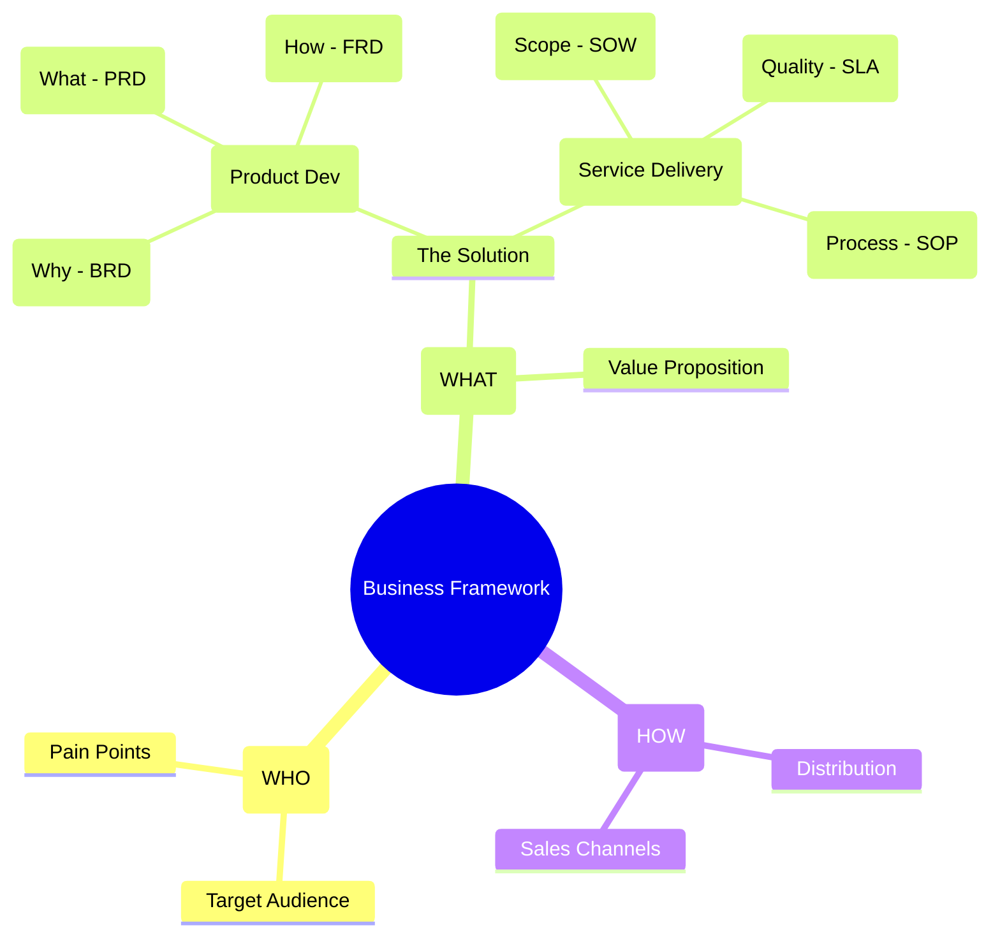

**Tl;DR**

Shipping is [the foundation](https://www.seangoedecke.com/shipping-is-the-foundation/)

**Intro**

* WHY Im writting this post: *Bc ive taken the PHF fwk, PIOs concepts to [go from inbound reactive fwk to an outbound generative one](#a-change-of-mindset)*
* What [Ive learnt](#conclusions) with it: **

It turns out that Ive been doing **these errors**: DFY with extremely slow price for wrong prospects that ended up in -100% NRR + automatic problem solving via SaaS for B2C that are never aware that the solution exists, or B2B equivalent when they dont have the problem.

Bc as I understand it **now**:

* A web/app is infrastructure for automatic conversions *and depending what you sell for delivery as well*
* If you are doing service delivery, your hands, knowledge and time are doing the delivery
* You still need the step 1: the attraction infrastructure - How do ppl get to know about what you ship/offer? Whats the distribution? a newsletter? 1M follwers on social media? cold mail campaign? ads?


You can test the market and prospect around one idea even before building it


**Luckily**, my time/know how is *still valuable* for service delivery, like D&A, in the market

The conversion infrastructure around all the webs ive put together is more solid than ever, unified and with a multi-site inbound in place.

And...the attraction infrastructure is WIP/in-validation with this outbound setup.

> If you are new around: *just get a 20$ AI sub and lets rnr*

## BiP

After [shipping several SaaS](#shipping-saas) in public, these is what I wish I had known earlier from the tech-stack angle to create basically anything: *to get started is not as hard as [getting data apps right](https://github.com/JAlcocerT/poc/tree/main/zzz-books)*.

> Are you building for feeling productive? How certain are you that your build will solve somebodies pain points? Do you even care and are just building for the sake of it?

If that's clear, then id recommend:

1. Astro SSG x Edge capabilities within Cloudflare offerings: *[scheduled posts](https://github.com/JAlcocerT/jalcocertech-core/blob/main/architecture/scheduled-rebuilds.md) via CI/CD, posts with auth, contact form, newsletter, DRIP, GDPR compliant, webp & mdx support, cms x pwa x offline optional.* With no [broken links](https://fossengineer.com/linkchecker-broken-link-checker/), [web-check](https://fossengineer.com/selfhosting-web-check/)ed, [Google search console](https://jalcocert.github.io/JAlcocerT/branded-jalcocertech/#google-search-api), PageSpeed and [CF analytics via API](https://jalcocert.github.io/JAlcocerT/branded-jalcocertech/#cf-api) setup for feedback and web audited and with a VSL. With the sitemaps configured for google and for `bing.com/webmasters`. Properly [audited](https://jalcocert.github.io/JAlcocerT/branded-jalcocertech/#web-audits-x-checks) and with [web best practices](https://jalcocert.github.io/JAlcocerT/branded-jalcocertech/#web-best-practices) in place, like [using webp images](https://jalcocert.github.io/JAlcocerT/branded-jalcocertech/#baj).

2. Auth: *better-auth with transactional emails setup in CF and google signin/up configured*

3. Analytics: *go with default cloudflare GDPR compliant and if you need links analytics go for any of these, like [relay](https://github.com/JAlcocerT/relay)*

4. Contact forms / qualifications:

5. Newsletters/Transactional/DRIPs: *mailjet API if you want EU based*

6. Roadmaps (kanban), changelog and gated feature requests

7. Product analytics: posthog is amazing


  



### A change of mindset

Im feeling a lot of friction lately.

My [notes](https://github.com/JAlcocerT/my-logseq-notes/tree/main/journals) have so far been an inbound-reactive framework: *for standups, ticket tracking, and client communication ("What did I do? What is blocking me? What questions do I need to ask?").*

A [solopreneur framework](https://github.com/JAlcocerT/my-logseq-notes/blob/main/journals/2026_10_18.md) has to be [outbound-generative framework](https://github.com/JAlcocerT/my-logseq-notes/blob/main/daily-solo/wk42y26/master-plan-sample.json): *nobody unblocks you, and vision/tasks don’t exist until you architect them*.

This requires a mindset and operational [shift towards orchestration](https://github.com/JAlcocerT/my-logseq-notes/blob/main/journals/2026_10_17.md).

$$\text{Vision / PIO} \longrightarrow \text{Roadmap (Milestones)} \longrightarrow \text{Execution (Tasks)} \longrightarrow \text{Changelog (Ledger)}$$

Understand the evolution of your thinking, as the inputs change, so do the failure modes.

As we go from trad BA, to specifying mechanics (BRD/PRD/FRD), the next steps above is **governing the intent and boundary conditions**.

> Fancy said as: *product & systems architecture*

> > Even fancier: you need [the foundations for](https://github.com/JAlcocerT/my-logseq-notes/blob/main/daily-solo/wk42y26/2026-10-17.md) a *hierarchical autonomous multi-agent framework* to ship.

### The Business Game

Its crucial to have an [ideas and opportunities health check](https://jalcocert.github.io/JAlcocerT/ideas-and-opportunities-health-check/):

{}


The **launch strategy**: *aka, focus strategy*:

| Element | Decision |
| :--- | :--- |
| **One Avatar** | |
| **One Product** | |
| **One Channel** | |

The **Tier of Service**: 

* Enhanced DIY when you claim the free tier where you bring your own key and data + using built in functions
* DFY for custom logics like calling functions, calendar, forms...

The **customer segmentation**: SMB

The **tech stack**: *this solution can start as a consulting / setup service, then and only when there are PxV signals...a potential product*

| Requirement | Specification | Clarification / Decision |
| :--- | :--- | :--- |
| **Frontend Framework** | | |
| **Styling/UI Library** | | |
| **[Backend](https://jalcocert.github.io/JAlcocerT/docs/dev/fe-vs-be/)/Database** | | |
| **[Authentication](https://jalcocert.github.io/JAlcocerT/docs/dev/authentication/)** | | |


* Supply - DFY, finite *on demand basis*
* Demand - constrained
  * *Visitors of FossEngineer that are potential interested into OSS, but will be leaning more towards a DIY offer*
  * *Targeted users via APIFY google maps scrapping + cold emails / social media reach*

But it does not apply, as the goal of this is more closing a long chapter and making the final learnings with it.

As the why, what was very clear, its time to put together the final HOW:

```md
# Project Name: [SaaS Name]

## 1. The Why (BRD)
- **Problem:** [Describe the pain point]
- **Value Prop:** [How I solve it]
- **Monetization:** [e.g., $9/mo Subscription via Stripe]

## 2. The What (PRD)
- **Primary User Flow:** Landing -> Auth -> Core Feature -> Payment.
- **V1 Features:** - [ ] Auth (Google/Email)
  - [ ] Feature A (The core value)
  - [ ] Settings (Billing/Delete account)

## 3. The How (FRD)
- **Stack:** T3 Stack (Next.js, Prisma, TRPC)
- **DB Schema:** - User: id, email, stripe_id
  - Data: id, user_id, content, timestamp
```

{}




#### PHF vs BCG PLC

McKinsey’s framework Three Horizons of Growth, and it focuses on managing innovation across different timeframes rather than product lifecycle actions.   

BCG Growth-Share Matrix (Cash Cows, Stars, Dogs, Question Marks) is ~ PLC.


---

## Conclusions


  
  



### Case Studies

With stuff ive been doing.

#### MultiSite OutReach

Weekly Reviews be like [this](https://github.com/JAlcocerT/my-logseq-notes/blob/main/daily-solo/wk41y26/2026-10-19.md)

##### InBound

Have been doing improvements across all my sites and having some [thoughts around the next jalc shape](http://192.168.1.2:3034/jalcocert/jalcocertech-web-proposal)

https://jalcocert.github.io/JAlcocerT/real-estate-landing/#making-website-services-known


1. You can get such **serverless setup** around CF to get contacts forms:

```sh
#cd /home/jalcocert/Desktop/mbsd-framework/leadarchitect-uk/data/sends
#cd jalcocertech-core/leads-hub/hub
docker exec homelab-leads-hub-1 python -c 'import sqlite3; c = sqlite3.connect("/data/leads.db"); print(c.execute("SELECT key, kind, received_at FROM leads WHERE key LIKE \"multibodysystemsdynamics.com:enquiry:2026-10-05%\"").fetchall())'
```

2. You can also make [a self-managed (via Jev) telegram community](https://github.com/JAlcocerT/my-logseq-notes/tree/main/daily-solo/wk43y26/pio-inbound-tg-bot)

##### OutBound

Aka [the clients you choose](https://jalcocert.github.io/JAlcocerT/custom-re-rag/#ps-)


Mind the applicable regulations and law!


1. Via cold mail:

```sh

```

2. Via cold calls:


3. Via...[automated outbound CVs](https://github.com/JAlcocerT/my-logseq-notes/tree/main/daily-solo/wk44y26/pio-outbound-jobs): *for which [writing daily](https://github.com/JAlcocerT/my-logseq-notes/tree/main/daily-history) and having a story brand helps*

#### Shipping SaaS

Lately im putting these together into `/projects` with `/roadmap & /vision` and `/changelog`.

That really helps to keep track of:

1. Wedding QRs: *google sign-in/up + CF s3/r2* and its lead CaC KPIs *to test distribution and perceived value*

2. Web Audits

3. MarginCMS: *what if I just needed git compatible notes with sign/in to Forgejo and PWA support? what if foldergram could use git?*

4. Real estate: *once an [idea](https://github.com/JAlcocerT/moi-realestate-pro-astro-bot) and [tech talk](https://jalcocert.github.io/JAlcocerT/custom-re-rag/#a-new-tech-talk), [later white-labeled](https://jalcocert.github.io/JAlcocerT/white-label-real-estate-solution/), now another producticed service*

5. GenBI: *the kind of PoC that you prepare sth, ship a video, have a waiting list and test the market interest* the shopify thing seems to have captured attention `https://sparkseopro.com/#pricing`

6. R&D / IoT / MBSD: `http://192.168.1.2:3038/?range=90d`

7. Around getleadarchitect Im testing the website fixes and taking the learnings for an outbound agency later on. 

> Outro: mbsd-oss x PWA and selfhosted-connectivity


  
  



#### Meta Frameworks

Beyond *no hello's* and *who/what/by-when*: governance matters and thinking in systems and their incentives helps

1. Product definition: *create, define, invest, smart, PIOs, BRD/PRD/FRD, project charters, RACIs, OKRs, outcome driven product development... whatever, but... just make it have sense*

2. PostMortems

3. PIOs: *[stop telling how's](https://www.youtube.com/watch?v=7T-gldvgfpo) and spend time defining WHYs*

> Im building with such [clear one time integrations setup](https://github.com/JAlcocerT/slubne-chwile-y26/blob/master/z-integrations.md), [ADRs](https://github.com/JAlcocerT/my-logseq-notes/tree/main/daily-solo/wk43y26/pio-inbound-tg-bot/adr), Roadmap and changelogs

> > From which i later make [builder posts](https://github.com/JAlcocerT/my-logseq-notes/tree/main/daily-solo/wk44y26/pio-outbound-jobs/builder-posts)

4. Smaller teams ftw: [network theory](https://github.com/JAlcocerT/poc/tree/main/physics-networktheory) backs this up

5. Time management: *now with pomodoro* https://github.com/JAlcocerT/omarchy-pomodoro

Declare what you want, not the procedure how to get there.

Start communicating *and governing* THE INTENT!

Goal/intent/contract/end state

#### Funnels

From skalas...

#### Electronic Design

Practical Electronics for Inventors, Fourth Edition is a nice book

#### mbsd


#### Homelab Hardening

---

## Outro

Lovely interfaces i found recently: 

1. `https://www.levels.fyi/salaries/add/chat` that also populates the UI as you write (using the new quick models maybe?)

2. For on boarding flows: `https://bitly.com/a/sign_up`

3. For roadmaps: `https://dbackup.app/roadmap/`

4. I loved this `https://levels.io/projects` *notice the success rate and w/o profit goal*


### Skills Im using

Coming from [here](https://jalcocert.github.io/JAlcocerT/jalcocertech-services-update/#skills-im-using)

1. Archify, Graphify
2. Zettel blog notes, weekly work summarizer
3. huashu design
4. blog post editor, image gen

### Integrations Im using

For example [email outbound and enrichment](https://github.com/JAlcocerT/leadarchitect-uk/blob/main/.env.sample)

But why not: smartlead, cf web analytics, or any of these web analytics tools, posthog...and [what now for any saas](https://github.com/JAlcocerT/slubne-chwile-y26/blob/master/z-integrations.md)

```env

```

---

## FAQ


### Improved RE and GenBI

I found 12 source posts dated 2026 mentioning one or both domains.

Six contain substantial discussion; the rest are roadmap, portfolio, or monitoring references.


```sh
#https://realestate.jalcocertech.com/
#https://genbi.jalcocertech.com/
```

#### realestate.jalcocertech.com

Your story evolved through three stages: `https://consulting.jalcocertech.com/talks/real-estate-agency-ai-website/`

1. Custom full-stack Real Estate product

In A SaaS for Real Estate Agencies (content/blog/entrep-saas-re-rag.md:1), you described:
- Real-estate agencies as the target avatar
- A conversion-ready website and property catalogue
- Mortgage calculator with Chart.js
- Markdown-based property storage and editing
- Astro hybrid rendering
- OpenAI chatbot and FastAPI scraper
- Basic authentication, CORS and rate limiting
- Docker deployment through your homelab

Your conclusion was blunt: the product worked; client acquisition did not.

2. Pivot into a white-label DFY offer

In White-Labelling the Real Estate solution (content/blog/entrep-saas-re-whitelabel.md:1), you reframed the existing software as a reusable service:
- Landing adapted from the Shopify/GenBI project
- Cal.com booking for qualified prospects
- Manual 1:1 onboarding
- $1,000–$3,000 setup
- $100–$300/month maintenance
- Targeted prospecting toward B2B real-estate agencies

The site became a funnel for selling the existing technical capability, rather than another speculative SaaS.

3. Original roadmap item cancelled, reusable asset retained

By March–May, you repeatedly described the original “Custom RAG and WebApp via DecapCMS” idea as cancelled and white-labelled, including in From Idea to Resolution (content/blog/z-idea-2-resolution.md:247), PoC 102 (content/blog/poc-102.md:179), and PoC 104 (content/blog/poc-104.md:168).

So, realestate.jalcocertech.com became a high-ticket white-label Real Estate funnel, calculator, chatbot and managed implementation offer—not a conventional self-serve SaaS.

#### genbi.jalcocertech.com

The main concept was a Shopify-focused agentic COO / profit-leak detector.

In The insights for a profitable Shopify (content/blog/entrep-saas-pnpshopify.md:1), you wrote that:

- Shopify stores share sufficiently similar data structures to support repeatable analytics.
- Store owners may ignore generic website audits but care about increasing profit.
- Every project should begin with a landing page and lead capture.
- The landing should qualify stores before admitting them to your calendar.
- AuditPro was intended for Shopify businesses doing more than $10k revenue.
- The offer could support high-ticket DFY analytics and potentially a success-fee model.

The technical model had four layers:

- PostgreSQL data
- BAML semantic definitions
- FastAPI/Python agentic logic
- React/Recharts representation

The landing used Astro/React, Tailwind, Framer Motion, Docker and a Cloudflare Tunnel. Its stronger ATF combined a headline, interactive URL input and video proof in the first viewport (example(content/blog/entrep-saas-slub-product-dev.md:74)).

In From Shopify to Profit (content/blog/entrep-saas-pnpshopify-be.md:1), you acknowledged that the landing existed before the complete product. The next work was:

- Shopify GraphQL integration
- Completing the analytics backend
- Manual onboarding
- Finding prospects
- Monitoring the public service with Uptime Kuma

So, genbi.jalcocertech.com was less a finished SaaS and more a productized demonstration and qualification funnel for your Generative BI/DFY analytics capability.

Shared conclusion

Both domains became proof assets inside your value ladder:

- realestate: industry-specific white-label software
- genbi: industry-specific analytics and profit discovery
- Both: high-ticket DFY lead magnets with manual onboarding
- Shared constraint: distribution and prospecting, not software construction
- Shared operational obligation: uptime, analytics, security and working follow-up

By April, you presented them together as portfolio PoCs in How to PoC (content/blog/poc-101.md:350): *demonstrations of what your consulting/full-service tier could deliver*.

The live domains, repository files and all 12 related 2026 posts are indexed in the expandable section below.

{}

The clearest domain-to-repository mapping is:

> Some implementation repositories are private working repos. These links remain useful as my project inventory, but readers without access will see a GitHub 404. `Data-Chat` is public; the live sites and related blog posts are public.

| Domain | Primary repository | Role |
|---|---|---|
| [`realestate.jalcocertech.com`](https://realestate.jalcocertech.com/) | [`moi-realestate-pro-astro-bot`](https://github.com/JAlcocerT/moi-realestate-pro-astro-bot) | Astro website, property editor, chatbot/RAG, mortgage calculator and FastAPI scraper. |
| [`genbi.jalcocertech.com`](https://genbi.jalcocertech.com/) | [`poc_shopify`](https://github.com/JAlcocerT/poc_shopify) | Shopify AuditPro landing, qualification funnel and product-facing application. |
| GenBI analytics engine | [`langchain-db-ui/Z_PGSQL-GenBI`](https://github.com/JAlcocerT/langchain-db-ui/tree/master/Z_PGSQL-GenBI) | PostgreSQL, FastAPI, BAML and React/Recharts experiments behind the Generative BI concept. |

##### Real Estate repository

The deployed service is primarily documented in [`moi-realestate-pro-astro-bot`](https://github.com/JAlcocerT/moi-realestate-pro-astro-bot):

- [Sales notes](https://github.com/JAlcocerT/moi-realestate-pro-astro-bot/blob/master/z-sales.md)
- [Sales automation](https://github.com/JAlcocerT/moi-realestate-pro-astro-bot/blob/master/z-sales-automation.md)
- [B2B positioning](https://github.com/JAlcocerT/moi-realestate-pro-astro-bot/blob/master/z-sales-b2b.md)
- [API security](https://github.com/JAlcocerT/moi-realestate-pro-astro-bot/blob/master/z-api-security.md)
- [CORS and rate-limiting change request](https://github.com/JAlcocerT/moi-realestate-pro-astro-bot/blob/master/cr-4-api-security.md)
- [Chatbot architecture](https://github.com/JAlcocerT/moi-realestate-pro-astro-bot/blob/master/cr-chatbot-astro.md)
- [Mortgage calculator](https://github.com/JAlcocerT/moi-realestate-pro-astro-bot/blob/master/src/pages/mortgage-calculator.astro)
- [FastAPI scraper service](https://github.com/JAlcocerT/moi-realestate-pro-astro-bot/tree/master/scraper-service)
- [Scraper migration change request](https://github.com/JAlcocerT/moi-realestate-pro-astro-bot/blob/master/cr-5-scraper-migration.md)

Earlier experiments that fed the final solution:

- [`ScrewFastMoiRealEstate`](https://github.com/JAlcocerT/ScrewFastMoiRealEstate) - earlier Astro real-estate website.
- [`Data-Chat`](https://github.com/JAlcocerT/Data-Chat) - database chat and RAG experiments.
- [`Data-Chat/LLamaIndex/With_Mem0`](https://github.com/JAlcocerT/Data-Chat/tree/main/LLamaIndex/With_Mem0) - real-estate assistant experiment with memory.
- [`moi-realestate-pb`](https://github.com/JAlcocerT/moi-realestate-pb) - previous Streamlit/PocketBase scraper logic.
- [`py_stocks/EDA_Mortage`](https://gitlab.com/fossengineer1/py_stocks/-/tree/main/EDA_Mortage) - original mortgage-calculator experiment.

##### GenBI repositories

[`poc_shopify`](https://github.com/JAlcocerT/poc_shopify) contains the domain-facing landing and qualification experience:

- [Business requirements](https://github.com/JAlcocerT/poc_shopify/blob/master/z-brd.md)
- [Requirement clarifications](https://github.com/JAlcocerT/poc_shopify/blob/master/clarification.md)
- [Development phases](https://github.com/JAlcocerT/poc_shopify/blob/master/z-development-phases.md)
- [Landing technical stack](https://github.com/JAlcocerT/poc_shopify/blob/master/landing/tech-stack.md)
- [Qualification-form implementation](https://github.com/JAlcocerT/poc_shopify/blob/master/landing/z-form-tech.md)
- [Qualification-form psychology](https://github.com/JAlcocerT/poc_shopify/blob/master/landing/z-form-psychology.md)
- [Above-the-fold changes](https://github.com/JAlcocerT/poc_shopify/blob/master/landing/z-atf-changes.md)
- [Landing-page business strategy](https://github.com/JAlcocerT/poc_shopify/blob/master/landing/business-strategy.md)

[`langchain-db-ui`](https://github.com/JAlcocerT/langchain-db-ui) contains the earlier and shared analytics foundation:

- [`Z_PGSQL-GenBI`](https://github.com/JAlcocerT/langchain-db-ui/tree/master/Z_PGSQL-GenBI) - the four-layer GenBI experiment.
- [GenBI technical stack](https://github.com/JAlcocerT/langchain-db-ui/blob/master/Z_PGSQL-GenBI/tech-stack.md)
- [GenBI sales notes](https://github.com/JAlcocerT/langchain-db-ui/blob/master/Z_PGSQL-GenBI/sales.md)
- [`Data-Chat`](https://github.com/JAlcocerT/Data-Chat) - the earlier chat-with-data foundation referenced by both project histories.

##### Related 2026 posts

The repositories explain the implementation. These posts preserve the decisions, experiments and commercial pivots around them.

**Real Estate story**

- [A SaaS for Real Estate Agencies: Custom RAG Solution](https://jalcocert.github.io/JAlcocerT/custom-re-rag/) - the full Astro, RAG/chatbot, editor, calculator, scraper and security build.
- [White-Labelling the Real Estate Solution](https://jalcocert.github.io/JAlcocerT/white-label-real-estate-solution/) - the pivot from an underpriced custom project to a repeatable DFY offer.
- [From Idea to Resolution](https://jalcocert.github.io/JAlcocerT/take-ideas-to-their-digital-resolution/) - records the original custom RAG/CMS roadmap item as cancelled and retained as a white-label asset.
- [How to PoC 102](https://jalcocert.github.io/JAlcocerT/poc-102/) - April roadmap checkpoint for the white-labelled Real Estate project.
- [How to PoC: Arbitrage with AI](https://jalcocert.github.io/JAlcocerT/poc-104/) - May checkpoint placing the original idea in the ideas cemetery while keeping the deployed solution.

**GenBI story**

- [Improving a micro-SaaS Conversion: Email Automation](https://jalcocert.github.io/JAlcocerT/iterating-and-improving-a-micro-saas/) - uses the GenBI landing as the example for a stronger ATF with an interactive input and video proof.
- [How to Analyze Business Opportunities](https://jalcocert.github.io/JAlcocerT/ideas-and-opportunities-health-check/) - places GenBI inside the wider business-opportunity and service-offer thinking.
- [The Insights for a Profitable Shopify](https://jalcocert.github.io/JAlcocerT/custom-analytics-for-shopify/) - defines AuditPro, the Shopify-facing landing, qualification logic and four-layer GenBI architecture.
- [From Shopify to Profit](https://jalcocert.github.io/JAlcocerT/shopify-business-data-analytics/) - continues from the landing toward Shopify integration, delivery, prospecting and service monitoring.
- [The RevOps You Always Dreamt About](https://jalcocert.github.io/JAlcocerT/building-a-revops-center-agency/) - positions GenBI as part of the broader RevOps and consulting offer.

**Shared portfolio and operations context**

- [How to PoC](https://jalcocert.github.io/JAlcocerT/poc-101/) - presents GenBI and Real Estate together as proof assets in the JAlcocerTech portfolio.
- [Spring Is Here (and So Are Weddings)](https://jalcocert.github.io/JAlcocerT/quick-weddings-poc/) - references the operational need to monitor deployed services such as `realestate.jalcocertech.com` rather than checking them manually.

The practical boundary is: `poc_shopify` owns the Shopify-specific offer and conversion layer, while `langchain-db-ui/Z_PGSQL-GenBI` records the reusable analytics architecture behind it.

{}


### Energy


### EayP v5 x EmDash x Monolith

Coming from the [last eayp change](https://jalcocert.github.io/JAlcocerT/branded-jalcocertech/#eayp-v4) around foldergram!

I got to know about: https://github.com/generalaction/emdash

And still i need to [improve `margin-cms`](https://github.com/JAlcocerT/poc/tree/main/pwa-margincms) and try `markdown plus plus`

### Slubne PoC

Expiry reminders versus marketing DRIP

Expiry reminders are a scheduled email sequence, so “DRIP” describes the mechanism. 

Keep two separate sequences:

* Service reminders: “Your gallery expires soon—download your originals.”
* Marketing DRIP: onboarding tips, upgrade offers, promotions.

They can **share infrastructure**, but not automatically share recipients, consent rules, or suppression behavior. 

```sh
git clone .../slubne-chwile-y26
```

> For security, you can have CI/CD https://github.com/JAlcocerT/slubne-chwile-y26/blob/master/.github/workflows/ci.yml on top of some agent+skills with regular checks to your homelab.

> > You can also add CI/CD checks for broken links and what not