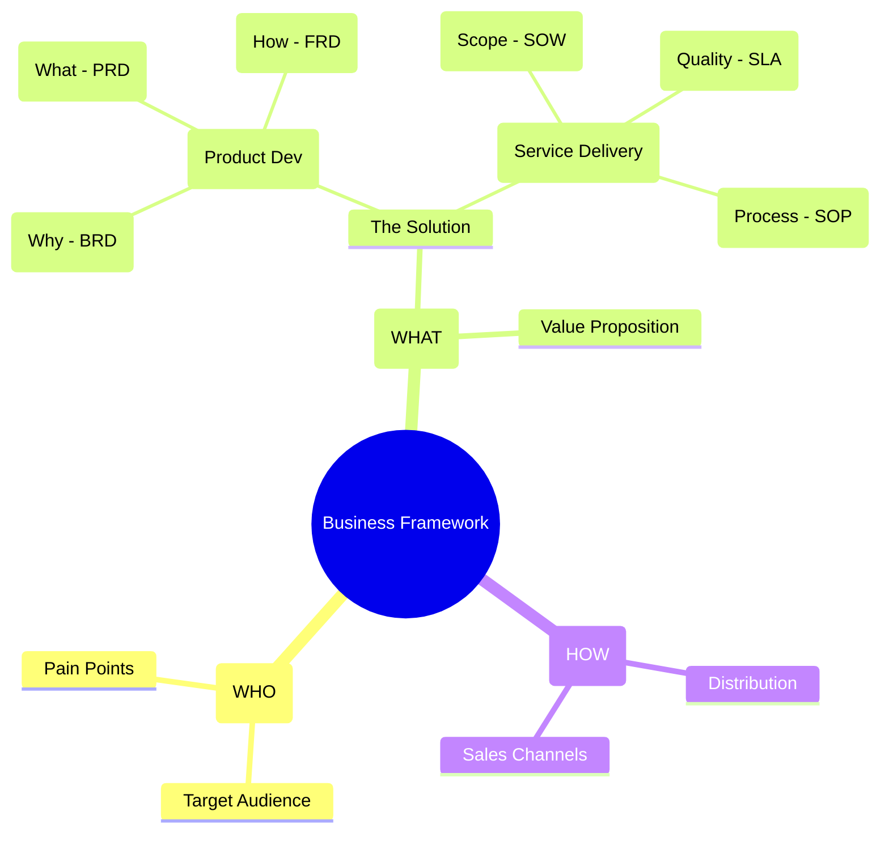

**Tl;DR**

Shipping is [the foundation](https://www.seangoedecke.com/shipping-is-the-foundation/)

**Intro**

* WHY Im writting this post: **
* What [Ive learnt](#conclusions) with it: **

## BiP

After [shipping several SaaS](#shipping-saas) in public, these is what I wish I had known earlier from the tech-stack angle to create basically anything:

1. Astro SSG x Edge capabilities within Cloudflare offerings: *scheduled posts via CI/CD, posts with auth, contact form, newsletter, DRIP, GDPR compliant, webp & mdx support, cms x pwa x offline optional.* With no [broken links](https://fossengineer.com/linkchecker-broken-link-checker/), [web-check](https://fossengineer.com/selfhosting-web-check/)ed, Google search console for feedback and web audited and with a VSL.

2. Auth: *better-auth with transactional emails setup in CF and google signin/up configured*

3. Analytics: *go with default cloudflare GDPR compliant and if you need links analytics go for*

4. Contact forms / qualifications:

5. Newsletters/Transactional/DRIPs: *mailjet API if you want EU based*

6. Roadmaps (kanban), changelog and gated feature requests

7. Product analytics: posthog is amazing


### The Business Game

Its crucial to have an [ideas and opportunities health check](https://jalcocert.github.io/JAlcocerT/ideas-and-opportunities-health-check/):

The **launch strategy**: *aka, focus strategy*:

| Element | Decision |
| :--- | :--- |
| **One Avatar** | |
| **One Product** | |
| **One Channel** | |

The **Tier of Service**: 

* Enhanced DIY when you claim the free tier where you bring your own key and data + using built in functions
* DFY for custom logics like calling functions, calendar, forms...

The **customer segmentation**: SMB

The **tech stack**: *this solution can start as a consulting / setup service, then and only when there are PxV signals...a potential product*



| Requirement | Specification | Clarification / Decision |
| :--- | :--- | :--- |
| **Frontend Framework** | | |
| **Styling/UI Library** | | |
| **[Backend](https://jalcocert.github.io/JAlcocerT/docs/dev/fe-vs-be/)/Database** | | |
| **[Authentication](https://jalcocert.github.io/JAlcocerT/docs/dev/authentication/)** | | |


* Supply - DFY, finite *on demand basis*
* Demand - constrained
  * *Visitors of FossEngineer that are potential interested into OSS, but will be leaning more towards a DIY offer*
  * *Targeted users via APIFY google maps scrapping + cold emails / social media reach*

But it does not apply, as the goal of this is more closing a long chapter and making the final learnings with it.


  
  


As the why, what was very clear, its time to put together the final HOW:

```md
# Project Name: [SaaS Name]

## 1. The Why (BRD)
- **Problem:** [Describe the pain point]
- **Value Prop:** [How I solve it]
- **Monetization:** [e.g., $9/mo Subscription via Stripe]

## 2. The What (PRD)
- **Primary User Flow:** Landing -> Auth -> Core Feature -> Payment.
- **V1 Features:** - [ ] Auth (Google/Email)
  - [ ] Feature A (The core value)
  - [ ] Settings (Billing/Delete account)

## 3. The How (FRD)
- **Stack:** T3 Stack (Next.js, Prisma, TRPC)
- **DB Schema:** - User: id, email, stripe_id
  - Data: id, user_id, content, timestamp
```


---

## Conclusions


  
  



### Case Studies


#### MultiSite InBound


https://jalcocert.github.io/JAlcocerT/real-estate-landing/#making-website-services-known


#### MultiSite OutBound

Aka [the clients you choose](https://jalcocert.github.io/JAlcocerT/custom-re-rag/#ps-)


#### Shipping SaaS

1. Wedding QRs: *google sign-in/up + CF s3/r2* 
2. Web Audits
3. MarginCMS: *what if I just needed git compatible notes with sign/in to Forgejo and PWA support? what if foldergram could use git?*
4. Real estate: *once an idea and [tech talk](https://jalcocert.github.io/JAlcocerT/custom-re-rag/#a-new-tech-talk), [later white-labeled](https://jalcocert.github.io/JAlcocerT/white-label-real-estate-solution/), now another producticed service*
5. GenBI: *the kind of PoC that you prepare sth, ship a video, have a waiting list and test the market interest*

> Outro: mbsd-oss and selfhosted-connectivity

#### Meta Frameworks

Beyond *no hello's* and *who/what/by-when*:

1. Product definition: *create, define, invest, smart, PIOs, BRD/PRD/FRD, project charters, RACIs whatever, but just make it have sense*

2. PostMortems

#### Electronic Design

