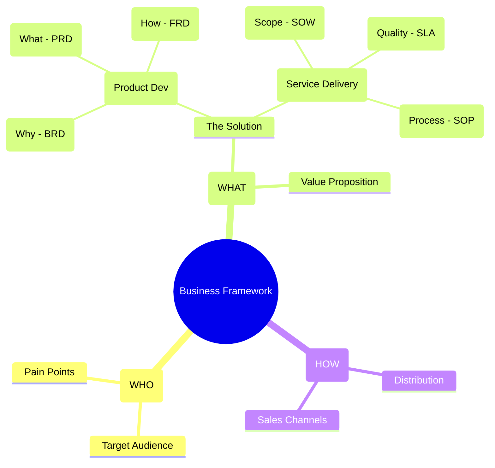

**Tl;DR**

Shipping is [the foundation](https://www.seangoedecke.com/shipping-is-the-foundation/)

**Intro**

* WHY Im writting this post: *Bc ive taken the PHF fwk, PIOs concepts to [go from inbound reactive fwk to an outbound generative one](#a-change-of-mindset)*
* What [Ive learnt](#conclusions) with it: **

It turns out that Ive been doing **these errors**: DFY with extremely slow price for wrong prospects that ended up in -100% NRR + automatic problem solving via SaaS for B2C that are never aware that the solution exists, or B2B equivalent when they dont have the problem.

Bc as I understand it **now**:

* A web/app is infrastructure for automatic conversions *and depending what you sell for delivery as well*
* If you are doing service delivery, your hands, knowledge and time are doing the delivery
* You still need the step 1: the attraction infrastructure - How do ppl get to know about what you ship/offer? Whats the distribution? a newsletter? 1M follwers on social media? cold mail campaign? ads?


You can test the market and prospect around one idea even before building it


**Luckily**, my time/know how is *still valuable* for service delivery, like D&A, in the market

The conversion infrastructure around all the webs ive put together is more solid than ever, unified and with a multi-site inbound in place.

And...the attraction infrastructure is WIP/in-validation with this outbound setup.

> If you are new around: *just get a 20$ AI sub and lets rnr*

## BiP

After [BiP](https://jalcocert.github.io/JAlcocerT/docs/entrepreneur/bip/) & [shipping several SaaS](#shipping-saas) in public, these is what I wish I had known earlier from the tech-stack angle to create basically anything: *to get started is not as hard as [getting data apps right](https://github.com/JAlcocerT/poc/tree/main/zzz-books)*.

> Are you building for feeling productive?

> > How certain are you that your build will solve somebodies pain points? Do you even care and are just building for the sake of it?

If that's clear, then id recommend such [workflow wrap](https://jalcocert.github.io/JAlcocerT/branded-jalcocertech/#workflow-wrap): *do and document [ADR](https://www.jalcocertech.com/support/articles/architecture-decision-records-solo-business/), decisions, roadmap, learnings and builder-posts*.

1. Astro SSG x Edge capabilities within Cloudflare offerings: *[scheduled posts](https://github.com/JAlcocerT/jalcocertech-core/blob/main/architecture/scheduled-rebuilds.md) via CI/CD, posts with auth, contact form, newsletter w/o ~~love~~ subscription bombing, DRIP, GDPR compliant, webp & mdx support, cms x pwa x offline optional, [rss and tg bot](https://www.jalcocertech.com/blog/telegram-bot-quiet-nightly-rss-digest/) that flag the new content to a group.* With no [broken links](https://fossengineer.com/linkchecker-broken-link-checker/), [web-check](https://fossengineer.com/selfhosting-web-check/)ed, [Google search console](https://jalcocert.github.io/JAlcocerT/branded-jalcocertech/#google-search-api), PageSpeed and [CF analytics via API](https://jalcocert.github.io/JAlcocerT/branded-jalcocertech/#cf-api) setup for feedback and web audited and with a VSL. With the sitemaps configured for google and for `bing.com/webmasters`. Properly [audited](https://jalcocert.github.io/JAlcocerT/branded-jalcocertech/#web-audits-x-checks) and with [web best practices](https://jalcocert.github.io/JAlcocerT/branded-jalcocertech/#web-best-practices) in place, like [using webp images](https://jalcocert.github.io/JAlcocerT/branded-jalcocertech/#baj). And with a [SEO](#seo) that gets the job done.

> You dont need hupspot to manage a newsletter like `dune.com` does

2. Auth: *better-auth with transactional emails setup in CF and google signin/up configured*

3. Analytics: *go with default cloudflare GDPR compliant and if you need links analytics go for any of these, like [relay](https://github.com/JAlcocerT/relay)*

4. Contact forms / qualifications:

5. Newsletters/Transactional/DRIPs/[OSS Leads Ops](https://fossengineer.com/marketing-newsletter-lead-ops/): *mailjet API if you want EU based*

6. Roadmaps (kanban), changelog and gated feature requests

https://frameleaf.app/timeline/#roadmap - lovely roadmap with a section explaining what the project is not (anti-features!) :)

`https://dbackup.app/roadmap/` *which was one [of the points](https://jalcocert.github.io/JAlcocerT/tech-recap-and-more-2025/#for-next-year) i wanted to cover this year*

7. Product analytics: *posthog is amazing and it can be one of your agents integrations for a self-improving product (P**I**Os)*



Assuming you want agentic capabilities in your team, having [preassure test your ideas](https://consulting.jalcocertech.com/talks/pressure-test-your-product-idea/) before making them reality is a good practice


### A change of mindset


Im trying not to use any gui apps: `https://learn.chatgpt.com/docs/linux/linux-app`, just going with `https://github.com/github/copilot-cli`

```sh
herdr #lazygit /resume /compact /usage /status
scoop install uv #winget #choco #https://scoop.sh/#/
```

> `https://github.com/maddada/Ghostex`

Why just CLI?

Bc im not coding any more.

I have interests, questions and can specify context goals.

[Non tech people](https://jalcocert.github.io/JAlcocerT/a-diy-boilerplate-to-ship/#why-creating-like-a-ba), managers and alike - keep doing what you are *supposed to be* good at and ship like never!

Back in january I was writing about forgeting of how and [focus on why's and what's.](https://jalcocert.github.io/JAlcocerT/a-diy-boilerplate-to-ship/#the-tech-talk)

Now i can say with confidence that you can just skip it and just focus on WHY's

https://jalcocert.github.io/JAlcocerT/a-diy-boilerplate-to-ship/#why-creating-like-a-ba



The only difference between working with virtual versus human agents, is that if you are the last HITL you are responsible for the outcome of that full virtual team. *Are you afraid of owning outcomes my friend?*


You can see that Im feeling a lot of friction lately.

My [notes](https://github.com/JAlcocerT/my-logseq-notes/tree/main/journals) have so far been an inbound-reactive framework: *for standups, ticket tracking, and client communication ("What did I do? What is blocking me? What questions do I need to ask?").*

A [solopreneur framework](https://github.com/JAlcocerT/my-logseq-notes/blob/main/journals/2026_10_18.md) has to be [outbound-generative framework](https://github.com/JAlcocerT/my-logseq-notes/blob/main/daily-solo/wk42y26/master-plan-sample.json): *nobody unblocks you, and vision/tasks don’t exist until you architect them*.

This requires a mindset and operational [shift towards **orchestration**](https://github.com/JAlcocerT/my-logseq-notes/blob/main/journals/2026_10_17.md).

$$\text{Vision / PIO} \longrightarrow \text{Roadmap (Milestones)} \longrightarrow \text{Execution (Tasks)} \longrightarrow \text{Changelog (Ledger)}$$

Understand the evolution of your thinking, as the inputs change, so do the failure modes.

As we go from trad BA, to specifying mechanics (BRD/PRD/FRD), the next steps above is **governing the intent and boundary conditions**.

> Fancy said as: *product & systems architecture*

> > Even fancier: you need [the foundations for](https://github.com/JAlcocerT/my-logseq-notes/blob/main/daily-solo/wk42y26/2026-10-17.md) a *hierarchical autonomous multi-agent framework* to ship.

For this you need proper foundations

Similarly that you need an Enterprise Knowledge Layer, not just a data catalogue of silos nowadays.

### The Business Game

Its crucial to have an [ideas and opportunities health check](https://jalcocert.github.io/JAlcocerT/ideas-and-opportunities-health-check/):

{}

The **launch strategy**: *aka, focus strategy*:

| Element | Decision |
| :--- | :--- |
| **One Avatar** | |
| **One Product** | |
| **One Channel** | |

The **Tier of Service**: 

* Enhanced DIY when you claim the free tier where you bring your own key and data + using built in functions
* DFY for custom logics like calling functions, calendar, forms...

The **customer segmentation**: SMB

The **tech stack**: *this solution can start as a consulting / setup service, then and only when there are PxV signals...a potential product*

| Requirement | Specification | Clarification / Decision |
| :--- | :--- | :--- |
| **Frontend Framework** | | |
| **Styling/UI Library** | | |
| **[Backend](https://jalcocert.github.io/JAlcocerT/docs/dev/fe-vs-be/)/Database** | | |
| **[Authentication](https://jalcocert.github.io/JAlcocerT/docs/dev/authentication/)** | | |


* Supply - DFY, finite *on demand basis*
* Demand - constrained
  * *Visitors of FossEngineer that are potential interested into OSS, but will be leaning more towards a DIY offer*
  * *Targeted users via APIFY google maps scrapping + cold emails / social media reach*

But it does not apply, as the goal of this is more closing a long chapter and making the final learnings with it.

As the why, what was very clear, its time to put together the final HOW:

```md
# Project Name: [SaaS Name]

## 1. The Why (BRD)
- **Problem:** [Describe the pain point]
- **Value Prop:** [How I solve it]
- **Monetization:** [e.g., $9/mo Subscription via Stripe]

## 2. The What (PRD)
- **Primary User Flow:** Landing -> Auth -> Core Feature -> Payment.
- **V1 Features:** - [ ] Auth (Google/Email)
  - [ ] Feature A (The core value)
  - [ ] Settings (Billing/Delete account)

## 3. The How (FRD)
- **Stack:** T3 Stack (Next.js, Prisma, TRPC)
- **DB Schema:** - User: id, email, stripe_id
  - Data: id, user_id, content, timestamp
```

{}




#### PHF vs BCG PLC

McKinsey’s framework Three Horizons of Growth, and it focuses on managing innovation across different timeframes rather than product lifecycle actions.   

BCG Growth-Share Matrix (Cash Cows, Stars, Dogs, Question Marks) is ~ PLC.

---

## Conclusions

SInce [last month](https://jalcocert.github.io/JAlcocerT/jalcocertech-services-oct/) ive ended up were I played around PIOs

Now, I have:


  


```sh

```

For anything else from now on: https://www.jalcocertech.com


  
  



### Case Studies

With stuff ive been doing.

#### MultiSite OutReach

Now im just doing Weekly Reviews be like [this](https://github.com/JAlcocerT/my-logseq-notes/blob/main/daily-solo/wk41y26/2026-10-19.md) or this

So its pretty much automatized.

##### InBound

Have been doing improvements across all my sites and having some [thoughts around the next jalc shape](http://192.168.1.2:3034/jalcocert/jalcocertech-web-proposal)


  
  


<!-- 

 -->

1. You can get such **serverless setup** around CF to get contacts forms: *you can get leads notifications to ntfy*

```sh
#cd /home/jalcocert/Desktop/mbsd-framework/leadarchitect-uk/data/sends
#cd jalcocertech-core/leads-hub/hub
docker exec homelab-leads-hub-1 python -c 'import sqlite3; c = sqlite3.connect("/data/leads.db"); print(c.execute("SELECT key, kind, received_at FROM leads WHERE key LIKE \"multibodysystemsdynamics.com:enquiry:2026-10-05%\"").fetchall())'
```

2. You can also make [a self-managed (via Jev) telegram community](https://github.com/JAlcocerT/my-logseq-notes/tree/main/daily-solo/wk43y26/pio-inbound-tg-bot)

> See more jev use cases: `https://github.com/yibie/awesome-jev`


If you are getting too much spam when you review the [inbound with your skill](https://github.com/JAlcocerT/jalcocertech-core/tree/main/.codex/skills/leads-review), you can blacklist mails...


...or anything that contain the word lead

3. Using Jev to categorize inbound lead traffic to avoid loosing precious attention

##### OutBound

Aka [the clients you choose](https://jalcocert.github.io/JAlcocerT/custom-re-rag/#ps-)


Mind the applicable regulations and law!


1. Via cold mail: `https://app.smartlead.ai/app/email-campaigns-v2`

```sh

```

2. Via cold calls: *using tts :)*

3. Via...[automated outbound CVs](https://github.com/JAlcocerT/my-logseq-notes/tree/main/daily-solo/wk44y26/pio-outbound-jobs): *for which [writing daily](https://github.com/JAlcocerT/my-logseq-notes/tree/main/daily-history) and having a story brand helps*

#### Shipping SaaS

Lately im putting these together into `/projects` with `/roadmap & /vision` and `/changelog`.

That really helps to keep track of:

1. Wedding QRs: *google sign-in/up + CF s3/r2* and its lead CaC KPIs *to test distribution and perceived value*

2. Web Audits [are productized diagnosis](https://jalcocert.github.io/JAlcocerT/notes/web-audits-are-productized-diagnostics/) and a pretty interesting part of an [attraction offer that shows the problem before the solution](https://jalcocert.github.io/JAlcocerT/notes/attraction-offers-should-show-the-problem-before-the-solution/). All thanks to *some [scripts & skills](https://github.com/JAlcocerT/poc_webs_magnet/tree/master/.agents/skills)* - Migrating a [WP has some challenges](https://jalcocert.github.io/JAlcocerT/wordpress-migration-to-ssg/#the-challenges)

3. MarginCMS: *what if I just needed git compatible notes with sign/in to Forgejo and PWA support? what if foldergram could use git? what if you could set goals with your vision and form a **fieldnotes CMS** that [commits](https://github.com/JAlcocerT/BeyondAJourney/commit/f7486225842acddea4016ef9180987bbc438064f) and pushes to your GH thanks to an api that can just edit one repo?*

> This one can become one more [OSS tool of my ecosystem](https://www.jalcocertech.com/tools/) going forward

4. Real estate: *once an [idea](https://github.com/JAlcocerT/moi-realestate-pro-astro-bot) and [tech talk](https://jalcocert.github.io/JAlcocerT/custom-re-rag/#a-new-tech-talk), [later white-labeled](https://jalcocert.github.io/JAlcocerT/white-label-real-estate-solution/), now another producticed service*

5. GenBI: *the kind of PoC that you prepare sth, ship a video, have a waiting list and test the market interest* the shopify thing seems to have captured attention `https://sparkseopro.com/#pricing`

6. R&D / IoT / MBSD: `http://192.168.1.2:3038/?range=90d`

7. Around getleadarchitect Im testing the website fixes and taking the learnings for an outbound agency later on. 

> Outro: mbsd-oss x PWA and selfhosted-connectivity


  
  


8. TTS/ST2 interview prep / speech improvement / interviewer / fluentie for NL: *from one plane conversation*

* https://why-postmortem-checks.pages.dev
* https://pm-pdm-checks.pages.dev

> Speech Sparring around `https://platform.openai.com/api-keys/`

> > `https://speech.jalcocertech.com/` or `byod-00335.tail1234567.ts.net` :)

```sh
! cd wk47y26/pio-tts-stt-speech/cf && npx wrangler secret put OPENAI_API_KEY
#make tailnet-off
#sudo make down
rclone config create r2 s3 provider=Cloudflare \
 access_key_id=<ACCESS_KEY_ID> \
 secret_access_key=<SECRET_ACCESS_KEY> \
 endpoint=https://6f6de37edde332d0622d5802db839ff7.r2.cloudflarestorage.com \
 acl=private no_check_bucket=true
#make r2-remote
#make pull-sessions
```

8. For cold email get your dns in line `https://mxtoolbox.com/` [some ppl](https://forocoches.com/foro/showthread.php?t=10856551) is [building](https://themailguard.ai/) around this

#### Meta Frameworks

Beyond *no hello's* and *who/what/by-when*: governance matters and thinking in systems and their incentives helps

1. Product definition: *create, define, invest, smart, PIOs, BRD/PRD/FRD, project charters, RACIs, OKRs, outcome driven product development... whatever, but... just make it have sense*

2. PostMortems: *bc there might be gaps in the way you always worked*

> clarity of execution matters!

3. PIOs: *[stop telling how's](https://www.youtube.com/watch?v=7T-gldvgfpo)spend time defining WHYs and [start with a contract](https://www.jalcocertech.com/blog/job-engine-pio-adrs-project-contract/) with current and desired state*. ADRs and `builder-posts`, learnings and metalearnings from them are great.

> Im building with such [clear one time integrations setup](https://github.com/JAlcocerT/slubne-chwile-y26/blob/master/z-integrations.md), [ADRs](https://github.com/JAlcocerT/my-logseq-notes/tree/main/daily-solo/wk43y26/pio-inbound-tg-bot/adr), Roadmap and changelogs

> > From which i later make [builder posts](https://github.com/JAlcocerT/my-logseq-notes/tree/main/daily-solo/wk44y26/pio-outbound-jobs/builder-posts)

4. Smaller teams ftw: [network theory](https://github.com/JAlcocerT/poc/tree/main/physics-networktheory) backs this up

5. Time management: *now with pomodoro* `https://github.com/JAlcocerT/omarchy-pomodoro` `https://github.com/solidtime-io/solidtime`


Providing you work with inteligent enough agents: Declare what you want, not the procedure how to get there.

Start communicating *and governing* THE INTENT!

Goal/intent/contract/end state/desired state

<!-- https://www.youtube.com/watch?v=7T-gldvgfpo -->



#### We are agents

Its pretty interesting that we have lost the good old meaning of an agent

The one prior to all AI stuff

> An entity that perceives its environment and its able to act with intent and pursue its goals

Thats why im lately clearly distinguishing between: 

* virtual agents, to particularize for claude/codex/whatever LLM + harness
* human agents, us!!

Some of my tech consulting which was supposed to bepurely technical, diverted to the philosophical side

And its not a bad thing to question from time to time these kind of ground truths/believes

In fact, in times of accelerated changes, is the best time to do so

What are the assumptions that we are making that are blocking us?

Are all those still true?

When was the last time that you asked yourself: why does this have to bethis way?

We are all delivering something, be it: vision, ambiguity reduction or real sh*t done (final end product/service)

Have you accepted some of your way of working as sth given?

We all have our how's, our procedures to get what we want, when we want it

What if now there is another way?

What if you took back your teen hunger of questioning how shitty the status quo is?

There are huge mindset gains when we start thinking about: problems and outcomes

In fact, we should be revisiting the problem statements more frequently, to make sure that we are optimizing in the best way

Have you thought lately around your current state and the desired state?

We start talking to ourselv declaratively, as in: I want to be there / achieve xyz

Then we do all those new year resolutions, weekly plannings, daily journals for geeks which go to the procedural level

Then ofc there is no magic and actions need to be taken for the state to change

There are many state changes that cant be driven *at least nowadays* by virtual agents

And yet if you work in IT, there is no excuse: start being more declarative, start forgetting about all the prompt engineering, the hows and all stuff that you are consistently feeding to virtual entities that are most likely more capable than we are already.

Define a problem, ask for an outcome and make a way to indentify clearly (programmatically) what success means

Its hard to make the switch OFF to the how brain *which you can still use for othe rpurposes*

But if the idea is to increase speed, GTM, to not leave intelligence in the table and make the most of these new *virtual* resources, then start being more declarative, dont micro-manage

Providing you agree with my statements above, we can agree that:

1. any manager who's job is to be declarative has to be shipping like a full division - Keep doing what you are supposed to be good at
2. any engineer whos job was to get sh*it done has to be declaring outcomes like a full division - Mindset change required


#### Funnels

From skalas...

to having a reliable top of the funnel with inbound marketing that you can visualize and attribute to sources

#### Electronic Design

Practical Electronics for Inventors, Fourth Edition is a nice book

#### mbsd

* https://multibodysystemsdynamics.com/tools/camber-gain-roll-centre-calculator/

You should know whats coming...

Just in case if you missed it, i was making single point mass lap optimization earlier this year

now i got an oss mbsd framework to play around

> `https://github.com/JAlcocerT/multi-body` which is also at `https://hub.xerj.org/corpus/jalcocert--mbsd-core`

Oh...and i havent forgot about beam theory nor FEM

See where this is going?

#### tts and stt

For `yt-distil` i was using lately local stt

And to acelerate my yt video creation, Ive been using voicebox, properly backedup lately with my voice cloned to read the captions.

What are some use cases around this?

> Yea, UC's, all those that are so hard to get in written in corporations!

1. Distill youtube videos to avoid clickbaits and what not
2. Prepare for ~~tech~~ interviews
3. Improve your speech, articulation fluency
4. Ship a PoC after a conversation in a plane


#### Homelab Hardening

Its never a bad moment to [improve the homelab](https://jalcocert.github.io/JAlcocerT/tech-recap-and-more-2025/#improving-the-homelab), specially with all security concerns like [the recent ssh](https://sshhole.com) we have with AI.

Ive learnt how to [upgrade pb](https://fossengineer.com/pocketbase-upgrade-security/) and [nextcloud to avoid p2p2shell](https://fossengineer.com/upgrade-nextcloud-php2shell/)

Together with some [**skills** & scripts](https://github.com/JAlcocerT/poc_webs_magnet/tree/master/.agents/skills/security-audit/scripts) to make the homelab more robust:

```sh
# sudo bash -c 'audit_parent=$(mktemp -d /tmp/auditmagnet-host-XXXXXX) && .agents/skills/security-audit/scripts/security-audit.sh --image auditmagnet-prod:202611 --source . --output-dir "$audit_parent/run" --host'
sudo bash -c 'audit_parent=$(mktemp -d /tmp/auditmagnet-host-XXXXXX) && .agents/skills/security-audit/scripts/security-audit.sh --image auditmagnet-prod:202611 --source . --output-dir "$audit_parent/run" --host && chown -R "$SUDO_USER:$SUDO_USER" "$audit_parent" && echo "Report saved to: $audit_parent/run"'
#sudo chmod -R a+rX /tmp/auditmagnet-host-6Woowg
#curl -sSfL https://get.anchore.io/syft | sudo sh -s -- -b /usr/local/bin
#curl -sSfL https://get.anchore.io/grype -o install-grype.sh
#sudo sh install-grype.sh -b /usr/local/bin && rm install-grype.sh
sudo .agents/skills/security-audit/scripts/fleet-security-audit.sh
```


You can create [such scripts](https://github.com/JAlcocerT/poc_webs_magnet/tree/master/.agents/skills/security-audit/scripts) with AI to help you defend from security attacks


The last CLI makes one audit per container available in the server :)

PS: **Security** is a process, not a snapshot.

---

## Outro

### Skills Im using

Coming from [here](https://jalcocert.github.io/JAlcocerT/jalcocertech-services-update/#skills-im-using)

1. Archify, Graphify
2. Zettel blog notes, weekly work summarizer
3. huashu design
4. blog post editor, image gen
5. testing: https://github.com/DietrichGebert/ponytail with caveman

Most importantly: *homelab security checks skills, together with [web stuff](https://github.com/JAlcocerT/jalcocertech-core/tree/main/.claude/skills/site-analytics-review) from performance,search and cf analytics skills, a [lead hub](https://github.com/JAlcocerT/jalcocertech-core/tree/main/leads-hub/hub) like [inbound leads checks](https://github.com/JAlcocerT/jalcocertech-core/tree/main/.codex/skills/leads-review)*.


```sh
make analytics-pages
```

### Integrations Im using

For example for [**email outbound** and enrichment](https://github.com/JAlcocerT/leadarchitect-uk/blob/main/.env.sample) based on a [hypothesis of urgent pain, not just random interumption](https://jalcocert.github.io/JAlcocerT/notes/leads-are-hypotheses-about-urgent-pain/)

But why not: smartlead, cf web analytics, or any of these web analytics tools, posthog...and [what now for any saas](https://github.com/JAlcocerT/slubne-chwile-y26/blob/master/z-integrations.md), [inbound lead capture](https://github.com/JAlcocerT/poc_webs_magnet/blob/master/z-lead-capture.md)...

```env

```


YOu guesses it, I use these for PIO's


#### Lovely CI/CD

Last year I was helping a hospital with their throughput via CI/CD workflows

There is much more to say now https://github.com/JAlcocerT/slubne-chwile-y26/tree/master/.github/workflows

1. From linkchecks and deployments to gh pages / firebase / cloudflare pages
2. To [DRIP campaigns](#eayp-v5-x-emdash-x-monolith)
3. Automatic future date draft=false to release
4. Automatic web page audit
5. Automatic container audit to prod/selfh 

---

## FAQ

### Energy

Started in [May/June](https://jalcocert.github.io/JAlcocerT/jalcocertech-services-snapshot/#iot-crops-and-energy)

And recently plugged a [Shelly to improve my selfhosting](https://jalcocert.github.io/JAlcocerT/selfhosting-energy-monitoring/):
```sh
npx wrangler pages project list
```

* https://go-solar.pages.dev - *which i needed to migrate away from Carto as it now requires API key*
* https://aerothermics-landing.pages.dev
* https://solar-trajectory.pages.dev  

{}

{}

### EayP v5 x EmDash x Monolith

Coming from the [last eayp change](https://jalcocert.github.io/JAlcocerT/branded-jalcocertech/#eayp-v4) around foldergram!

I got to know about [emdash](https://fossengineer.com/selfhosting-emdash-astro-cms/): `https://github.com/generalaction/emdash` as they call it, the spiritual succesor of [WP](https://fossengineer.com/selfhosting-wordpress-docker/) and also [about monolith](https://fossengineer.com/selfhosting-monolith-cloudflare-blog-cms/)
I got to know about: https://github.com/generalaction/emdash `https://try.emdashcms.com/playground`

And still i need to [improve `margin-cms`](https://github.com/JAlcocerT/poc/tree/main/pwa-margincms) and try `markdown plus plus`

Having **foldergram instalabble as PWA** in a tablet is nice, but it lacks the writing editor that I have at fieldnotes for beyond a journey.

At some point all that setup should converg to a solution that im really confortable with, which has to be git first and wrap any site, from `https://cyclingthere.pages.dev/` to `eyap` `https://beyondajourney.pages.dev/`.

Its good to see how far im from [the webifyer concept](https://jalcocert.github.io/JAlcocerT/tech-recap-and-more-2025/#about-webifyer) now.

> `https://beyondajourney-fieldnotes.jesalctag.workers.dev/`

> > Which allow for `https://beyondajourney.pages.dev/articles/questions-as-an-entrepreneur/`

```sh
cd /home/jalcocert/Desktop/BeyondAJourney/cms
npm run deploy:hosted
#df -h
#npx wrangler pages deployment list --project-name jalcocert
```

The password is stored locally here: `~/.config/fieldnotes/owner-password.txt`

```sh
#To read it:
cat ~/.config/fieldnotes/owner-password.txt
```

It was generated by:

```sh
npm --prefix cms run setup:password
```
The corresponding Worker secrets are stored at: `~/.config/fieldnotes/worker-secrets.json`

That file should never be committed or pasted into chat.

Static and markdown are great, yet seem an understatement of all you can achieve with them: `https://dillinger.io/`


Who said Features to superseed Wordpress?


1. PWA Installable
2. Writting first, with nice to have flow for optimized photos / audios
3. Git integrated: to get all CI/CD magic under the hood and SSG goodies

> `https://github.com/manuelernestog/astropod`


### Slubne PoC

Expiry reminders versus marketing DRIP

Expiry reminders are a scheduled email sequence, so “DRIP” describes the mechanism. 

Keep two separate sequences:

* Service reminders: Your gallery expires soon—download your originals.
* Marketing DRIP: onboarding tips, upgrade offers, promotions.
* Marketing [DRIP](https://github.com/JAlcocerT/slubne-chwile-y26/actions/workflows/drip.yml): onboarding tips, upgrade offers, promotions.

They can **share infrastructure**, but not automatically share recipients, consent rules, or suppression behavior. 

```sh
git clone .../slubne-chwile-y26 #https://slubnechwile.com/dashboard
```

> For security, you can have CI/CD https://github.com/JAlcocerT/slubne-chwile-y26/blob/master/.github/workflows/ci.yml on top of some agent+skills with regular security checks to your homelab/VPS.

> > You can also add CI/CD checks for broken links (linkcheker, [lycheeverse/lychee](https://github.com/lycheeverse/lychee-action)... via [gh ci/cd](https://github.com/JAlcocerT/JAlcocerT/actions/workflows/links.yml)), [offhost availability](https://github.com/JAlcocerT/slubne-chwile-y26/actions/workflows/offhost.yml) and what not

### SEO

Beyond having a nice performing website:


  
  











  
    



    


### DNS Checks

Some people are having lead magnets around email DNS checks for cold mail

> `https://192.168.1.1/#/vpndashboard`

You can have it for free: `https://github.com/domainaware/checkdmarc` and `https://github.com/internetstandards/Internet.nl`

```sh
dig +short TXT google._domainkey.getleadarchitect.com
```






