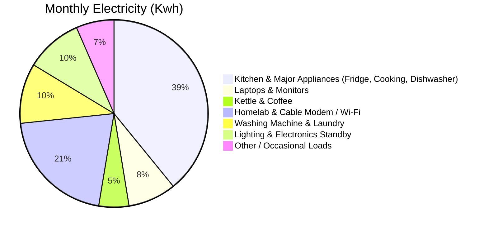
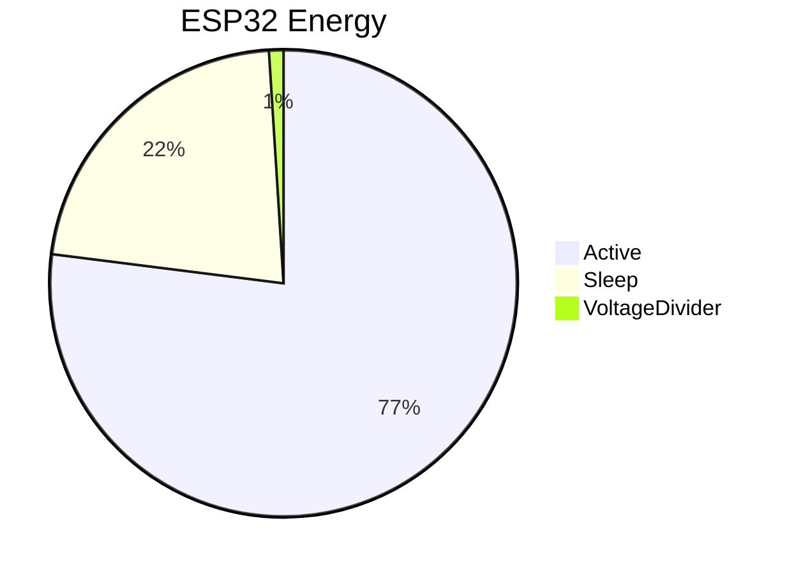

**TL;DR**

Ive connected a Shelly to my iot dashboard.

https://www.youtube.com/@QuantumMakers

---

**Intro**

* Why Im writting this post: *Bc you can do cool stuff with batteries, a tappo and some sensor bring data, you might want to bring sense to a bluetti or custom 18650 packs with BMS...*
* What Ive learnt with it: *d*



<!-- 
https://www.youtube.com/shorts/UjD94SGqIdM 
-->



<!-- 
https://www.youtube.com/shorts/IiuDQhFgmq4 
-->

## Home Energy

By inspecting your monthly utility bills you can get some interesting numbers: *aka [energy consumption data points](https://jalcocert.github.io/JAlcocerT/starting-with-3dprinting/#energy-consumption-data-points)*

The big snapshots: ~100/125 kwh monthly consumption *with 300 kwh peaks if you live in south europe*

Some more details:

* HomeLab + Router ~30w constantly, so ~20kwh a month
* Fridge ~500 wh/day
* Dish washer ~800wh per run
* Washing machine *depends heavily on the mode you choose*
* Work setups: 33w and ~100w
* Air frier makes you fires for 500 wh for a delicious spanish omelette

To keep it simple with a chart:



### Shelly 

To get more granular data: *you can measure your home consumption*.

This also helps to understand your **daily consumption patterns** if you are wondering about a [solar](#solar) and/or [battery](#batteries) setup.

> Time matters :)

Shelly has been [adquired recently by SE](https://corporate.shelly.com/en/news/shelly-group-has-entered-into-an-investment-agreement-with-schneider-electric-on-the-intended-voluntary-public-takeover)

Despite the Shelly smart control app being cool, i didnt need it to get the data at any step.

The shelly has an esp32 inside, which when connected to the network provides a web server so that you input there your home wifi creds.

It also allows via blueetooth and lan cable.

From the portal, you can get the mqtt creds on the top right side.

Oh and also update the firmware.

Once the **wifi connection details** are provided, the local network dissapears and you wont need any more the `192.168.33.1`.

While i was installing the shelly, i disconnected the main power at home.

Luckily, i got the bluetti acting as UPS/SAI [battery](#batteries) keeping alive the homelab and CM (at ~30w the Ah would last around ~5h???)

## Batteries

Not as energy packed as gasoline, yet definitely more than [pumping](https://github.com/JAlcocerT/poc/tree/main/physics-electronics/bucks) energy up an olimpic pool at 20m and yet pretty useful.

A **2,000 Wh (2 kWh)**—which aligns with modern portable power stations (e.g., a 2 kWh LiFePO4 battery commonly weighs around 19–22 kg)—the water requirement scales by a factor of 10.

You would need roughly **52,400 kg (52.4 metric tons)** of water at real-world efficiency to match it.

{}

**1. Energy to Match (2 kWh):**

$$E = 2{,}000\text{ W} \times 3{,}600\text{ s} = 7{,}200{,}000\text{ J (7.2 MJ)}$$

**2. Potential Energy of Water at 20 m:**

$$E_p = m \cdot g \cdot h = 1\text{ kg} \times 9.81\text{ m/s}^2 \times 20\text{ m} \approx 196.2\text{ J/kg}$$

**3. Theoretical Mass (100% Efficiency):**

$$m_{\text{theoretical}} = \frac{7{,}200{,}000\text{ J}}{196.2\text{ J/kg}} \approx 36{,}700\text{ kg}$$

**4. Real-World Water Needed ($\sim 70\%$ Water-to-Wire Efficiency):**


$$m_{\text{real}} = \frac{36{,}700\text{ kg}}{0.70} \approx \mathbf{52{,}400\text{ kg}}$$

---

**Physical Scale**

* **Volume:** **$52.4\text{ m}^3$** (52,400 liters, or ~13,850 gallons).
* **Pool Size:** A full-sized residential swimming pool (e.g., $8\text{ m} \times 4\text{ m} \times 1.6\text{ m}$ deep).
* **Weight Ratio:** A **$19\text{ kg}$** battery replaces over **$52{,}000\text{ kg}$** of water perched atop a 20-meter tower (about a 6-story building).

Gravity stores very little energy per kilogram compared to chemical bonds—electrochemical batteries are roughly **2,700 times more mass-efficient** than a 20-meter water head.

You would need **around 1 liter of gasoline** (roughly 0.8 to 1.1 liters) to produce that same 2,000 Wh (2 kWh) of electricity.

Step-by-Step Breakdown

**1. Energy Contained in Gasoline:**

* 1 liter of gasoline holds about **32 to 34 MJ (megajoules)** of chemical potential energy, which equals roughly **9 to 9.5 kWh** of raw thermal energy.

**2. Generator Efficiency (Carnot Strikes Back!):**
Unlike the hydro turbine, a gasoline generator **is** a heat engine, so the thermodynamic limits we discussed earlier directly apply:

* Small four-stroke engines have a thermal efficiency of only about **25% to 30%**.
* The alternator and inverter convert mechanical motion into clean electricity at about **80% to 90%** efficiency.
* **Overall "fuel-to-electricity" efficiency:** Typically **20% to 25%** under decent load.

**3. Fuel Required for 2 kWh:**

$$\text{Electrical output per liter} \approx 9.2\text{ kWh} \times 0.22 \approx \mathbf{2.0\text{ kWh per liter}}$$

$$\text{Fuel needed} = \frac{2\text{ kWh}}{2.0\text{ kWh/L}} \approx \mathbf{1.0\text{ liter}}$$

*(In practice, running a small inverter generator delivering 2 kW of power burns around **0.9 to 1.1 liters per hour**.)*

{}

Delivering 2 kWh of Usable Electricity

| Storage Method | Weight / Volume Needed | Form of Energy | Practical Efficiency |
| --- | --- | --- | --- |
| **Gasoline** | **~0.75 kg** (~1 liter) | Chemical (covalent bonds) | ~20% – 25% (heat engine losses) |
| **LiFePO4 Battery** | **~19 kg** (shoebox size) | Electrochemical | ~90% – 95% round-trip |
| **Water at 20 m Head** | **~52,400 kg** (52,400 liters / whole pool) | Gravitational potential | ~70% water-to-wire |

Chemical bonds pack an immense amount of energy into tiny masses. 

Even after wasting 75% to 80% of its energy as heat and exhaust, a single bottle of gasoline still easily matches 52 metric tons of elevated water.


I got to know an interesting option to to overdimension the setup and make ROI absurd


{}

Lately I got to know that there are [plug n play batteries](https://www.youtube.com/watch?v=H-wlO5_l9K4) of ~ for ~

You can plug up to x4 panels to them and connect them to any socket at home to roll

In theory paired with the shelly the system would know when to feed or not energy to the outer network.

{}

### Bluetti

The bluetti setup as SAI/UPS have saved me from some energy cuts affecting my modem and my x300 homelab.

It stores 18Ah and i can plug solar panels with open circuit voltage of up to 28V.

For bigger more efficient panels, you'd need panels with 48V

#### 1s 18650 x TP

Coming from [this post](https://jalcocert.github.io/JAlcocerT/starting-with-3dprinting/#esp32-power-consumption-tweaks).

I used [initially this setup](https://github.com/JAlcocerT/poc/blob/main/iot-dashboard-v2/z-setups/1s/esp32_panel_dht_pump_1s_shield.json) to measure T/H via esp32 deep sleep and mqtt

```sh
cd ./data1tb/services/iot-dashboard-v2/data/readings.sqlite
```


First try ~78h (18 oct 7pm 22 oct 2am), after the second try with same firmware/script got ~52h (22 Oct 3pm to 24th 7pm) and the 3rd one made ~72h


But 5h a day it was active, so i swapped it to 1 min awake and 29 min asleep and expected to get ~7days

I changed `esp32_panel_dht_pump_winter.ino` [here](https://github.com/JAlcocerT/poc/blob/main/iot-dashboard-v2/z-setups/esp32_panel_dht_pump_winter.ino) so the onboard blue LED stays dark from 22:00 to 08:00, and flashed it. 

What changes at night:
- No Wi-Fi or MQTT connect blinks.
- No heartbeat and no fast blink while the pump runs.
- The connect blinks are skipped entirely, so the board also doesn't sit through their delays.

Exception: right after a power-on, before the board has the time from the internet, the LED blinks normally.

That way you can still see Wi-Fi problems when you plug it in or flash it.

> `http://192.168.1.2:3038/`




After simulating the sun you can gather, you might consider [a 1s2p](https://jalcocert.github.io/JAlcocerT/starting-with-3dprinting/#1s2p-5v) setup to accomodate further cloudy days


#### 3s 18650 x BMS x PWM

I applied this one for the watering setup.


---

## Solar

If you just got potential, its time for you to make power:


See [a panel I-V](https://github.com/JAlcocerT/poc/tree/main/physics-electronics/solar-panel) with the esp32


### MPPT vs PWM


See [a panel I-V](https://github.com/JAlcocerT/poc/tree/main/physics-electronics/solar-panel) with the esp32


### Charging via CC-CV



MPPT chooses the panel point, but [CC/CV charges the battery safely](https://github.com/JAlcocerT/poc/tree/main/physics-electronics/cc-cv-cn3722) with the esp32


### Measuring solar W with INA

```sh

flatpak uninstall --unused
```


### Modelling sun rays

I started the experiments earlier [this year](https://youtube.com/shorts/cHIPjAG2dkk) around [blender](https://jalcocert.github.io/JAlcocerT/using-blender-with-ai/) and my [initial insulation experiment](https://jalcocert.github.io/JAlcocerT/data-driven-insulation-evaluation/)

Last time i left it at [building geo PL](https://github.com/JAlcocerT/poc/tree/main/building-geo-pl/renders) that was considering the OSM buildings.


#### What to do with excess sun energy?

An [AC](https://jalcocert.github.io/JAlcocerT/data-driven-insulation-evaluation/#which-ac-is-enough-for-my-house)/heat pump?

Charge an electric motorbike?

Heat water and storage it for consumption?

You can charge your fpv batteries, like the 4s ovonic i got of 1300mah aka 19.2wh

---

## Conclusions

It seems that calling dashboard to such project is an understatement.

And it actually makes sense.

In facts, such systems are a self-hosted SCADA (one of [PLC](https://en.wikipedia.org/wiki/Programmable_logic_controller)).


  
  


If you have a distribution list, having such [energy solution waiting list](https://github.com/JAlcocerT/poc/tree/main/genbi-energy-solutions/waitlist) can make sense.

But creating a free lead magnet that provides value is just a very low hanging fruit today to not do it.

Imagine solving a real pain point: how much I need to spend and what will be the ROI in my region?

### Energy Lead Magnet


### Tech Talk

Using [these brand assets](https://github.com/JAlcocerT/poc/tree/main/zzz-outbound)


### Blackout Prep work

Get to know your [consumptions data](https://jalcocert.github.io/JAlcocerT/starting-with-3dprinting/#energy-consumption-data-points)


### HomeLab Updates 1126

Coming from [the last post](https://jalcocert.github.io/JAlcocerT/selfhosted-tts/#homelab-updates-1026), ive done some clean up and [upgraded the security](https://jalcocert.github.io/JAlcocerT/selfhosted-tts/#homelab-hardening)!

Ive also kept using my `yt-distill` poc to go through [interesting videos](https://github.com/JAlcocerT/my-logseq-notes/tree/main/distilled-videos/business-hormozi): *just that with local tts/s2t*

```sh
#git clone ./poc/yt-distill #http://localhost:8001/
make up-local
#docker compose --profile local rm -sf llm && docker run --rm -v "$PWD/out:/out" --entrypoint sh yt-distil:latest -c 'rm -f /out/*/video.mp4' && rm -rf models ~/.cache/huggingface/hub/models--unsloth--Qwen3-4B-Instruct-2507-GGUF ~/.cache/huggingface/hub/.locks/models--unsloth--Qwen3-4B-Instruct-2507-GGUF
make clean-media
```

From here, [*destilling* is not the problem](https://github.com/JAlcocerT/jalcocertech-services/blob/master/docs/destilled-ebooks/z-read-books-notes/z-hormozi-curated.md), its just doing.



Despite this section being selfhost center, i cant deny the nice tech and building in the edge with cf: *we can get linkshorteners, [git repos](https://github.com/deathbyknowledge/ripgit), mails... to work with cf d1/r2/kv/workers*.


```sh
#docker builder prune -a
docker image prune -a
docker system df
```

I tried **Gladys** and it has interesting integrations with tappo, zigbee2mqtt...


  
  


But honestly, i just dont care about learning how to use a tool that ,,I'' ve not designed anymore.

Just give me mqtt [with emqx](https://fossengineer.com/selfhosting-emqx/) and ill get a custom dashboard done around all functionality I need.

For travel, i got to know `https://hotelist.com/` which is some kind of...numbeo for hotel ratings?



  
  



* https://jalcocert.github.io/JAlcocerT/selfhosted-apps-oct-2025/#traefik-x-x300-homelab
* https://fossengineer.com/selfhosting-traefik/


  
  


#### Swapping CMs

I was tired of quite frequently wifi issues with my ISP router and swap it for [my own glinet](https://jalcocert.github.io/JAlcocerT/travel-router-gl-mt3000-review/).

#### Router x VPN

[This](https://jalcocert.github.io/JAlcocerT/selfhosted-tts/#travel-router-as-home-router) worked and I updated my CM.

* https://docs.gl-inet.com/router/en/4/features_update/firmware_v4.11/#dns

`http://192.168.8.1/#/lanip` - `#/multiwan`


You can have same SSID for `5g` & `2.4g` and the latter will be needed for the shelly connectivity



#### x DNS

Technitium x [Unbound](https://jalcocert.github.io/JAlcocerT/private-dns-with-docker/#unbound-dns) has been interesting in the dell.

Ive been wondering to bring the setup to the homelab and use it from the router from each device at home.

https://jalcocert.github.io/JAlcocerT/private-dns-with-docker/#proton-for-all

---

## FAQ


* https://github.com/mortennordbye/homelab
* https://github.com/lfnovo/open-notebook
* https://github.com/Priveetee/TypeType

### Interesting Pi Ideas

1. Pi off grid - Solar panels: ppl do it in `https://www.reddit.com/r/raspberry_pi/comments/2b0ccl/anyone_running_their_pi_off_of_solar_panels/`

2.  RPi [weather station](https://www.youtube.com/watch?v=5JfPzvcm0E8)

<!-- 
https://www.youtube.com/watch?v=5JfPzvcm0E8 
-->

<!--  -->


[Eigenvalues](https://www.youtube.com/watch?v=05QDX1xBpTE)

### Interesting Edge Tools

1. [Ripgit](https://github.com/deathbyknowledge/ripgit) which you might like if youve seen [forgejo](https://fossengineer.com/selfhosting-forgejo/)

2. For mail you have [mailflare](https://fossengineer.com/selfhosting-mailflare/) and also [tempik](https://fossengineer.com/selfhosting-tempik-cloudflare-temp-mail/). For local testing with docker I liked [mailpit](https://fossengineer.com/selfhosting-mailpit/) `http://localhost:8025/`.

3. If you are BiP'ing with a roadmap: [feedlog](https://fossengineer.com/selfhosting-feedlog/) can be interesting and also allows to be deployed via Docker locally. For a kanban [seeder](https://github.com/danielsyauqi/Seeder) is also cool!

> Having a feedback section + roadmap (kanban) + changelog make sense!

> > A [client board](https://seederpm.xyz/docs/features/client-board/), [client requests](https://seederpm.xyz/docs/features/client-requests/) and [daily planner](https://seederpm.xyz/docs/features/daily-planner/) make so much sense

4. Last year I tinkered a lot with authentication: *Logto, Firebase auth, even with pocketbase BaaS that i managed to combine with streamlit and with astro static sites with some cf workers connection.*

Turns out that all that have been simplified further wuth projects like [cloudflare](https://fossengineer.com/selfhosting-cloudflarebase-firebase-cloudflare/) [base](https://github.com/cloudflarebase/cloudflarebase) which is **the open source firebase for CF** and uses *better-auth* internally.

They [claim to be cheaper](https://cloudflarebase.com/#pricing) than firebase and supabase


  


5. If you have been crazy building websites without CMS, maybe [monolith](https://github.com/one-ea/Monolith) or [emdash](https://github.com/emdash-cms/emdash) or [emdash](https://github.com/emdash-cms/emdash) inspire you to make a decent `margin-cms`

[EmDash](https://fossengineer.com/selfhosting-emdash-astro-cms/) is what WordPress would look like if you started from scratch with today's tools.

{}

Running WordPress today means managing PHP alongside JavaScript, layering caches to get acceptable performance, and knowing that 96% of WordPress security vulnerabilities come from plugins.

Built for agents.

EmDash publishes agent skills that teach coding assistants its APIs, a CLI that lets agents manage content and schema programmatically, and a built-in MCP server so AI tools like Claude and ChatGPT can interact with your site directly.

Runs anywhere. 

EmDash uses portable abstractions at every layer -- Kysely for SQL, S3 API for storage -- that work with SQLite, D1, Turso, PostgreSQL, R2, AWS S3, or local files. 

{}

It runs best on Cloudflare, but it's not locked to it.

> multi-platform import (WordPress/Ghost/Hexo/Hugo/Jekyll/Halo)


[Emdash](https://fossengineer.com/selfhosting-emdash-astro-cms/) uses `SSR/server` output, monolith uses another SSR/api so that when you edit in CMS its saved to the DB then next refresh loads the new content from the db (inside monolith the db stores .md though) - None of them are SSG with a git based workflow were you edit .md - commit - ci/cd - astro built - static html deploy




When portability, static output, rollback and githistory matter just go for a  gitbased cms


> You can also have a look to: `https://github.com/sveltia/sveltia-cms` or to foldergram

### How many users can a Pi4 2GB handle

Im more and more interested about [architecture and system design](https://www.youtube.com/watch?v=xV2SpvHHF_I):

So just took [my benchmarks](https://github.com/JAlcocerT/Home-Lab/tree/main/z-benchmarks) and applied it.

Bc deploying and putting *the right* features fast infront of prospects matter

The questions is: via a [VPS/HomeLab](https://jalcocert.github.io/JAlcocerT/where-to-deploy/#vps) or now using CF KV Workers?

I compared [clouds](https://jalcocert.github.io/Linux/docs/linux__cloud/cloud/#other-clouds) and [mini-pcs/sbcs](https://jalcocert.github.io/RPi/posts/minipc-vs-pi/) in several occasions.


  
  


### ProtonCLI x Rust

How about [taking this](https://proton.me/blog/proton-drive-cli) and making a desktop that doesnt is cool?

* https://github.com/ProtonDriveApps/sdk

> How about doing the same for Nextcloud?

### Some Photos

For media: `https://selfh.st/apps/?tag=Photos`

* https://github.com/paulomarques742/imago
* https://imago.742studio.eu/

* https://foldergram.github.io/

```sh
git clone /JalcocerT/foldergram
```

> Point it at your folders, browse everything through a fast feed-style interface. No cloud, no accounts — just your files and SQLite.

* https://github.com/open-noodle/gallery a fork of immich :)

> Some time back i [tried immich](https://fossengineer.com/selfhosting-immich/) but i didnt like that my folder order is not respected and also neither need the [heavy face recognition](https://jalcocert.github.io/JAlcocerT/selfhosted-apps-oct-2025/#files-files-files) feature that i dont care about

High performance self-hosted photo and video management solution.

https://github.com/storytold

https://github.com/andrii-kryvoviaz/slink