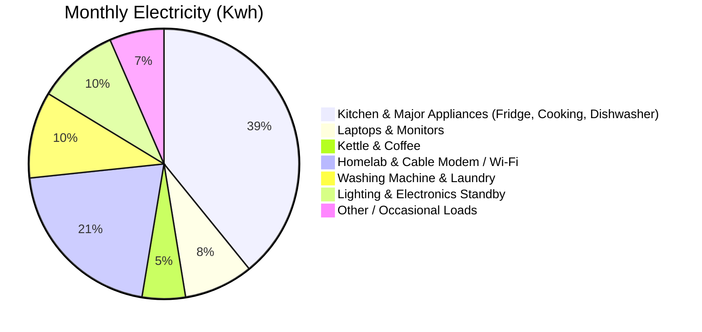
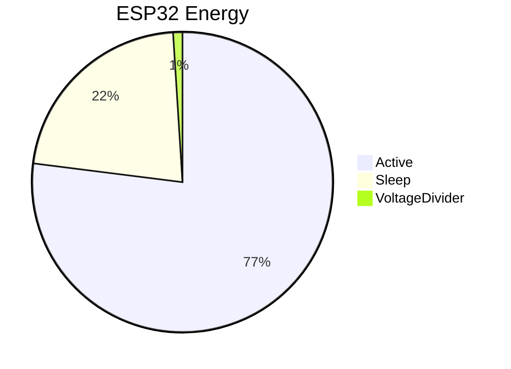

**TL;DR**

Ive connected a Shelly to my iot dashboard.

https://www.youtube.com/@QuantumMakers

---

**Intro**

* Why Im writting this post: *Bc you can do cool stuff with batteries, a tappo and some sensor bring data, you might want to bring sense to a bluetti or custom 18650 packs with BMS...*
* What Ive learnt with it: *d*



<!-- 
https://www.youtube.com/shorts/UjD94SGqIdM 
-->



<!-- 
https://www.youtube.com/shorts/IiuDQhFgmq4 
-->

## Home Energy

By inspecting your monthly utility bills you can get some interesting numbers: *aka [energy consumption data points](https://jalcocert.github.io/JAlcocerT/starting-with-3dprinting/#energy-consumption-data-points)*

The big snapshots: ~100/125 kwh monthly consumption *with 300 kwh peaks if you live in south europe*

Some more details:

* HomeLab + Router ~30w constantly, so ~20kwh a month
* Fridge ~500 wh/day
* Dish washer ~800wh per run
* Washing machine *depends heavily on the mode you choose*
* Work setups: 33w and ~100w
* Air frier makes you fires for 500 wh for a delicious spanish omelette

To keep it simple with a chart:



### Shelly 

To get more granular data: *you can measure your home consumption*.

This also helps to understand your **daily consumption patterns** if you are wondering about a [solar](#solar) and/or [battery](#batteries) setup.

> Time matters :)

Shelly has been [adquired recently by SE](https://corporate.shelly.com/en/news/shelly-group-has-entered-into-an-investment-agreement-with-schneider-electric-on-the-intended-voluntary-public-takeover)

Despite the Shelly smart control app being cool, i didnt need it to get the data at any step.

The shelly has an esp32 inside, which when connected to the network provides a web server so that you input there your home wifi creds.

It also allows via blueetooth and lan cable.

From the portal, you can get the mqtt creds on the top right side.

Oh and also update the firmware.

Once the wifi details are provided, the local network dissapears and you wont need any more the `192.168.33.1`.

While i was installin the shelly, i disconnected the main power at home.

Luckily, i got the bluetti acted as UPS/SAI [battery](#batteries) keeping alive the homelab and CM (at ~30w the ah would last around ~5h???)

## Batteries

Not as energy packed as gasoline, yet definitely more than [pumping](https://github.com/JAlcocerT/poc/tree/main/physics-electronics/bucks) energy up an olimpic pool at 20m and yet pretty useful.

A **2,000 Wh (2 kWh)**—which aligns with modern portable power stations (e.g., a 2 kWh LiFePO4 battery commonly weighs around 19–22 kg)—the water requirement scales by a factor of 10.

You would need roughly **52,400 kg (52.4 metric tons)** of water at real-world efficiency to match it.

{}

**1. Energy to Match (2 kWh):**

$$E = 2{,}000\text{ W} \times 3{,}600\text{ s} = 7{,}200{,}000\text{ J (7.2 MJ)}$$

**2. Potential Energy of Water at 20 m:**

$$E_p = m \cdot g \cdot h = 1\text{ kg} \times 9.81\text{ m/s}^2 \times 20\text{ m} \approx 196.2\text{ J/kg}$$

**3. Theoretical Mass (100% Efficiency):**


$$m_{\text{theoretical}} = \frac{7{,}200{,}000\text{ J}}{196.2\text{ J/kg}} \approx 36{,}700\text{ kg}$$

**4. Real-World Water Needed ($\sim 70\%$ Water-to-Wire Efficiency):**


$$m_{\text{real}} = \frac{36{,}700\text{ kg}}{0.70} \approx \mathbf{52{,}400\text{ kg}}$$

---

**Physical Scale**

* **Volume:** **$52.4\text{ m}^3$** (52,400 liters, or ~13,850 gallons).
* **Pool Size:** A full-sized residential swimming pool (e.g., $8\text{ m} \times 4\text{ m} \times 1.6\text{ m}$ deep).
* **Weight Ratio:** A **$19\text{ kg}$** battery replaces over **$52{,}000\text{ kg}$** of water perched atop a 20-meter tower (about a 6-story building).

Gravity stores very little energy per kilogram compared to chemical bonds—electrochemical batteries are roughly **2,700 times more mass-efficient** than a 20-meter water head.

You would need **around 1 liter of gasoline** (roughly 0.8 to 1.1 liters) to produce that same 2,000 Wh (2 kWh) of electricity.

Step-by-Step Breakdown

**1. Energy Contained in Gasoline:**

* 1 liter of gasoline holds about **32 to 34 MJ (megajoules)** of chemical potential energy, which equals roughly **9 to 9.5 kWh** of raw thermal energy.

**2. Generator Efficiency (Carnot Strikes Back!):**
Unlike the hydro turbine, a gasoline generator **is** a heat engine, so the thermodynamic limits we discussed earlier directly apply:

* Small four-stroke engines have a thermal efficiency of only about **25% to 30%**.
* The alternator and inverter convert mechanical motion into clean electricity at about **80% to 90%** efficiency.
* **Overall "fuel-to-electricity" efficiency:** Typically **20% to 25%** under decent load.

**3. Fuel Required for 2 kWh:**


$$\text{Electrical output per liter} \approx 9.2\text{ kWh} \times 0.22 \approx \mathbf{2.0\text{ kWh per liter}}$$

$$\text{Fuel needed} = \frac{2\text{ kWh}}{2.0\text{ kWh/L}} \approx \mathbf{1.0\text{ liter}}$$

*(In practice, running a small inverter generator delivering 2 kW of power burns around **0.9 to 1.1 liters per hour**.)*

{}

Delivering 2 kWh of Usable Electricity

| Storage Method | Weight / Volume Needed | Form of Energy | Practical Efficiency |
| --- | --- | --- | --- |
| **Gasoline** | **~0.75 kg** (~1 liter) | Chemical (covalent bonds) | ~20% – 25% (heat engine losses) |
| **LiFePO4 Battery** | **~19 kg** (shoebox size) | Electrochemical | ~90% – 95% round-trip |
| **Water at 20 m Head** | **~52,400 kg** (52,400 liters / whole pool) | Gravitational potential | ~70% water-to-wire |

Chemical bonds pack an immense amount of energy into tiny masses. 

Even after wasting 75% to 80% of its energy as heat and exhaust, a single bottle of gasoline still easily matches 52 metric tons of elevated water.

### Bluetti

The bluetti setup as SAI/UPS have saved me from some energy cuts affecting my modem and my x300 homelab.

It stores 18Ah and i can plug solar panels with open circuit voltage of up to 28V.

For bigger more efficient panels, you'd need panels with 48V

#### 1s 18650 x TP

Coming from [this post](https://jalcocert.github.io/JAlcocerT/starting-with-3dprinting/#esp32-power-consumption-tweaks).

I used [initially this setup](https://github.com/JAlcocerT/poc/blob/main/iot-dashboard-v2/z-setups/1s/esp32_panel_dht_pump_1s_shield.json) to measure T/H via esp32 deep sleep and mqtt


First try ~78h (18 oct 7pm 22 oct 2am), after the second try with same firmware/script got ~52h (22 Oct 3pm to 24th 7pm)


But 5h a day it was active, so i swapped to 1 min awake and 29 min asleep and expected to get ~7days


> `http://192.168.1.2:3038/`




After simulating the sun you can gather, you might consider [a 1s2p](https://jalcocert.github.io/JAlcocerT/starting-with-3dprinting/#1s2p-5v) setup to accomodate further cloudy days


#### 3s 18650 x BMS x PWM

I applied this one for the watering setup.


---

## Solar



See [a panel I-V](https://github.com/JAlcocerT/poc/tree/main/physics-electronics/solar-panel) with the esp32


### MPPT vs PWM


See [a panel I-V](https://github.com/JAlcocerT/poc/tree/main/physics-electronics/solar-panel) with the esp32


### Charging via CC-CV



MPPT chooses the panel point, but [CC/CV charges the battery safely](https://github.com/JAlcocerT/poc/tree/main/physics-electronics/cc-cv-cn3722) with the esp32


### Measuring solar W with INA


### Modelling sun rays


---

## Conclusions


  
  


### Tech Talk

Using [these brand assets](https://github.com/JAlcocerT/poc/tree/main/zzz-outbound)


### Blackout Prep work

Get to know your [consumptions data](https://jalcocert.github.io/JAlcocerT/starting-with-3dprinting/#energy-consumption-data-points)


### HomeLab Updates 1126

Coming from the last post, ive done some clean up and upgraded the security!


Despite this section being selfhost center, i cant deny the nice tech and building in the edge with cf: *we can get linkshorteners, [git repos](https://github.com/deathbyknowledge/ripgit), mails... to work with cf d1/r2/kv/workers*.


```sh
docker builder prune -a
docker image prune -a
docker system df
```

I tried Gladys and it has interesting integrations with tappo, zigbee2mqtt...


  
  


But honestly, i just dont care about learning how to use a tool that ,,I'' ve not designed anymore. Just give me mqtt [with emqx](https://fossengineer.com/selfhosting-emqx/) and ill get a custom dashboard done.


For travel, i got to know `https://hotelist.com/` which is some kind of...numbeo for hotel ratings?


---

## FAQ


### Interesting Pi Ideas


1. Pi off grid - Solar panels

<https://www.reddit.com/r/raspberry_pi/comments/2b0ccl/anyone_running_their_pi_off_of_solar_panels/>

2.  RPi weather station

<!-- 
https://www.youtube.com/watch?v=5JfPzvcm0E8 
-->



### Interesting Edge Tools

1. [Ripgit](https://github.com/deathbyknowledge/ripgit) which you might like if youve seen [forgejo](https://fossengineer.com/selfhosting-forgejo/)

2. For mail you have mailflare and also tempik. For local testing with docker I liked [mailpit](https://fossengineer.com/selfhosting-mailpit/)

3. If you are BiP with a roadmap: feedlog can be interesting and also allows to be deployed via Docker locally. For a kanban seeder is also cool!

> Having a feedback section + roadmap (kanban) + changelog make sense!

> > A [client board](https://seederpm.xyz/docs/features/client-board/), [client requests](https://seederpm.xyz/docs/features/client-requests/) and [daily planner](https://seederpm.xyz/docs/features/daily-planner/) make so much sense

4. Last year I tinkered a lot with authentication: Logto, Firebase auth, even with pocketbase BaaS that i managed to combine with streamlit and with astro static sites with some cf workers connection. 

Turns out that all that have been simplified further wuth projects like [cloudflare base](https://github.com/cloudflarebase/cloudflarebase) which is **the open source firebase for CF** and uses better-auth internally.

They [claim to be cheaper](https://cloudflarebase.com/#pricing) than firebase and supabase


  



5. If you have been crazy building websites without CMS, maybe [monolith](https://github.com/one-ea/Monolith) or [emdash](https://github.com/emdash-cms/emdash) or [emdash](https://github.com/emdash-cms/emdash) inspire you to make a decent `margin-cms`

WordPress was built for a different era. Running WordPress today means managing PHP alongside JavaScript, layering caches to get acceptable performance, and knowing that 96% of WordPress security vulnerabilities come from plugins. EmDash is what WordPress would look like if you started from scratch with today's tools.

Built for agents.

EmDash publishes agent skills that teach coding assistants its APIs, a CLI that lets agents manage content and schema programmatically, and a built-in MCP server so AI tools like Claude and ChatGPT can interact with your site directly.

Runs anywhere. EmDash uses portable abstractions at every layer -- Kysely for SQL, S3 API for storage -- that work with SQLite, D1, Turso, PostgreSQL, R2, AWS S3, or local files. It runs best on Cloudflare, but it's not locked to it.

> multi-platform import (WordPress/Ghost/Hexo/Hugo/Jekyll/Halo)


Emdash uses SSR/server output, monolith uses another SSR/api so that when you edit in CMS its saved to the DB then next refresh loads the new content from the db (inside monolith the db stores .md though) - None of them are SSG with a git based workflow were you edit .md - commit - ci/cd - astro built - static html deploy




When portability, static output, rollback and githistory matter just go for a  gitbased cms


> You can also have a look to: `https://github.com/sveltia/sveltia-cms` or to foldergram


### How many users can a Pi4 2GB handle

Im more and more interested about architecture and system design:

https://www.youtube.com/watch?v=xV2SpvHHF_I

So just took [my benchmarks](https://github.com/JAlcocerT/Home-Lab/tree/main/z-benchmarks) and applied it.

Bc deploying and putting features fast infront of prospects matter

The questions is: via a [VPS/HomeLab](https://jalcocert.github.io/JAlcocerT/where-to-deploy/#vps) or now using CF KV Workers?

I compared [clouds](https://jalcocert.github.io/Linux/docs/linux__cloud/cloud/#other-clouds) and [mini-pcs/sbcs](https://jalcocert.github.io/RPi/posts/minipc-vs-pi/) in several occasions.


  
  



### ProtonCLI x Rust

How about [taking this](https://proton.me/blog/proton-drive-cli) and making a desktop that doesnt is cool?

* https://github.com/ProtonDriveApps/sdk

> How about doing the same for Nextcloud?


### The AI Agent Stack

The biggest learning from this (May 2026) batch: **modern self-hosted AI tooling is splitting into five distinct layers** that don't compete, they compose. 

The honest map:

```
┌─────────────────────────────────────────────────────────────────┐
│  Orchestration layer ──── Paperclip          (the "company")    │
│                           Symphony           (vendor-flavored)  │
├─────────────────────────────────────────────────────────────────┤
│  Personal assistant ───── OpenClaw           (maximalist)       │
│  (messenger-resident)    NanoClaw           (minimalist)        │
│                           Hermes Agent       (self-improving)   │
├─────────────────────────────────────────────────────────────────┤
│  Coding agent harness ─── Pi                 (open + extensible)│
│  (terminal-resident)     Claude Code         (Anthropic)        │
│                           Codex CLI          (OpenAI)           │
│                           Cursor CLI         (Cursor)           │
├─────────────────────────────────────────────────────────────────┤
│  Coding standards ─────── Agent OS           (capture + inject) │
├─────────────────────────────────────────────────────────────────┤
│  Coding workflow ──────── OpenSpec           (propose → apply)  │
└─────────────────────────────────────────────────────────────────┘
```

**The layers don't just stack — they cross.** OpenClaw's SDK integration embeds Pi as its agent runtime, so a single message routed through OpenClaw can ultimately be processed by a Pi session in OpenClaw's container, which in turn might invoke an Agent OS standard or an OpenSpec workflow inside that session. 

The boundaries blur productively.

The right AI-first developer stack today might combine: **Hermes/OpenClaw/NanoClaw** (your messenger-resident assistant) + **Pi or Claude Code** (your terminal-resident coding agent) + **Agent OS** (your codebase's standards) + **OpenSpec** (your coding workflow) + **Paperclip or Symphony** (orchestration when you have many agents working in parallel).

Each post in this batch surfaces five "design principle" claims, not just feature bullets, because the design philosophies are what actually differentiate them.

---

### Orchestration layer

#### Paperclip — `paperclipai/paperclip` (MIT)

**Tagline:** "If OpenClaw is an _employee_, Paperclip is the _company_."

**Key insight:** Treats AI agents as **persistent organizational members** with roles, budgets, reporting lines, and audit logs — not ephemeral chat sessions. Heartbeats wake agents on a schedule; budgets are **hard stops** enforced atomically at every tick (no "you spent $50 this week" warnings — actual cancellation of queued work).

**Distinctive features:**
- Multi-company isolation in a single deployment (portfolio of autonomous AI businesses)
- 12 systems: Identity, Work, Heartbeat, Governance, Org Chart, Workspaces, Plugins, Budget, Routines, Secrets, Activity, Portability
- Adapter set: Claude Code, Codex, Cursor, OpenClaw, bash, HTTP/webhooks
- Export/import entire orgs with secret scrubbing → Clipmart roadmap

**Stack:** Node 20+ / TypeScript / React UI / PostgreSQL 17 / Better Auth. Port 3100. Auth modes: trusted loopback (default) or authenticated (LAN/Tailnet).

#### Symphony — `openai/symphony` (Apache 2.0)

**Tagline:** OpenAI's spec for "manage work, not coding agents."

**Key insight:** **The spec IS the product.** A 2,169-line RFC-2119 specification with the Elixir code as "one reference, build your own." The README explicitly endorses asking Claude/Codex to re-implement Symphony from `SPEC.md` in any language.

**Distinctive features:**
- Linear-only, Codex-only, single-tenant (deliberately narrow)
- `WORKFLOW.md` is repo-owned — the agent's policy lives in the target codebase
- No persistent database — restart recovery from tracker + filesystem
- Trust posture is implementation-defined; Elixir reference defaults to `approval_policy: never` for trusted environments

**Stack:** Elixir/OTP 1.19 / Phoenix LiveView / mise version manager.

**vs Paperclip:** Symphony is opinionated and narrow (Codex + Linear); Paperclip is configurable and broad. Same architectural slot, different design point.

---

### Assistant runtime layer

#### OpenClaw — `openclaw/openclaw` (MIT)

**Tagline:** 🦞 "EXFOLIATE! EXFOLIATE!"

**Key insight:** The **maximalist** answer to "personal AI assistant." 14,406 TS files, 134 plugins, 23+ messaging channels, native macOS/iOS/Android apps, voice (Wake + Talk Mode), Live Canvas (A2UI agent-driven UI). Sponsored by OpenAI, GitHub, NVIDIA, Vercel, Blacksmith, Convex.

**Distinctive features:**
- 23+ channels: WhatsApp, Telegram, Slack, Discord, Signal, iMessage, Matrix, plus Feishu/LINE/Mattermost/Synology/Tlon/Twitch/Zalo/WeChat/QQ/WebChat
- 30+ provider adapters (Anthropic, OpenAI, Bedrock, Vertex, DeepSeek, Cerebras, vLLM, Cloudflare AI Gateway…)
- Main vs non-main session split: main = full host access, non-main = sandbox (Docker/SSH/OpenShell)
- DM pairing as security default; `openclaw doctor` flags misconfigurations

**Operational note:** Docker compose hard-pins `OPENCLAW_*_DIR` and `HOME` to prevent macOS host paths leaking through `.env` into Linux container (issue #77436). This pattern is worth remembering across other Node + Docker projects.

#### NanoClaw — `nanocoai/nanoclaw` (MIT)

**Tagline:** Personal Claude assistant. Lightweight, secure, customizable.

**Key insight:** The **minimalist** answer to the same problem. Small codebase you can audit (one process, handful of files), per-session Docker containers by default, no config files — customization via code edits. The bet: "small enough that Claude Code can safely modify it" beats "large enough that no human can audit it."

**Distinctive features:**
- Per-session two-SQLite-DB design (inbound.db + outbound.db, host vs container as single writers, even/odd seq parity)
- Two-runtime split: Node + pnpm on host (supply-chain controls via `minimumReleaseAge: 4320`), Bun in the container (fast cold-start, native SQLite)
- Credentials via OneCLI Agent Vault — never enter the container
- Channels and providers install via `/add-<channel>` skills that `git fetch` from sibling branches into your fork

**Honest constraint:** Per-fork rebuilt image — no `nanoclaw/nanoclaw:latest` to pull because every fork has different installed skills/MCPs/packages.

#### Hermes Agent — `NousResearch/hermes-agent` (MIT)

**Tagline:** The self-improving AI agent.

**Key insight:** The defining feature is the **closed learning loop** — agent-curated memory, autonomous skill creation after complex tasks, skills self-improving during use, FTS5 cross-session search with LLM summarization, Honcho dialectic user modeling. The agent gets better at being *your* agent over time, not just generically smarter when the underlying model upgrades.

**Distinctive features:**
- 22 messaging platforms (incl. LINE, SimpleX, Microsoft Teams via Graph foundation)
- **7 terminal backends** including Modal and Daytona for **serverless hibernate-on-idle** — 24/7 agent costing cents/month at rest
- `hermes proxy` — OpenAI-compatible local proxy for OAuth providers (Claude Pro, ChatGPT Pro, SuperGrok) → Codex/Aider/Cline can use your subscription
- First-class `hermes claw migrate` from OpenClaw — auto-detected during setup
- `pip install hermes-agent` (new in v0.14.0)

**Supply-chain hardening** (worth flagging across all Python projects): every direct dependency exact-pinned (no `>=` ranges), explicitly because of the Mini Shai-Hulud worm hitting `mistralai 2.4.6` on PyPI in May 2026. v0.14.0 adds an advisory checker that scans on every install.

---

### Coding agent harness layer

#### Pi — `earendil-works/pi` (MIT)

**Tagline:** "Adapt pi to your workflows, not the other way around."

**Key insight:** Same architectural slot as Claude Code / Codex CLI / Cursor CLI — terminal-resident coding agent — but **MIT, aggressively extensible, and SDK-embeddable**. Six explicit non-features in the README (no MCP, no sub-agents, no plan mode, no permission popups, no built-in to-dos, no background bash) — each rejected with a stated rationale and a "build it with an extension if you want it" pointer.

**Distinctive features:**
- 5-package monorepo: `pi-coding-agent` (CLI) + `pi-agent-core` (runtime) + `pi-ai` (provider API) + `pi-tui` (terminal UI) + `pi-web-ui` (web components)
- Four operating modes: interactive (TUI), print/JSON (one-shot), RPC (stdin/stdout JSONL with strict LF framing), SDK (embed in your app)
- 30+ providers including OAuth subscription auth (Claude Pro, ChatGPT Plus, GitHub Copilot)
- Cross-provider handoffs mid-session (Claude → GPT mid-conversation with context preserved)
- Sessions as trees — `/tree`, `/fork`, `/clone` for branching
- TypeScript extensions API with full surface area (register tools, commands, keybindings, UI components, even replace built-in tools)
- Pi packages: `pi install npm:@foo/pi-tools` or `pi install git:github.com/user/repo`
- Public OSS session sharing via `pi-share-hf` → Hugging Face datasets (research-friendly stance)

**The OpenClaw connection — the layer cross-reference:** OpenClaw's SDK integration uses `pi-coding-agent`'s SDK as its agent backend. When OpenClaw answers a Slack message and generates code, that code is being produced by a Pi session running inside OpenClaw's per-agent container. Pi is both a standalone CLI and a library that personal-assistant projects can embed.

**Honest design contrast:** Where OpenClaw is maximalist (134 plugins, voice, Canvas, native apps) on the *personal assistant* axis, Pi is minimalist on the *coding agent* axis. Same author-philosophy split visible in NanoClaw vs OpenClaw at the personal-assistant layer — there's a consistent "minimal core + extensions" pattern across the open-source AI tooling ecosystem in 2026.

**Author:** Mario Zechner (`@badlogicgames`). Domain `pi.dev` donated by `exe.dev`. Auto-close on new-contributor issues/PRs as a deliberate scope-control mechanism (maintainers review daily).

---

### Coding augmenter layer

#### Agent OS — `buildermethods/agent-os` (MIT)

**Tagline:** "Agents that build the way you would."

**Key insight:** **Retreated to its strongest niche in v3.** Brian Casel explicitly dropped spec writing, task breakdown, and implementation orchestration in v3 (January 2026) because Claude Code's Plan Mode + extended thinking now do those better. What remains: standards capture/injection, the part AI tools don't do well on their own.

**Distinctive features:**
- `/discover-standards` reads your codebase and surfaces patterns into versioned `.md` files
- `/inject-standards` picks relevant standards from `index.yml` per context (Plan Mode / Skill / conversation)
- Profile inheritance (`config.yml`) for cross-project reuse
- Pure bash + markdown — no runtime, no daemon, no API keys

**v3 install gotchas (fixed):** `((var++))` under `set -e` failed silently on some shells (PR #328); `tac` is GNU-only, not on macOS without coreutils (PR #327).

#### OpenSpec — `Fission-AI/OpenSpec` (MIT)

**Tagline:** "AI-native system for spec-driven development."

**Key insight:** **29 AI tools supported out of the box** is the unusual feat. OpenSpec auto-installs the correct adapter files for each tool's specific convention (`.claude/`, `.cursor/`, `.codex/`, `.github/`, `.gemini/`, `.windsurf/`, …) — the bet is that you'll switch between 2-3 AI tools depending on the task, and the workflow needs to be consistent across all of them.

**Distinctive features:**
- `/opsx:propose` → `/opsx:apply` → `/opsx:archive` workflow
- Brownfield-first delta model: `openspec/specs/` is the truth, `openspec/changes/` are proposals that merge in on archive
- "Fluid not rigid" — no phase gates; create artifacts in any order
- Core profile (5 commands) or expanded (11) via `openspec config profile`

**vs Agent OS:** OpenSpec captures *changes*; Agent OS captures *standards*. Both are pure-markdown + small CLI, both MIT, both install into your project — they're complementary, not competing.

**vs alternatives:** Spec Kit (GitHub) is more thorough but rigid + Python; Kiro (AWS) is polished but IDE-locked + Claude-only; OpenSpec aims at the everyday case.

---

### Cross-cutting patterns in the AI batch

**Polite-but-clear positioning via migration tooling.** Hermes ships `hermes claw migrate` that auto-detects `~/.openclaw` and imports settings/memories/skills/keys. That's not casual — it's saying "if OpenClaw isn't working for you, here's the door." This is a useful pattern when entering a category with an incumbent.

**Single-process vs micro-service.** NanoClaw is one Node host + Bun container per session, **no IPC**, all communication through SQLite files. OpenClaw is one Gateway daemon + plugin loader for 134 plugins. Paperclip is one server + Postgres. Symphony is one orchestrator + Codex subprocesses. **None of them are micro-service architectures** — the modern self-hosted agent platform is almost always a single process plus per-session/per-task isolation.

**Supply-chain hardening is becoming a default.** Hermes exact-pins every dep + advisory checker. NanoClaw has `minimumReleaseAge: 4320` (pnpm 3-day quarantine). Symphony's `WORKFLOW.md` includes `shell_environment_policy.inherit=all` as a deliberate trust posture. The Mini Shai-Hulud worm hitting `mistralai 2.4.6` on PyPI is now a frequent reference point in pyproject comments.

**MIT dominates.** Of the seven AI projects: 6× MIT, 1× Apache 2.0 (Symphony). No AGPL, no Fossorial Commercial-style dual licensing. The license norm for AI agent tooling appears to be permissive-default.

**Slash-command markdown is the lingua franca.** Agent OS, OpenSpec, NanoClaw, OpenClaw, and Hermes all ship markdown-based slash commands as their primary user interface. Cursor / Claude Code / Codex / 29 tools all read this convention. Markdown-as-prompt-template is the de facto AI-tool integration protocol.

**"Heartbeat" over "chat session" is the orchestration pattern.** Paperclip, Symphony, and Hermes scheduling all use periodic ticks rather than continuous chat. The agent wakes, checks work, acts, sleeps. This makes budgeting, cost control, and "what is the agent doing right now?" tractable.

**"Minimal core + extension API" is a convergent design.** NanoClaw deliberately ships a tiny core with channels installed via `/add-<channel>` skills. Pi deliberately ships a minimal core with six explicit non-features and a TypeScript extension API. Both projects' authors explicitly state the rationale: a small core you can read + a powerful extension surface beats a maximalist core that fights every user's preference. The pattern shows up independently at the personal-assistant layer (NanoClaw vs OpenClaw) and the coding-agent layer (Pi vs Claude Code) — likely an emerging consensus design for open-source AI tooling.

**Open-source vs vendor split is starkest at the coding-agent layer.** Pi is the only MIT-licensed option in the "terminal-resident coding agent" category — Claude Code (Anthropic), Codex CLI (OpenAI), and Cursor CLI (Cursor) are all vendor products. At the personal-assistant layer (OpenClaw / NanoClaw / Hermes) and the orchestration layer (Paperclip / Symphony), open source is the norm. The vendor lock-in pattern concentrates around the agent that actually writes the code.

**Layers cross via SDK embedding.** OpenClaw uses Pi's SDK as its agent runtime — so a Slack message routed through OpenClaw is ultimately processed by a Pi session in OpenClaw's container, which might invoke an Agent OS standard or an OpenSpec workflow inside that session. The five-layer stack isn't strictly hierarchical; it's a graph where SDK-embeddable projects (Pi, Honcho, OneCLI) become primitives that higher-layer projects compose.

**Two patterns at the vertical-application layer: open research vs vendor content.** TradingAgents (finance, UCLA) and Claude for Financial Services (finance, Anthropic) ship the same week, both Apache 2.0, both target FSI — and they're opposite in nearly every design dimension. TradingAgents is an *open research framework* (Python + LangGraph, 15+ LLM providers, runs anywhere, makes trading decisions). Claude for FS is *vendor reference content* (markdown + JSON, Claude-only, runs on Anthropic platforms, drafts work product for human sign-off, never decides). This **isn't a competitive overlap — they're at different layers of the same vertical**. The pattern is likely to repeat: every domain will see both an open research framework (MedAgents, LegalAgents) and vendor-provided reference content (Claude for Legal, Claude for Healthcare) emerge in parallel. The contrasts to flag when comparing them: who authored (academia vs vendor), decision authority (makes decisions vs drafts for review), provider lock-in (multi-provider vs single-provider), data sources (free APIs vs commercial MCP subscriptions), and self-host shape (Python on your machine vs vendor-hosted runtime).

---

## Vertical applications

This is the **layer above** the AI infrastructure stack — what all the infrastructure is actually *for*.

Two distinct shapes here, both Apache 2.0, both shipped May 2026, both target financial services.

They illustrate the open-research-vs-vendor-content pattern that's emerging across every AI vertical.

### TradingAgents — `TauricResearch/TradingAgents` (Apache 2.0)

**Tagline:** Multi-agent LLM financial trading framework.

**Key insight:** Open academic research framework that models a trading firm — analysts (fundamentals/sentiment/news/technical) → researcher debate (bullish vs bearish) → trader → risk team → portfolio manager — using LangGraph for orchestration. Makes trading decisions in a simulated exchange. Decision log persists across runs with realised-return + reflection feedback loop.

**Distinctive features:**
- 15+ LLM providers with dual-region China endpoints (`qwen` vs `qwen-cn`, `glm` vs `glm-cn`, `minimax` vs `minimax-cn`)
- Two-tier model config (`deep_think_llm` for reasoning, `quick_think_llm` for data fetch) — cost-management knob
- Closed feedback loop via `~/.tradingagents/memory/trading_memory.md` — each run fetches realised return + alpha vs SPY, generates reflection, injects past lessons into next Portfolio Manager prompt
- LangGraph checkpoint resume for long debate runs
- Backtrader integration
- Apache 2.0 with citable arXiv paper (2412.20138)

**Stack:** Python 3.10+, LangChain + LangGraph, Docker compose with optional Ollama profile for fully-local runs.

### Claude for Financial Services — `anthropics/financial-services` (Apache 2.0)

**Tagline:** Reference agents, skills, and data connectors for FSI workflows.

**Key insight:** Vendor-provided reference content for Claude in financial services. 10 named agents (Pitch / Meeting Prep / Market Researcher / Earnings Reviewer / Model Builder / Valuation Reviewer / GL Reconciler / Month-End Closer / Statement Auditor / KYC Screener) shipped as Cowork plugins AND Managed Agents cookbooks from the same source. **Drafts work product for human sign-off — explicitly does not make decisions.**

**Distinctive features:**
- Two deployment paths from one source — Cowork plugin (interactive) AND Managed Agents API (headless) reference the same prompt + skill files
- 6 vertical skill bundles (IB / equity research / PE / wealth / fund admin / operations) + 2 partner-built (LSEG, S&P Global)
- 11 commercial MCP data connectors (Daloopa, Morningstar, FactSet, Moody's, PitchBook, LSEG, S&P Global, MT Newswires, Aiera, Chronograph, Egnyte) — largest commercial MCP integration set in any open repo
- Pure markdown + JSON — no build step, no Node toolchain
- Skill drift detection via `check.py` (fails if agent-plugin skill copies diverge from vertical-plugin sources)
- Pre-commit version-bump hook (`.githooks` via `git config core.hooksPath`, no Husky)
- Microsoft 365 add-in install tooling for self-hosted routing (Vertex / Bedrock / internal LLM gateway)

**Stack:** No runtime stack — it's reference content. Runs on Anthropic's platforms (Cowork, Managed Agents API) or Claude Code.

The contrast (worth memorizing for future vertical-content reviews)

| Axis | TradingAgents | Claude for FS |
|------|---------------|---------------|
| **Author** | UCLA research group | Anthropic (model vendor) |
| **Purpose** | Research framework | Enterprise enablement |
| **Output authority** | Makes decisions (simulated) | Drafts for human sign-off |
| **LLM provider lock-in** | None (15+ providers) | Claude only |
| **Architecture** | Python + LangGraph | Markdown + JSON, no code |
| **Self-host runtime** | Yes (Docker / Ollama) | Partial (only MSFT 365 routing) |
| **Data sources** | Free APIs + scraping | Commercial MCP subscriptions |
| **Cost shape** | LLM API only (~$0.20-$2/run) | Cowork + Anthropic API + each MCP subscription |
| **Audience** | Researcher / quant developer | FSI firm with paid Anthropic + data subscriptions |

The pattern this represents — **open research framework + vendor content shipping in parallel** — will repeat across legal (LegalAgents vs Claude for Legal), healthcare (MedAgents vs Claude for Healthcare), engineering, etc. When analyzing future projects in those domains, the question to ask is *which kind* it is, not whether it's "better" — they coexist at different layers.

---

## Media & Library

### MediaLyze — `frederikemmer/MediaLyze` (MIT)

**Key insight:** **Read-only by design** — mount media `:ro`, never modifies/renames/transcodes. Complement to Plex/Jellyfin (not replacement), opposite of Tdarr (no write path at all).

**Stack:** Python 3.12 / FastAPI / SQLAlchemy / SQLite + Sidekiq / Redis + PostgreSQL + PostGIS. Frontend: React 19 + Vite + ECharts. Image: `ghcr.io/frederikemmer/medialyze:latest`, port 8080.

**Cool feature:** Same FastAPI+React stack runs as both containerized server *and* native Electron desktop app (`.exe`, `.dmg`, `AppImage`). Unusual — most projects pick one.

**Operational note:** Change detection uses path+size+mtime triple — incremental scans on 10TB libraries take seconds, not hours.

### SnapOtter — `snapotter-hq/snapotter` (AGPL-3.0 + Commercial)

**Key insight:** Single container, SQLite-only image-manipulation suite with local AI (background removal, upscaling, OCR, photo restoration, colorization). 51 tools + Pipelines feature lets you chain tools into reusable workflows.

**Stack:** TypeScript/Fastify backend + Python 3.12 AI venv (rembg, ONNX, PyTorch). Port 1349. **`shm_size: 2gb` is mandatory for GPU compose** (PyTorch CUDA shared memory) — easy to strip on copy-paste, breaks GPU silently.

**Mirror detection learning:** `stirling-image/stirling-image` and `ashim-hq/ashim` are identical mirrors with same commit hash `6e103d3`. Same `package.json.name`, same homepage. Fingerprint check now codified in `z-agent-learnings.md` and in the foss-post skill's style guide.

### Technitium DNS — `TechnitiumSoftware/DnsServer` (GPL v3)

> https://jalcocert.github.io/JAlcocerT/selfhosting-information-flow/#homelab-updates-0926

> > https://jalcocert.github.io/JAlcocerT/private-dns-with-docker/ 

**Key insight:** Full authoritative + recursive DNS server (vs Pi-hole's "blocking layer bolted onto a DNS resolver"). C#/.NET 10, DoT/DoH/DoQ both client and server side, DNSSEC signing of your own zones, native clustering, SSO via OIDC, 27+ DNS Apps plugins, built-in DHCP.

**Pi-hole comparison FAQ pattern:** Position "what's actually different" with 6 concrete capabilities (authoritative zones, DNSSEC signing, serve encrypted DNS to clients, native clustering, plugin API, SSO/RBAC) and an honest assessment of where Pi-hole still wins (community size, simplicity, ecosystem).

### Tinyauth — `tinyauthapp/tinyauth` (GPL-3.0)

**Key insight:** Forward-auth middleware for Traefik / Nginx (`auth_request`) / Caddy (`forward_auth`) in one Go binary + SQLite. Built-in users + OAuth (Google, GitHub, Microsoft, Tailscale, generic OIDC) + LDAP + TOTP 2FA. The lean alternative to Authelia / Authentik.

**Pattern preserved:** `TINYAUTH_AUTH_USERS=user:$$2a$$10$$...` requires `$$` escaping for literal `$` in compose env values.

**Three forward-auth endpoints:** `/api/auth/traefik`, `/api/auth/nginx`, `/api/auth/caddy` — each formatted for the specific proxy's expected response shape.

---

## Location & Tracking

### Dawarich — `Freika/dawarich` (AGPL-3.0)

**Key insight:** Self-hosted Google Timeline replacement (Google killed Timeline as a cloud feature in 2024). Rails 8 + PostgreSQL 17 + **PostGIS 3.5** + Sidekiq + Redis. Four-container stack.

**Critical setup details:**
- ARM hosts need `imresamu/postgis:17-3.5-alpine` instead of `postgis/postgis` (amd64-only)
- `SELF_HOSTED=true` env var bypasses the two-tier plan system (Lite/Pro) — without it, your self-hosted instance silently behaves like the Cloud free tier with 12-month data window
- Cloud product is dual-tier; self-hosted should always set the bypass

**Strong project warning preserved:** "DO NOT UPDATE AUTOMATICALLY" — under active development with breaking migrations. Watchtower-style auto-updaters explicitly discouraged.

**Import sources:** Google Takeout, OwnTracks, Strava, Immich, GPX, GeoJSON, photo EXIF. Tracker apps: Dawarich iOS/Android, OwnTracks, Overland, GPSLogger, Home Assistant.